# CRAYvings Monitoring System — Database Schema

**Database:** `crayvings_monitoring_system_db` (PostgreSQL)

> **Verified against the live database 2026-10-18**, after applying migrations
> through 025. Every table, column, type, nullability, default, index, check
> constraint, foreign key, and trigger below was read back from a
> `pg_dump --schema-only` of the live database (PostgreSQL 18.3) — not inferred
> from the migration scripts. An earlier verification on 2026-10-15 used
> `information_schema` / `pg_catalog` directly; migrations 022–025 (defects
> D1–D5) were applied on 2026-10-18 and every table below reflects them.
>
> **16 tables. 8 foreign keys. 1 trigger** (`trg_sms_logs_recipient`). The DBML
> block near the bottom is ready to paste into <https://dbdiagram.io>, and the
> Mermaid block after it renders the same schema.
>
> **Known schema defects** are listed in their own section before the ERD.
> D1–D7 were fixed on 2026-10-18 by migrations `000` and `022`–`025`; only
> D8 (a redundant index) and D9 (an unused `schema_migrations.checksum`
> column) remain open.
>
> **One relationship that looks like it should be a foreign key but is not:**
>
> - `sms_logs.recipient_phone` → `authorized_recipients.phone_number` — cannot
>   be an FK, because migration 006 made `phone_number` unique only via a
>   *partial* index. Enforced by trigger `trg_sms_logs_recipient` instead.

---

## Overview

The database stores user accounts, device registry, sensor readings, alert state,
activity/audit trails, SMS recipients, and SMS send history for the Smart
Aquaculture Monitoring System for Crayfish Production. Foreign keys are enforced
so related data is referenced, not duplicated.

---

## Table: `users`

Stores application login accounts with PBKDF2-hashed passwords and session
tokens.

| Column | Type | Constraints | Notes |
|---|---|---|---|
| `id` | SERIAL | PRIMARY KEY | |
| `name` | VARCHAR(100) | NOT NULL | Display name |
| `username` | VARCHAR(50) | NOT NULL | Login name. Not an FK target: the audit link is `activity_logs.user_id` → `users.id` (migration 019), and `user_name` stays a display string. UNIQUE only while active (partial index `idx_users_username_active`) |
| `email` | VARCHAR(255) | NOT NULL | UNIQUE only while active (partial index `idx_users_email_active`) |
| `password_hash` | TEXT | NOT NULL | PBKDF2 (`iterations:salt:hash`) |
| `role` | VARCHAR(20) | NOT NULL DEFAULT `'user'`, CHECK `chk_users_role` IN (`'admin'`, `'user'`) (migration 024) | `admin` or `user`. "Owner" is *not* a stored value: the server derives it at runtime by matching `username`/`email` against the `ADMIN_USERNAME` / `ADMIN_EMAIL` env vars (`isOwnerUser()` in `server.cjs`), and returns it as a separate `owner: boolean` on the session payload — so the column itself never holds `'owner'` |
| `token` | VARCHAR(255) | | Active session token, stored **hashed** as SHA-256 (migration 013) — never the raw value, so a DB read cannot impersonate a user. Clients keep the raw 64-char hex token and every comparison hashes it first |
| `created_at` | TIMESTAMPTZ | DEFAULT CURRENT_TIMESTAMP | Account creation. Converted from naive `TIMESTAMP` by migration 025 |
| `updated_at` | TIMESTAMPTZ | DEFAULT CURRENT_TIMESTAMP | Last change. Converted from naive `TIMESTAMP` by migration 025 |
| `token_expires_at` | TIMESTAMPTZ | | 24-hour session token expiry (timezone-aware so `new Date()` checks are unambiguous) |
| `status` | VARCHAR(20) | NOT NULL DEFAULT `'active'`, CHECK `chk_users_status` IN (`'active'`, `'pending_deletion'`, `'deleted'`, `'archived'`) (migration 024) | Soft-delete lifecycle. Login only succeeds for `active` |
| `deleted_at` | TIMESTAMPTZ | | Set when the account is archived (soft-deleted); cleared on restore |
| `pending_deletion_at` | TIMESTAMPTZ | | When a deletion request was made (account kept working until approval) |
| `pending_deletion_requested_by` | VARCHAR(100) | | Username of the admin who requested deletion |

**Indexes**

| Index | Definition |
|---|---|
| `idx_users_status` | `(status)` |
| `idx_users_username_active` | `UNIQUE (username) WHERE status IS DISTINCT FROM 'archived'` |
| `idx_users_email_active` | `UNIQUE (email) WHERE status IS DISTINCT FROM 'archived'` |
| `idx_users_token_active` | `(token, status) WHERE token IS NOT NULL` — migration 017; the session-lookup hot path |

**Archiving (migration 006)**

- Archiving an account (the flow still labelled "deletion") sets
  `status = 'archived'` and `deleted_at = NOW()`; the row is kept so it can be
  restored. The approval OTP is emailed to the **owner**.
- Restore sets `status='active'` and clears `deleted_at`
  (`POST /auth/users/:id/restore`).
- Permanently purging an archived account is the only irreversible action
  (`DELETE /auth/users/archived/:id`; `DELETE FROM users WHERE status = 'archived'`).
- The full-column UNIQUE constraints are replaced by the two **partial** unique
  indexes above, so a new active account may reuse a username/email held by an
  archived row. The owner account and the last remaining admin are guarded from
  archiving.

---

## Table: `devices`

Canonical registry of ESP32 devices. Referenced by `sensors` and `last_alerts`.
Star-topology: each device maps to one tank; the central server also records the
device's static IP (used to poll `GET /status`) and last health check.

| Column | Type | Constraints | Notes |
|---|---|---|---|
| `device_id` | VARCHAR(50) | PRIMARY KEY | ESP32 device identifier. `idx_devices_device_id_ci` adds a **case-insensitive** unique index on `LOWER(device_id)` (migration 014) so `esp32-01` and `ESP32-01` cannot both be registered. Archived rows keep the ID reserved forever. If duplicate case-variants exist when 014 runs, the unique index is **not** created and a non-unique `idx_devices_device_id_folded` is added instead — see "Blocked migration 014" below |
| `name` | VARCHAR(100) | | Optional friendly name. Written by `POST /devices` alongside `tank_name` |
| `is_active` | BOOLEAN | NOT NULL DEFAULT true | Whether the device is enabled. Cleared on archive, restored on un-archive |
| `created_at` | TIMESTAMPTZ | DEFAULT CURRENT_TIMESTAMP | Device first seen (migration 007) |
| `last_seen` | TIMESTAMPTZ | | Latest reading timestamp (migration 007) |
| `ip_address` | TEXT | | Static LAN IP of the device (e.g. `192.168.4.101`); needed by the device poller to reach `GET /status`. An admin may correct it via `PUT /devices/:deviceId { ip_address }`, which also flips `ip_source` to `'manual'` so ingest stops overwriting it |
| `tank_name` | VARCHAR(100) | | Friendly tank label (e.g. "Tank 3 - Bayside") — the actual display label everywhere |
| `tank_location` | VARCHAR(100) | | Physical location / zone |
| `device_secret` | VARCHAR(255) | | Optional per-device ingestion secret (migration 008). When set, `POST /sensor` accepts this value in `X-Device-Secret` for this device; otherwise the shared `DEVICE_SECRET` applies. Deliberately opt-in — nothing is auto-generated, but an admin can issue one via `POST /devices/:deviceId/rotate-secret` (see below) |
| `last_health_seen` | TIMESTAMPTZ | | Last successful `GET /status` poll (health only; `sensors` rows are **not** written by the poller) |
| `registered_via` | VARCHAR(20) | NOT NULL DEFAULT 'auto', CHECK IN ('manual','auto') | How the row entered the registry (migration 014). `manual` = `POST /devices`; `auto` = first-contact upsert from `POST /sensor`. Read-only provenance — it never blocks ingestion |
| `ip_source` | VARCHAR(10) | NOT NULL DEFAULT 'auto', CHECK IN ('manual','auto') | Who last set `ip_address` (migration 014). When `manual`, sensor ingest will **not** overwrite the IP, so an Owner-entered address survives firmware that reports a different one |
| `archived_at` | TIMESTAMPTZ | | Soft-delete marker (migration 014). NULL = live. Indexed via `idx_devices_archived_at`. All active-list queries filter `archived_at IS NULL` |
| `archived_by` | VARCHAR(100) | | Username of the admin who archived the device (migration 014) |
| `device_secret_rotated_at` | TIMESTAMPTZ | | When the current per-device secret was issued (migration 015). Metadata only; `NULL` for a device that has never had a per-device secret. Read endpoints expose this — never the secret itself |
| `device_secret_prev` | VARCHAR(255) | | The **outgoing** per-device secret, still accepted until its deadline (migration 015). `NULL` when there is no live grace window (never rotated, revoked immediately, or first-secret migration) |
| `device_secret_prev_expires_at` | TIMESTAMPTZ | | The instant `device_secret_prev` stops being accepted (migration 015). The deadline is compared in SQL on every `POST /sensor`, so a lapsed secret dies on its own with no cleanup job. Pairs with `device_secret_prev` via `chk_devices_secret_prev_pair` |

**Secret columns never leave the database.** The shared `DEVICE_COLUMNS` projection
used by every device read endpoint lists only `device_secret_rotated_at` and
`device_secret_prev_expires_at`; `device_secret` and `device_secret_prev` are
excluded. A new secret is returned exactly once, by the
`POST /devices/:deviceId/rotate-secret` response that created it, and is never
written to `system_logs`, `activity_logs`, or the server log — only the *fact* of
a rotation is recorded (`activity_logs.action_type = 'DEVICE_SECRET_ROTATED'`).

### Secret rotation (migration 015)

A board can only learn a new secret through its WiFiManager config portal, so
rotating is inherently a physical task: somebody has to reach the tank. Rotating
with no overlap would guarantee an outage, and for a board that is *already*
unreachable — the usual reason to rotate after a suspected compromise — it would
leave it unable to report until someone carries a laptop to the tank. So the
outgoing secret stays valid for a bounded, explicit grace window.

| Rule | Behaviour |
|---|---|
| Default grace | 24h. Caller may pass `grace_hours` (0–168, hard-capped at 7 days); `DEVICE_SECRET_GRACE_MS` overrides the default |
| Immediate revoke | `grace_hours: 0` parks **no** previous secret — the old one stops working at once (a compromise response) |
| Deadline enforcement | `device_secret_prev_expires_at > NOW()` inside the auth query, so a lapsed secret stops working the moment its window closes without depending on any cleanup job |
| First-secret migration | A device still on the shared `DEVICE_SECRET` cannot be *rotated*; `POST .../rotate-secret` returns `409` with `can_migrate_from_shared`, and the caller must explicitly send `migrate_from_shared: true`. Both prev columns stay `NULL` because there is no previous **per-device** secret to park, and the response reports `devices_still_on_shared_secret` |
| Atomicity | One `UPDATE` swaps `device_secret` while parking the old value, so a reader can never see both columns `NULL` (locked out) or both set to the same value |
| Archived devices | Rejected with `409` — an archived ID is permanently retired, so there is nothing to rotate |

**Check constraints**

| Constraint | Definition |
|---|---|
| `chk_devices_secret_prev_pair` | `(device_secret_prev IS NULL) = (device_secret_prev_expires_at IS NULL)` — the secret and its deadline are meaningless apart; storing one without the other would either silently disable the grace window or make the auth path compare against a secret it can never expire |

**Indexes**

| Index | Definition | Purpose |
|---|---|---|
| `idx_devices_device_id_ci` | `UNIQUE (LOWER(device_id))` | Case-insensitive uniqueness. This — not `devices_pkey` — is the guarantee that `esp32-01` and `ESP32-01` cannot both exist (migration 014) |
| `idx_devices_archived_at` | `(archived_at)` | Supports the `archived_at IS NULL` filter on every active-device query |
| `idx_devices_device_secret` | `(device_secret) WHERE device_secret IS NOT NULL` | PARTIAL: per-device ingest secret lookup. Devices with no secret stay `NULL` and are excluded |
| `idx_devices_secret_prev` | `(device_secret_prev) WHERE device_secret_prev IS NOT NULL` | PARTIAL: the auth lookup for a previous secret. Most devices never rotate and stay `NULL` |
| `idx_devices_secret_prev_expires` | `(device_secret_prev_expires_at) WHERE device_secret_prev_expires_at IS NOT NULL` | PARTIAL: expiry is evaluated per request, so a lapsed window must be bulk-cleanable rather than only on that device's next request |

`idx_devices_device_id_folded` is deliberately **not** listed: migration 014
creates it only as a fallback when case-variant duplicates make the unique index
impossible. It does not exist on the live database.

Devices can be registered explicitly with `POST /devices` (admin only), which sets
`registered_via='manual'` and records the activity. They are **also** still
auto-registered server-side on first sensor ingest
(`INSERT INTO devices ... ON CONFLICT ... UPDATE` → `registered_via='auto'`) so the
`sensors.device_id` FK never fails for an un-registered board. Auto-registration is
a safety net, not the intended workflow. `tank_name` / `tank_location` / `name` are
static registry metadata and are never overwritten by ingests; `ip_address` is
overwritten by ingest only while `ip_source='auto'`.

### Claiming an auto-discovered device

`POST /devices` doubles as the claim operation, so an un-registered board does not
have to be renamed in firmware to get a tank name. A duplicate `device_id` is
rejected with `409` **only** when the existing row is archived (permanently
retired) or already `registered_via='manual'`. When the existing row is
`registered_via='auto'` and live, the request instead **updates** it in place:

- `registered_via` flips `'auto'` → `'manual'`, `is_active` is set `true`, and
  `name` / `tank_name` / `tank_location` / `ip_address` are set with `COALESCE`
  (a submitted `ip_address` also flips `ip_source` to `'manual'`).
- `activity_logs` gets `action_type = 'DEVICE_CLAIMED'`.
- The response is `200` (not `201`) and computes `online` from `last_seen`, because
  a board that had to be claimed is usually already reporting — hardcoding
  `online: false` would flash "Offline" until the next reload.

The upsert uses `RETURNING (xmax = 0) AS auto_registered` to tell a row a request
*created* from one it merely refreshed. That flag is logged server-side and
returned on both `POST /sensor` response paths, so the classic
firmware/registration mismatch is visible on the board's serial monitor instead of
only as an "Auto-discovered" badge.

### Blocked migration 014 (case-insensitive uniqueness) — did NOT happen

**This is a contingency, not a description of the live database.** Verified
2026-09-28: `idx_devices_device_id_ci` exists and **is unique**, and
`schema_migrations` contains version `014`. Migration 014 applied cleanly, and
`idx_devices_device_id_folded` does not exist. Nothing is blocked.

The behaviour below is retained for reference in case it is ever needed again.

If pre-existing rows contain case-variant duplicates (`esp32-01` / `ESP32-01`),
migration 014 still commits its columns, checks, and backfill — rolling those back
would be worse than the problem — but it **cannot** create
`idx_devices_device_id_ci`, so it:

- adds a non-unique `idx_devices_device_id_folded` on `LOWER(device_id)` to keep
  the app's `lower(device_id)` lookups index-backed. It is deliberately *not*
  named `idx_devices_device_id_ci`, because `CREATE UNIQUE INDEX IF NOT EXISTS` is
  a no-op when *any* index of that name exists — reusing the name would leave a
  non-unique index sitting on the target forever.
- **does not** record version `014` in `schema_migrations` and exits non-zero, so a
  migration runner cannot treat a half-applied version as complete.
- drops a non-unique `idx_devices_device_id_ci` left by an earlier blocked run
  before building the unique one, and reports whether the index is present *and*
  unique (a non-unique index of the right name otherwise reads as "present").

Resolve the duplicates listed in the migration output and re-run 014.

### Archiving vs. hiding (migration 014)

These are deliberately two different concepts:

| | Hide | Archive |
|---|---|---|
| Mechanism | `is_active = false` | `is_active = false` **+** `archived_at`/`archived_by` set |
| Endpoint | `PUT /devices/:deviceId` | `POST /devices/:deviceId/archive` |
| Reversible | yes (`is_active = true`) | yes (`POST /devices/:deviceId/restore`) |
| Device ID reusable | n/a | **no — never**, even after restore or archive |
| In `GET /devices` | no (unless `include_hidden=1`) | no (unless `include_archived=1`, which returns archived rows even with `is_active=false`) |
| Polled for health | no | no |
| Sensor readings retained | yes | yes — `sensors` and `last_alerts` FKs are `NO ACTION`, `system_logs` is `SET NULL`, `device_threshold_overrides` is `CASCADE` (configuration, not history) |

`chk_devices_archived_pair` enforces that `archived_at` and `archived_by` are either
both set or both NULL. There is no hard delete and no purge endpoint, so historical
readings always remain addressable.

---

## Table: `sensors`

Time-series log of ESP32 sensor readings. One row per reading (delta logging:
unchanged heartbeats write no row).

| Column | Type | Constraints | Notes |
|---|---|---|---|
| `id` | SERIAL | PRIMARY KEY | |
| `device_id` | VARCHAR(50) | NOT NULL, FK → `devices.device_id` | ESP32 device identifier |
| `temperature` | DECIMAL(5,2) | NULLABLE (no DEFAULT since migration 022) | Degrees Celsius. `NULL` when the DS18B20 failed (firmware reports −1 / 0) |
| `water_level` | DECIMAL(5,2) | NULLABLE (no DEFAULT since migration 022) | Percent (%), **0-100** — `level% = (empty_cm − water_distance_cm) / (empty_cm − full_cm) × 100`, clamped; see `sensor_calibration`. `NULL` when the HC-SR04 failed (firmware reports −1). Note `0` is a *real* value (an empty tank), never a failure sentinel |
| `water_distance_cm` | DECIMAL(6,2) | NULLABLE (migration 018) | Raw HC-SR04 distance, sensor to water surface. `NULL` = not reported by the firmware, or a failed sensor. Stored so a corrected calibration can be re-applied to history |
| `ammonia` | DECIMAL(5,2) | NULLABLE (no DEFAULT since migration 022) | ppm (MQ-137 sensor). `NULL` when the MQ-137 failed (firmware reports −1). **Precision is (5,2)**, verified against the live database — it was previously documented here as (5,3) |
| `timestamp` | TIMESTAMPTZ | DEFAULT CURRENT_TIMESTAMP | Reading time (migration 007) |

Since migration 009 the server converts firmware failure sentinels to `NULL`
before the row is written; existing sentinel rows were migrated to `NULL`. Both
firmwares convert the DS18B20's −127 disconnect code to −1 before sending, so
the **wire** sentinels are: `temperature` −1 or 0, `water_level` −1, `ammonia`
−1. `temperature <= 0` is treated as a failure (tropical farm; the client chart
filter and alert engine use the same rule). CHECK constraints enforce this at
the database level.

All three columns are nullable in practice — a NULL reading records a failed
sensor rather than a rejected row, which is why the CHECK constraints below all
permit NULL.

**Check constraints (migration 009)**

| Constraint | Definition |
|---|---|
| `chk_sensors_temperature_valid` | `temperature IS NULL OR (temperature > 0 AND temperature <= 100)` |
| `chk_sensors_water_level_valid` | `water_level IS NULL OR (water_level >= 0 AND water_level <= 200)` |
| `chk_sensors_ammonia_valid` | `ammonia IS NULL OR (ammonia >= 0 AND ammonia <= 1000)` |
| `chk_sensors_water_distance_valid` | `water_distance_cm IS NULL OR (water_distance_cm > 0 AND water_distance_cm <= 400)` (migration 018) |

**Indexes**

| Index | Definition | Purpose |
|---|---|---|
| `idx_sensors_timestamp` | `(timestamp DESC)` | |
| `idx_sensors_device_id` | `(device_id)` | |
| `idx_sensors_device_timestamp` | `(device_id, timestamp DESC)` | per-tank history / trend queries (migration 007) |
| `idx_sensors_valid_readings` | `(device_id, timestamp DESC) WHERE temperature IS NOT NULL OR water_level IS NOT NULL OR ammonia IS NOT NULL` | PARTIAL: rows with at least one valid reading (migration 009) |
| `idx_sensors_device_id_ci` | `(LOWER(device_id), timestamp DESC)` | The app resolves tanks case-insensitively (`lower(device_id)` in `server.cjs`), which the plain btree indexes above cannot serve — `EXPLAIN` showed a `Seq Scan` on every history query. Built `CONCURRENTLY` by migration 016 so ingest is never blocked. Verified: the planner now reports `Bitmap Index Scan on idx_sensors_device_id_ci` |

**Former defect (fixed by migration 022, 2026-10-18) — the `DEFAULT 0`
values contradicted the CHECK constraints.** `temperature`, `water_level` and
`ammonia` carried a vestigial `DEFAULT 0` from before migration 009, and
`chk_sensors_temperature_valid` requires `temperature > 0`, so any `INSERT`
that omitted `temperature` wrote `0` and was then rejected — the default could
never legally fire. Migration 022 dropped all three defaults (the server has
always written explicit values or `NULL`), and the boot DDL in `server.cjs`
no longer recreates them.

---

## Table: `sensor_settings`

Singleton row of current alert thresholds for each sensor parameter.

| Column | Type | Constraints | Notes |
|---|---|---|---|
| `id` | SERIAL | PRIMARY KEY, CHECK (id = 1) (migration 023) | Singleton guard — a second row would silently redefine every tank's global thresholds |
| `temp_min` | DECIMAL(5,2) | NULLABLE, DEFAULT 20.0 | Min temperature (°C) |
| `temp_max` | DECIMAL(5,2) | NULLABLE, DEFAULT 31.0 | Max temperature (°C) |
| `water_level_min` | DECIMAL(5,2) | NULLABLE, DEFAULT 10.0 | Min water level (%) |
| `water_level_max` | DECIMAL(5,2) | NULLABLE, DEFAULT 100.0 | Max water level (%) |
| `ammonia_min` | DECIMAL(5,2) | NULLABLE, DEFAULT 0.25 | Min ammonia (ppm) |
| `ammonia_max` | DECIMAL(5,2) | NULLABLE, DEFAULT 1.00 | Max ammonia (ppm) |
| `updated_at` | TIMESTAMPTZ | DEFAULT CURRENT_TIMESTAMP | Last write. Converted from naive `TIMESTAMP` by migration 025 |

All six range columns have defaults but **no `NOT NULL` constraint** — verified
against `information_schema.columns`. This document previously listed them as
`NOT NULL`. Migration 023 enforces the singleton itself with `CHECK (id = 1)`,
so the row can no longer be duplicated by hand.

---

## Table: `device_threshold_overrides`

Per-tank threshold ranges layered on top of the global `sensor_settings`
singleton (migration 012). At most one row per device. **Every range column is
nullable and `NULL` means "inherit the global value"**, resolved at read time as
`COALESCE(override, global)` by `getThresholdsForDevice` in `server.cjs`.

| Column | Type | Constraints | Notes |
|---|---|---|---|
| `device_id` | VARCHAR(50) | PRIMARY KEY, FK → `devices.device_id` (`ON DELETE CASCADE`) | Tank the override applies to |
| `temp_min` | DECIMAL(5,2) | NULLABLE | Overrides `sensor_settings.temp_min`. `NULL` = inherit |
| `temp_max` | DECIMAL(5,2) | NULLABLE | Overrides `sensor_settings.temp_max`. `NULL` = inherit |
| `water_level_min` | DECIMAL(5,2) | NULLABLE | Overrides `sensor_settings.water_level_min`. `NULL` = inherit |
| `water_level_max` | DECIMAL(5,2) | NULLABLE | Overrides `sensor_settings.water_level_max`. `NULL` = inherit |
| `ammonia_min` | DECIMAL(5,2) | NULLABLE | Overrides `sensor_settings.ammonia_min`. `NULL` = inherit |
| `ammonia_max` | DECIMAL(5,2) | NULLABLE | Overrides `sensor_settings.ammonia_max`. `NULL` = inherit |
| `updated_at` | TIMESTAMPTZ | NOT NULL DEFAULT NOW() | Last write to the row |

**Notes**

- No backfill exists or is needed: the *absence* of a row **is** the
  inherit-from-global state, so every tank starts on the current global
  thresholds and existing data is untouched.
- Overrides are per-column, not per-row — setting only `temp_max` leaves
  `temp_min` on the global value.
- These are **alert thresholds**, not geometry. Retuning a sensor must not move
  the alert lines; that is what `sensor_calibration` is for.
- If the table is missing (migration 012 not applied), `getThresholdsForDevice`
  catches the query and degrades quietly to the global thresholds, so alerting
  keeps working on a server started without migrations.
- `server.cjs` also runs `CREATE TABLE IF NOT EXISTS` for **this** table on boot
  (line ~1702), mirroring migration 012, so a fresh database is usable before
  the migration is run manually. This is the only table the boot DDL creates.

### `sensor_calibration` (migration 018)

HC-SR04 **geometry** per tank — the pair the water-level percentage is computed
from. Deliberately separate from the two tables above, which answer "when should
we warn", not "what distance is 0%".

| Column | Type | Constraints | Notes |
|---|---|---|---|
| `device_id` | VARCHAR(50) | PRIMARY KEY, FK → `devices.device_id` (`ON DELETE CASCADE`) | Tank the geometry applies to |
| `empty_cm` | DECIMAL(6,2) | NOT NULL | Distance from sensor to water surface at **minimum** fill = **0%**. Default 23.5 |
| `full_cm` | DECIMAL(6,2) | NOT NULL | Distance at **maximum** fill = **100%**. **Placeholder default 8.0 — measure the real tank** |
| `updated_at` | TIMESTAMPTZ | NOT NULL DEFAULT NOW() | Last write to the row |
| `updated_by` | VARCHAR(100) | NULLABLE | Username from the session that wrote it |

**Check constraints**

| Constraint | Definition |
|---|---|
| `chk_sensor_calibration_span` | `empty_cm > full_cm` — the whole table is read by a formula that divides by `empty_cm - full_cm` |
| `chk_sensor_calibration_range` | `full_cm >= 2 AND empty_cm <= 400` — the 2 cm floor is the HC-SR04's near-field blind spot, not a policy |

**Notes**

- Migration 018 seeds one row per existing device with the defaults. Re-running
  uses `ON CONFLICT DO NOTHING`, so a tuned calibration is never overwritten.
- Read via `GET /calibration/water-level?device_id=…` (any authenticated user),
  written via `PUT /calibration/water-level` (`requireAdmin`). A tank with no row
  falls back to `server.cjs`'s `WATER_LEVEL_EMPTY_CM` / `WATER_LEVEL_FULL_CM`.
- Because `sensors.water_distance_cm` keeps the raw measurement, a calibration
  corrected today can be applied to history — no reflash, no trip to the tank.
- This FK into `devices` uses `ON DELETE CASCADE` together with the matching
  FK on `device_threshold_overrides`: both tables are configuration, not
  history, so they go when the device does. (Two CASCADE FKs into `devices`
  exist — 012 and 018 — not one; this section previously claimed it was the
  only one.) There is no hard delete of a device in this system, so in
  practice neither fires.

---

## Table: `system_logs`

Change and alert records for sensor parameters (feed the Alerts & Logs page and
PDF export). Stores human-readable strings; the only relationship is the
per-tank attribution added in migration 011.

| Column | Type | Constraints | Notes |
|---|---|---|---|
| `id` | SERIAL | PRIMARY KEY | |
| `action` | VARCHAR(100) | NOT NULL | e.g. `Alert`, `Change`, `Alert Resolved`, `Alert Muted`, `Device Disconnect` |
| `parameter` | VARCHAR(100) | NOT NULL | e.g. `Temperature`, `Water Level`, `Ammonia`; for a `Device Disconnect` row it carries the `device_id` |
| `old_value` | VARCHAR(50) | | Previous value or Low/High/status |
| `new_value` | VARCHAR(50) | | New value or status (`good`, `warning`, `critical`) |
| `ack_status` | VARCHAR(20) | | `confirmed` or `allowed` (set when an alert is acknowledged) |
| `acknowledged_at` | TIMESTAMPTZ | | When acknowledged. Converted from naive `TIMESTAMP` by migration 016 |
| `acknowledged_by` | VARCHAR(100) | | Username of the acknowledger |
| `timestamp` | TIMESTAMPTZ | DEFAULT CURRENT_TIMESTAMP | (migration 007) |
| `device_id` | VARCHAR(50) | NULLABLE, FK → `devices.device_id` (migration 011, `ON DELETE SET NULL`) | Per-tank attribution for threshold alerts, alert-resolves, device disconnects, and settings changes. `NULL` = farm-wide/global, which also covers every row that predates migration 011. Indexed with `timestamp` for per-tank log queries |

Migration 011 backfilled the only derivable rows: `Device Disconnect` entries
whose `parameter` matches a live `device_id`. Disconnect strings that do not
(`DEVICE` / `ESP32` / `TEST`) deliberately stay `NULL`.

**Data anomaly (pre-existing, left uncorrected):** 2 of the 6 acknowledged rows
(`id` 1982 and 2002, both by `admin`, dated 2026-09-12/13) hold
`acknowledged_at` values roughly 8 hours *earlier* than the `timestamp` on the
same row. That is the `Asia/Kuala_Lumpur` (+8) UTC offset, so the admin's client
was on UTC while the server is +8. This predates migration 016 and is not
caused by it — the naive `TIMESTAMP` column simply made it invisible. The values
were **not** patched, because the correct value is ambiguous and overwriting
would destroy the evidence.

**Indexes**

| Index | Definition |
|---|---|
| `idx_system_logs_timestamp` | `(timestamp DESC)` |
| `idx_system_logs_action` | `(action)` |
| `idx_system_logs_ack_status` | `(ack_status)` — created on server boot (`server.cjs`), not by a migration script |
| `idx_system_logs_device_ts` | `(device_id, timestamp DESC)` — per-tank log queries (migration 011) |

---

## Table: `last_alerts`

Current alert state per device per sensor key (used for alert
deduplication/cooldown and restored from DB on server start).

| Column | Type | Constraints | Notes |
|---|---|---|---|
| `device_id` | VARCHAR(50) | PRIMARY KEY (composite), FK → `devices.device_id` | ESP32 device identifier |
| `sensor_key` | VARCHAR(50) | PRIMARY KEY (composite), CHECK `chk_lastalerts_sensor_key` IN (`Temperature`, `Water Level`, `Ammonia`) (migration 024) | e.g. `Temperature`, `Water Level`, `Ammonia` |
| `status` | VARCHAR(20) | CHECK `chk_lastalerts_status` IN (`good`, `warning`, `critical`), or NULL (migration 024) | `good`, `warning`, or `critical` |
| `value` | DECIMAL(5,2) | | Reading that triggered / cleared the state |
| `timestamp` | TIMESTAMPTZ | | Alert state change time. Converted from naive `TIMESTAMP` by migration 016 |

---

## Table: `activity_logs`

Audit trail of user interactions (navigation, settings changes, device
connect/disconnect, login/logout).

| Column | Type | Constraints | Notes |
|---|---|---|---|
| `id` | SERIAL | PRIMARY KEY | |
| `user_name` | VARCHAR(100) | NULLABLE | Display string — the acting user's username as written at the time. Not an FK (see below) |
| `user_id` | INTEGER | NULLABLE. FK → `users.id` `ON DELETE SET NULL` (migration 019) | Acting account. NULL = actor not resolvable: account purged, row predates 019, or no account resolved (`"unknown"`). Never 0 |
| `action_type` | VARCHAR(50) | NOT NULL | e.g. `navigation`, `settings_change`, `device_connect`, `device_disconnect`, `login`, `logout`, `DEVICE_CLAIMED`, `DEVICE_SECRET_ROTATED` |
| `description` | TEXT | | Human-readable event description |
| `module` | VARCHAR(100) | | App module where the event occurred |
| `timestamp` | TIMESTAMPTZ | DEFAULT CURRENT_TIMESTAMP | Converted from naive `TIMESTAMP` by migration 016 |

**Indexes**

| Index | Definition |
|---|---|
| `idx_activity_logs_timestamp` | `(timestamp DESC)` |
| `idx_activity_logs_action_type` | `(action_type)` |
| `idx_activity_logs_user_id` | `(user_id) WHERE user_id IS NOT NULL` (migration 019) |

**`user_name` and `user_id` are deliberately different things.** `user_name`
records what the trail displayed; `user_id` is the enforced reference used to
join a row back to its account. Migration 001 originally made `user_name` itself
an FK to `users.username` (`activity_logs_user_name_fkey`, `ON DELETE SET NULL`);
that constraint was later removed and cannot be re-created, because
`users.username`'s `UNIQUE` is the *partial* index `idx_users_username_active`
and a foreign key cannot reference a partial index. Migration 019 closes the gap
the honest way — reference `users.id`, a plain primary key — and leaves
`user_name` as the human-readable label. Migration 019 is applied: `user_id`
carries `fk_activity_logs_user` (`ON DELETE SET NULL`), so the audit trail has a
real reference.

The 019 backfill is conservative by design: it links a historical row only when
exactly one account ever carried that username *and* the row was written no
earlier than that account was created. Usernames are reusable after archive
(006) and after purge, so anything looser would risk attributing one person's
action to another — worse in an audit trail than an honest NULL.

---

## Table: `user_deletion_requests`

Audit chain for the secure account-archive flow: WHO requested, WHO the OTP was
sent to (always the owner), WHO verified it, WHO approved, and WHO executed the
archive. A separate purge can remove the archived account later; this row
survives with `user_id = NULL`. Set up by migration 001.

| Column | Type | Constraints | Notes |
|---|---|---|---|
| `id` | SERIAL | PRIMARY KEY | |
| `user_id` | INTEGER | NULLABLE. FK → `users.id` `ON DELETE SET NULL` (migration 020) | Target account. Migration 020 drops the original `NOT NULL` so an archived account can be purged without destroying the audit row — then `user_id` goes NULL and `user_username` keeps the identity |
| `user_username` | VARCHAR(100) | NOT NULL | Target username |
| `requester_username` | VARCHAR(100) | NOT NULL | Admin who requested |
| `requester_email` | VARCHAR(255) | NOT NULL | Admin's email (audit snapshot; the OTP itself goes to the owner) |
| `status` | VARCHAR(20) | NOT NULL DEFAULT `'PENDING_OTP'`, CHECK `chk_deletion_requests_status` IN (`PENDING_OTP`, `EXPIRED`, `COMPLETED`) (migration 024) | Lifecycle state; the default's case matches the stored values since migration 024 |
| `reason` | TEXT | | Deletion reason |
| `otp_hash` | VARCHAR(64) | | SHA-256 hash of OTP |
| `otp_salt` | VARCHAR(32) | | Per-row salt |
| `otp_expires_at` | TIMESTAMPTZ | | OTP validity window |
| `otp_attempts` | INTEGER | NOT NULL DEFAULT 0 | Brute-force counter |
| `otp_verified_at` | TIMESTAMPTZ | | |
| `otp_verified_by` | VARCHAR(100) | | |
| `requested_at` | TIMESTAMPTZ | DEFAULT NOW() | |
| `approver` | VARCHAR(100) | | |
| `approved_at` | TIMESTAMPTZ | | |
| `executed_by` | VARCHAR(100) | | |
| `executed_at` | TIMESTAMPTZ | | |

The per-transition log that migration 001 kept here as the `status_history` JSONB
column now lives in `user_deletion_request_status_history` below; migration 021
relocated the entries and dropped the column.

**Indexes**

| Index | Definition |
|---|---|
| `idx_deletion_requests_status` | `(status)` |
| `idx_deletion_requests_user` | `(user_id)` — also backs migration 020's FK |

---

## Table: `user_deletion_request_status_history`

One row per state transition of a `user_deletion_requests` row. Created by
migration 021, which also relocated the entries from the parent's old
`status_history` JSONB array and dropped it.

| Column | Type | Constraints | Notes |
|---|---|---|---|
| `id` | SERIAL | PRIMARY KEY | |
| `request_id` | INTEGER | NOT NULL. FK → `user_deletion_requests.id` `ON DELETE CASCADE` | |
| `status` | VARCHAR(20) | NOT NULL | State entered: `PENDING_OTP`, `EXPIRED`, or `COMPLETED` |
| `recorded_at` | TIMESTAMPTZ | NOT NULL DEFAULT NOW() | From the JSONB entry's `at`, else the request's `requested_at` |
| `recorded_by` | VARCHAR(100) | | Admin behind the transition (soft reference by username) |

**Indexes**

| Index | Definition |
|---|---|
| `idx_deletion_status_history_request` | `(request_id)` |

The JSONB entry's `from` field is deliberately not carried over: the previous
row's `status` is the from-state, and storing it a second time only lets the two
copies disagree. Unlike the old array, this table records the `EXPIRED`
transition too, which the JSONB log never captured.

---

## Table: `email_otps`

Second-factor store for account-archive approval OTPs (always addressed to the
owner). The code is stored **hashed** (SHA-256 with a per-row salt), never in
plaintext; expires after 10 minutes; capped at 5 attempts. No FK to `users` so it
still works for an account already marked pending. Set up by migration 001.

| Column | Type | Constraints | Notes |
|---|---|---|---|
| `id` | SERIAL | PRIMARY KEY | |
| `email` | VARCHAR(255) | NOT NULL | Recipient email |
| `code_hash` | VARCHAR(64) | NOT NULL | SHA-256 of the code |
| `code_salt` | VARCHAR(32) | NOT NULL | Per-row salt |
| `expires_at` | TIMESTAMPTZ | NOT NULL | |
| `attempts` | INTEGER | NOT NULL DEFAULT 0 | |
| `max_attempts` | INTEGER | NOT NULL DEFAULT 5 | |
| `used_at` | TIMESTAMPTZ | | |
| `created_at` | TIMESTAMPTZ | DEFAULT NOW() | |

**Indexes**

| Index | Definition |
|---|---|
| `idx_email_otps_email` | `(email)` |
| `idx_email_otps_expires` | `(expires_at)` |

---

## Table: `system_state`

Simple key/value store for server-persisted runtime state (survives restarts).

| Column | Type | Constraints | Notes |
|---|---|---|---|
| `key` | VARCHAR(255) | PRIMARY KEY | e.g. `last_hourly_update_ts`, `sms_mute_until` |
| `value` | TEXT | | |

---

## Table: `authorized_recipients`

SMS recipients allowed to receive alert notifications.

| Column | Type | Constraints | Notes |
|---|---|---|---|
| `id` | SERIAL | PRIMARY KEY | |
| `phone_number` | VARCHAR(20) | NOT NULL | Contact number in E.164 format. UNIQUE only while active (partial index `idx_recipients_phone_active`) |
| `name` | VARCHAR(100) | | Recipient display name |
| `is_active` | BOOLEAN | DEFAULT true | Whether alerts are sent here |
| `archived_at` | TIMESTAMPTZ | | `NULL` = active. Set when the recipient is archived (soft-deleted); cleared on restore |
| `created_at` | TIMESTAMPTZ | DEFAULT NOW() | Recipient added. Converted from naive `TIMESTAMP` by migration 025, ending the mixed naive/aware pair with `archived_at` on this row |
| `updated_at` | TIMESTAMPTZ | DEFAULT NOW() | Last write. Converted from naive `TIMESTAMP` by migration 025 |

**Indexes**

| Index | Definition |
|---|---|
| `idx_recipients_archived_at` | `(archived_at)` |
| `idx_recipients_phone_active` | `UNIQUE (phone_number) WHERE archived_at IS NULL` |

**Archive/restore (migration 006)**

- Archive sets `archived_at = NOW()` (row kept, restorable); restore clears it.
- SMS sending only considers recipients `WHERE is_active = true AND archived_at IS NULL`.
- `phone_number`'s plain UNIQUE constraint was replaced by the partial unique
  index above so an archived number does not block re-adding it later. This is
  also precisely why `sms_logs.recipient_phone` **cannot** be a foreign key to
  it — see *Foreign Key Relationships*.
- Permanently purging an archived recipient is the only irreversible action.

---

## Table: `sms_logs`

Audit trail of every SMS send attempt (`queued`/`delivered`/`failed`/`capped`).
`queued` rows are reconciled by the delivery poller against httpsms, which nails
down `delivered_at` / `failure_reason` so every SMS reaches a terminal state.

| Column | Type | Constraints | Notes |
|---|---|---|---|
| `id` | SERIAL | PRIMARY KEY | |
| `recipient_phone` | VARCHAR(20) | NOT NULL; no FK (see note below) | Phone SMS was sent to |
| `message` | TEXT | NOT NULL | Full message body |
| `status` | VARCHAR(20) | NOT NULL, CHECK `chk_sms_logs_status` IN (`queued`, `delivered`, `failed`, `capped`) (migration 024) | `queued`, `delivered`, `failed`, or `capped` |
| `error_message` | TEXT | | Failure reason |
| `sms_id` | VARCHAR(100) | | httpsms message identifier |
| `delivered_at` | TIMESTAMPTZ | | Set when the delivery poller confirms receipt |
| `failure_reason` | TEXT | | Delivery failure reason |
| `sent_at` | TIMESTAMPTZ | DEFAULT CURRENT_TIMESTAMP | |

**Indexes**

| Index | Definition |
|---|---|
| `idx_sms_logs_sent_at` | `(sent_at DESC)` |
| `idx_sms_logs_status` | `(status)` |

**Referential integrity**

`recipient_phone` is *not* a foreign key, and cannot be one while migration 006's
partial unique index `idx_recipients_phone_active` exists — see the
**`sms_logs.recipient_phone` has NO foreign key, by necessity** section under
*Foreign Key Relationships*.

Migration 016 enforces the intent with the trigger `trg_sms_logs_recipient`
(installed, `enabled=origin`), which fires `BEFORE INSERT OR UPDATE OF
recipient_phone` and raises a `foreign_key_violation` when no matching
`authorized_recipients` row exists.

The 5 pre-existing orphan rows (ids 970, 974, 979, 984, 989 — all one recipient
number, all 2026-09-16, 4 `queued` + 1 `failed`) were **left in place by
design**: whether an alert was actually delivered is an operator decision, and
deleting or reassigning them would fabricate a delivery record.

---

## Table: `schema_migrations`

Version tracking for the `db/migrations/*.cjs` scripts (migration 010). Seeded
with the history of migrations 001-010 so operators can see which structural
changes have been applied. Verified present 2026-10-18: versions `000`–`025`, no gaps.

| Column | Type | Constraints | Notes |
|---|---|---|---|
| `version` | VARCHAR(50) | PRIMARY KEY | Migration number (e.g. `"009"`) |
| `name` | VARCHAR(255) | NOT NULL | Migration slug |
| `applied_at` | TIMESTAMPTZ | NOT NULL (DEFAULT NOW()) | When it was applied |
| `checksum` | VARCHAR(64) | | Reserved for future use |

---

## Foreign Key Relationships (enforced)

Verified against a `pg_dump --schema-only` of the live catalog on 2026-10-18,
migrations through 025. **Eight** foreign keys:

| Constraint (live name) | Column(s) | References | Delete rule |
|---|---|---|---|
| `fk_sensors_device` | `sensors.device_id` | `devices.device_id` | `NO ACTION` |
| `fk_lastalerts_device` | `last_alerts.device_id` | `devices.device_id` | `NO ACTION` |
| `system_logs_device_id_fkey` | `system_logs.device_id` | `devices.device_id` | `SET NULL` (migration 011) |
| `device_threshold_overrides_device_id_fkey` | `device_threshold_overrides.device_id` | `devices.device_id` | `CASCADE` (migration 012) |
| `sensor_calibration_device_id_fkey` | `sensor_calibration.device_id` | `devices.device_id` | `CASCADE` (migration 018) |
| `fk_activity_logs_user` | `activity_logs.user_id` | `users.id` | `SET NULL` (migration 019) |
| `fk_user_deletion_requests_user` | `user_deletion_requests.user_id` | `users.id` | `SET NULL` (migration 020) |
| `user_deletion_request_status_history_request_id_fkey` | `user_deletion_request_status_history.request_id` | `user_deletion_requests.id` | `CASCADE` (migration 021) |

The names above are the ones actually in the database. `fk_sensors_device`,
`fk_lastalerts_device`, `fk_activity_logs_user` and `fk_user_deletion_requests_user`
are explicitly named by their migration; the rest were created inline and carry
the PostgreSQL default `<table>_<column>_fkey`.

The two `SET NULL` rules into `users` exist for the same reason: purging an account
must not delete the audit trail that names it. The `CASCADE` on the child table
means a request that is removed outright — the OTP-email-failure path in
`server.cjs` deletes a just-created request — takes its history with it, the same
verdict as "this never happened". `users`, previously referenced by nothing, is
now the target of two foreign keys.

### `activity_logs.user_name` is a display string, not a foreign key

`user_name` looks like it should reference `users.username`, and migrations
001/002 did create `activity_logs_user_name_fkey` to do exactly that — but the
constraint was later removed and cannot be re-created: `users.username`'s
`UNIQUE` is the *partial* index `idx_users_username_active (WHERE status IS
DISTINCT FROM 'archived')`, and a foreign key cannot reference a partial index.
Restoring a full `UNIQUE` would undo migration 006's deliberate
username-reuse-after-archive design.

Migration 019 sidesteps the problem by referencing `users.id` — a plain primary
key — through the new `user_id` column, leaving `user_name` as the
human-readable string the UI renders. So it is the *name* column that stays
unenforced, on purpose.

The DBML below therefore does **not** draw a `Ref` from `user_name` to
`username` — drawing an unenforced relationship as enforced is exactly the kind
of drift that makes a diagram lie. The `user_id` reference (migration 019) *is*
drawn, because it is real.

### `sms_logs.recipient_phone` has NO foreign key, by necessity

This document previously listed `fk_sms_logs_recipient ... ON DELETE CASCADE`.
That constraint has never existed — no migration in `db/migrations/` ever
created it; `003_sms_integration.cjs` created both tables without it — and it
cannot be added as originally intended, because a foreign key must reference a
`UNIQUE` **constraint** or a non-partial unique index, while migration 006
replaced `authorized_recipients.phone_number`'s `UNIQUE` with the *partial*
index `idx_recipients_phone_active (... WHERE archived_at IS NULL)`. PostgreSQL
rejects the reference with *"there is no unique constraint matching given keys."*

Restoring a full `UNIQUE` would undo 006's deliberate design (letting an archived
recipient's number be reused), and a column cannot back both a foreign key and a
partial index. The conflict is structural, not an oversight.

Migration 016 therefore enforces the same intent with a trigger,
`trg_sms_logs_recipient` (function `check_sms_logs_recipient`), which rejects
`INSERT` and `UPDATE OF recipient_phone` when no matching recipient exists. The
5 pre-existing orphan rows are deliberately left in place: whether an alert was
actually delivered is an operator decision, not something a migration may invent.

This is **weaker** than a foreign key in one respect worth knowing: the trigger
only fires on write to `sms_logs`. If a recipient row is later hard-deleted, an
FK's `ON DELETE CASCADE` would have removed its `sms_logs` rows; the trigger
does not. Recipients are archived rather than deleted, so this path is rare.

**Notes**

- `activity_logs.user_name` **and** `user_id` are both derived from the session
  server-side. `user_id` is the enforced reference (migration 019, `SET NULL` so
  the audit row survives account archive and purge); `user_name` is the display copy and
  is intentionally left unenforced — see the section above.
- `email_otps` deliberately defines **no** foreign key constraints, so a code can
  still be verified for an account that has already been archived or purged.
  `user_deletion_requests` now has one (migration 020) rather than none; its
  `SET NULL` rule preserves the same pipeline — the request survives the target's
  archive/purge, with the identity kept in `user_username`.
- `last_alerts` is keyed by `(device_id, sensor_key)` so each device keeps its
  own alert state; derived from the latest `sensors` reading by the alert engine.
- `users.token` + `users.token_expires_at` implement 24-hour session
  authentication.
- `system_state` and `schema_migrations` are standalone by nature. The only
  relationship on `system_logs` is the nullable per-tank attribution added in
  migration 011. `sensor_settings` is a deliberate singleton with no FK — it
  holds one global threshold row, and per-tank overrides live in
  `device_threshold_overrides` instead.

---

## Data Retention

Four tables are purged on a schedule (`runRetentionPurge` in `server.cjs`,
run at startup and periodically). Each limit is an env var; **0 disables that
purge**. Verified against `.env.example` and `server.cjs` 2026-10-18:

| Table | Env var | Default | Column compared |
|---|---|---|---|
| `sensors` | `SENSOR_RETENTION_DAYS` | 30 days | `timestamp` |
| `system_logs` | `SYSTEM_LOGS_RETENTION_DAYS` | 30 days | `timestamp` |
| `activity_logs` | `ACTIVITY_LOGS_RETENTION_DAYS` | 90 days | `timestamp` |
| `sms_logs` | `SMS_RETENTION_DAYS` | 30 days | `sent_at` (purged by `runSmsMaintenance`) |

The purge of `sensors` at 30 days means the UI's "all time" range is at most
30 days unless the retention env var is raised — a known gap between the
label and the data (capstone finding E3).

The alert engine enforces SMS cooldowns (warning vs critical intervals) and a
daily SMS cap (`SMS_DAILY_CAP`, 0 = unlimited) stored in the server config.
`email_otps` rows are not purged by the schedule; expired rows are simply
ignored and overwritten by newer codes.

---

## Setup and provisioning

On a **fresh** database, create it, run the baseline, then replay `001`..`025` in
order. Every migration is idempotent and records itself in `schema_migrations`,
but the loop below is for a fresh database — do not blindly replay the whole
chain against a live one.

```powershell
createdb -U postgres crayvings_monitoring_system_db
node db/migrations/000_baseline.cjs
Get-ChildItem db/migrations/*.cjs |
  Where-Object { $_.Name -match '^\d{3}_.*\.cjs$' -and $_.Name -notmatch '^000_' } |
  Sort-Object Name |
  ForEach-Object { node $_.FullName }
```

The server's additive boot DDL is a safety net for an existing database, not a
substitute for this chain.

## Notes

- **Schema creation:** the eight base tables (`users`, `devices`, `sensors`,
  `sensor_settings`, `system_logs`, `last_alerts`, `activity_logs`,
  `system_state`) were originally created **outside this repository** (manual
  setup in pgAdmin / SQL shell). Migration `000_baseline.cjs` (defect D7,
  2026-10-18) closes that gap: `createdb` + `000` + `001`..`025` is now a
  complete provisioning path, and on the live database every statement in it
  is a no-op. The server's boot DDL (`server.cjs` ~1669–1720)
  creates **`device_threshold_overrides`** (mirroring migration 012) and
  applies additive self-healing `ADD COLUMN IF NOT EXISTS` / index statements
  for columns like `ammonia`, `token_expires_at`, and the alert-ack columns —
  it does **not** create `system_state` (this document previously said it did;
  no such statement exists in the current `server.cjs`). Structural changes
  ship as idempotent migration scripts in `db/migrations/`:

  | Migration | What it does |
  |---|---|
  | `000_baseline.cjs` | Genesis schema for the eight base tables + `schema_migrations`, so a fresh database can replay the whole chain. Keeps the full-UNIQUE `users.username`/`email` (needed by 002's FK; 006 replaces them) and omits every object later migrations create. No-op on live |
  | `001_user_deletion.cjs` | `users` soft-delete columns + indexes, `user_deletion_requests`, `email_otps`, `activity_logs.user_name` nullable + FK `ON DELETE SET NULL` |
  | `002_owner_admin.cjs` | `activity_logs` FK `ON UPDATE CASCADE`; converts legacy `admin` account into the owner; seeds owner from env on fresh DBs |
  | `003_sms_integration.cjs` | `authorized_recipients` + `sms_logs` tables |
  | `004_sms_delivery.cjs` | `sms_logs.delivered_at`, `failure_reason` (delivery-polling support) |
  | `005_schema_consistency.cjs` | Aligns the live schema with this doc: `sensor_settings.ammonia_min/max` defaults 0.25/1.00; drops stray `last_alerts.device_id` and `activity_logs.user_name` defaults; `users.password_hash` → TEXT; makes `users.token_expires_at` + `sms_logs.sent_at` TIMESTAMPTZ |
  | `006_archive_restore.cjs` | Soft-delete (archive) + restore: `users` `status='archived'` reuse + partial unique indexes on username/email; `authorized_recipients.archived_at` column + partial unique index on `phone_number` |
  | `007_multi_device.cjs` | Multi-tank/star-topology support: `devices.ip_address`/`tank_name`/`tank_location`/`last_health_seen`; `devices`, `sensors` & `system_logs` timestamps → TIMESTAMPTZ; composite index `idx_sensors_device_timestamp` (`device_id, timestamp DESC`) |
  | `008_device_secrets.cjs` | `devices.device_secret` (per-device ingestion secret) |
  | `009_sensor_constraints.cjs` | `sensors` value constraints/ranges |
  | `010_schema_migrations.cjs` | `schema_migrations` bookkeeping table |
  | `011_system_logs_device.cjs` | `system_logs.device_id` FK to `devices` |
  | `012_device_thresholds.cjs` | `device_threshold_overrides` (per-device thresholds) |
  | `013_token_hash.cjs` | `users.token` → stored as a hash |
  | `014_device_registration.cjs` | Device registration & archive: `devices.archived_at`/`archived_by`/`registered_via`/`ip_source`; checks `chk_devices_registered_via`/`chk_devices_ip_source`/`chk_devices_archived_pair`; indexes `idx_devices_archived_at` + case-insensitive unique `idx_devices_device_id_ci` on `LOWER(device_id)`; backfills `registered_via='manual'` for pre-existing rows that had a `tank_name`. Records itself in `schema_migrations` **only** when the unique index is genuinely in place; on case-variant duplicates it commits the rest, falls back to a non-unique `idx_devices_device_id_folded`, and exits non-zero |
  | `015_device_secret_rotation.cjs` | Per-device secret rotation: `devices.device_secret_rotated_at`, `devices.device_secret_prev`, `devices.device_secret_prev_expires_at`; check `chk_devices_secret_prev_pair`; partial indexes `idx_devices_secret_prev` + `idx_devices_secret_prev_expires` |
  | `016_audit_fixes.cjs` | Fixes from the 2026-09-28 read-only audit: functional index `idx_sensors_device_id_ci` on `sensors (LOWER(device_id), "timestamp" DESC)` built `CONCURRENTLY`; `sms_logs.recipient_phone` integrity via trigger `trg_sms_logs_recipient` (an FK is impossible while 006's partial unique index exists); clears `token`/`token_expires_at` on non-active users; `system_logs.acknowledged_at`, `activity_logs.timestamp`, `last_alerts.timestamp` → `TIMESTAMPTZ` |
  | `017_token_index.cjs` | Partial composite index `idx_users_token_active` on `users (token, status) WHERE token IS NOT NULL`, built `CONCURRENTLY`. `users.token` had no index at all, so both session guards (`requireAdmin`, `requireAuth`) sequentially scanned the table on every authenticated request and every SSE connect. Partial because signed-out users hold a NULL token and a full index would index them all; composite because the guards match `token` **and** `status` in one predicate, which `idx_users_status` alone cannot serve |
  | `018_water_level_calibration.cjs` | HC-SR04 geometry: `sensors.water_distance_cm` (+ `chk_sensors_water_distance_valid`); `sensor_calibration` table (`device_id` PK, FK → `devices` `ON DELETE CASCADE`, `empty_cm`/`full_cm` with span + range checks); seeds default empty/full distances for existing devices without overwriting tuned values |
  | `019_activity_logs_user_id.cjs` | `activity_logs.user_id` + FK → `users.id` `ON DELETE SET NULL`; conservative backfill (exactly one account carries the username **and** the row was written after that account was created — 285 of 3,265 rows linked); partial index `idx_activity_logs_user_id`. Gives the audit trail a real reference without touching the partial-unique `username` model |
  | `020_deletion_requests_user_fk.cjs` | Drops `user_deletion_requests.user_id` `NOT NULL`, nulls ids whose account was already purged (19 of 20 rows), adds FK → `users.id` `ON DELETE SET NULL`. Resolves the paradox 001 documented: the row survives the account's archive/purge, with `user_username` keeping the identity |
  | `021_status_history_child.cjs` | Creates `user_deletion_request_status_history` (FK → `user_deletion_requests` `ON DELETE CASCADE`), relocates the 40 `status_history` JSONB entries into it, drops the column. The server's flow was updated in the same change (it now archives); restart the backend after running it |
  | `022_sensor_defaults.cjs` | Defect D1: `DROP DEFAULT` on `sensors.temperature`/`water_level`/`ammonia` — the vestigial `DEFAULT 0` contradicted `chk_sensors_temperature_valid` and could never legally fire |
  | `023_sensor_settings_singleton.cjs` | Defect D2: renumbers the `sensor_settings` row onto `id = 1` if needed, resets the sequence, adds `CHECK (id = 1)`. Paired with `server.cjs` INSERTs that now supply `id = 1 ... ON CONFLICT (id) DO UPDATE` |
  | `024_enum_checks.cjs` | Defects D3 + D4: upper-cases `user_deletion_requests.status` and corrects its default to `'PENDING_OTP'`; adds CHECK constraints on `users.role`, `users.status`, `last_alerts.status`, `last_alerts.sensor_key`, `sms_logs.status`, `user_deletion_requests.status`. Aborts (rolling back) if any row holds an unexpected value |
  | `025_timestamps_timestamptz.cjs` | Defect D5: converts the last five `timestamp without time zone` columns (`users.created_at`/`updated_at`, `sensor_settings.updated_at`, `authorized_recipients.created_at`/`updated_at`) to `TIMESTAMPTZ`, interpreting stored wall-clock values in the **server process's** zone so every displayed time is unchanged |

- **Hash format:** `password_hash = PBKDF2_ITERATIONS:salt_hex:hash_hex` (sha512,
  600,000 iterations, 64-byte key).
- **Owner/root admin:** seeded by `db/migrations/002_owner_admin.cjs` from
  `ADMIN_USERNAME` / `ADMIN_EMAIL` / `ADMIN_INITIAL_PASSWORD` (no hardcoded
  default admin).
- **Device auto-registration:** the backend upserts `devices` on every sensor
  ingest so unknown ESP32 `device_id`s never violate `fk_sensors_device`.

---

## Known schema defects (audited 2026-10-18)

Verified against a `pg_dump --schema-only` of the live database. D1–D7 were
**fixed on 2026-10-18** by migrations `000` and `022`–`025` (plus the paired
`server.cjs` edits); D8–D9 remain open. None of these defects ever caused
incorrect behaviour in the current server code (which always writes explicit
values). Listed worst-first.

| # | Defect | Location | Why it matters | Fix |
|---|---|---|---|---|
| D1 | `DEFAULT 0` contradicts `chk_sensors_temperature_valid` (`temperature > 0`) | `sensors.temperature`, also `water_level`, `ammonia` | Any `INSERT` omitting `temperature` writes `0` and is rejected — the default can never legally fire | **Fixed** — migration 022 `DROP DEFAULT` on all three; boot DDL no longer recreates them |
| D2 | Singleton unenforced | `sensor_settings` | A second row silently redefines every tank's global thresholds; `getThresholdsForDevice` assumes exactly one row | **Fixed** — migration 023 renumbers/verifies the row, resets the sequence, adds `CHECK (id = 1)`; `server.cjs` INSERTs supply `id = 1` with `ON CONFLICT` |
| D3 | Enum columns with no CHECK | `users.role`, `users.status`, `last_alerts.status`, `last_alerts.sensor_key`, `sms_logs.status`, `user_deletion_requests.status` | A typo (`'admn'`, `'PENDING'`) inserts cleanly; `devices.registered_via`/`ip_source` and all four `sensors` ranges *do* have CHECKs, so coverage is inconsistent | **Fixed** — migration 024 adds one CHECK per column (value sets verified against the code first; the migration aborts on unexpected data) |
| D4 | Default/stored case mismatch | `user_deletion_requests.status` DEFAULT is lowercase `'pending_otp'`; stored values are documented uppercase `PENDING_OTP` / `EXPIRED` / `COMPLETED` | A default-written row would not match the application's uppercase comparisons | **Fixed** — migration 024 upper-cases existing rows and sets the default to `'PENDING_OTP'` before adding D3's CHECK |
| D5 | Naive timestamps | `users.created_at`/`updated_at`, `sensor_settings.updated_at`, `authorized_recipients.created_at`/`updated_at` | The only **5** columns still `timestamp without time zone` (this table previously said 7 — wrong); `authorized_recipients` mixes naive `created_at` with timestamptz `archived_at` **on the same row**. Migrations 005/007/016 converted every other timestamp | **Fixed** — migration 025 converts all five to `TIMESTAMPTZ`, interpreting stored values in the server process's zone so displayed times are unchanged |
| D6 | Boot DDL drift | `server.cjs` ~1673: `ammonia DECIMAL(5,3) DEFAULT 0` in an `IF NOT EXISTS` block; live column is `DECIMAL(5,2)` and should have no default | No-op on the live DB, but a truly fresh database would get the wrong precision **and** the D1 defect from boot | **Fixed** — boot DDL now says `DECIMAL(5,2)` with no `DEFAULT`, and `acknowledged_at` was aligned to `TIMESTAMPTZ` (016's live type) in the same pass |
| D7 | No baseline schema in the repo | 8 of 16 tables had no `CREATE TABLE` anywhere | A fresh database could not be provisioned from this repository (capstone finding E1) | **Fixed** — `000_baseline.cjs` creates the eight base tables + `schema_migrations` in final live shape (with the genesis artifacts the 001→002→006 replay chain needs); no-op on live |
| D8 | Redundant index | `idx_sensors_device_id` on `(device_id)` | Strictly a prefix of `idx_sensors_device_timestamp (device_id, timestamp DESC)`; write cost, no read benefit | Open — drop (deferred: F1-style judgement call, low impact) |
| D9 | Unused column | `schema_migrations.checksum` | Written by nothing, read by nothing | Open — either populate it on apply (tamper detection) or drop |

Soft-reference columns (`activity_logs.user_name`, `user_deletion_requests.user_username`,
`acknowledged_by`, `archived_by`, `updated_by`, `recorded_by`, `otp_verified_by`,
`approver`, `executed_by`) are **not** listed as defects: they are deliberate,
documented display strings paired with real FKs where enforcement matters
(migrations 019/020). See the FK notes above.

---

## ERD Source (DBML for dbdiagram.io)

Copy the block below into <https://dbdiagram.io> to render the diagram. It
contains all **16 tables** and the **8 real foreign keys**, matching the live
database after migrations through `025`.

The same DBML and Mermaid blocks are appended to eight sibling schema documents
(`docs/capstone/01`–`06`, `docs/TESTING_SCHEMA_FIX.md`, `docs/ARCHITECTURE.md`)
as a copy-paste appendix, so each of them can be checked standalone against this
file.

Things to know before you paste it:

- **`users` is now connected.** It is the target of two foreign keys
  (`activity_logs.user_id`, `user_deletion_requests.user_id`), both added by
  019/020.
- **`sms_logs` will look disconnected** from `authorized_recipients`, and that
  is structural — it *cannot* be a foreign key. Integrity is enforced by trigger
  `trg_sms_logs_recipient`, which no ERD tool can draw.
- `user_name` (in `activity_logs`), `acknowledged_by`, `archived_by`,
  `requester_username`, `approver`, `executed_by`, `otp_verified_by` and the new
  `recorded_by` are **soft references by username**, not foreign keys, and are
  deliberately not drawn — see the notes at the bottom of the block.
- `schema_migrations` is bookkeeping and has no relationships; it is included
  only so the table count matches. Delete it freely if you want a cleaner
  diagram.
- Indexes are included but most ERD tools ignore them — they are there for
  documentation, not for rendering.

```dbml
// Full schema and enforcement notes: see DATABASE.md

Table users {
  id int [pk, increment]
  name varchar(100) [not null]
  username varchar(50) [not null]
  email varchar(255) [not null]
  password_hash text [not null]
  role varchar(20) [not null, default: 'user']
  // CHECK (migration 024): role IN ('admin', 'user'). 'owner' is derived at
  // runtime by isOwnerUser() and never stored in this column.
  token varchar(255)
  // created_at/updated_at were the last naive columns here; migration 025
  // converted both to timestamptz (token_expires_at was converted by 005).
  created_at timestamptz [default: `now()`]
  updated_at timestamptz [default: `now()`]
  token_expires_at timestamptz
  status varchar(20) [not null, default: 'active']
  // CHECK (migration 024): status IN ('active', 'pending_deletion', 'deleted', 'archived')
  deleted_at timestamptz
  pending_deletion_at timestamptz
  pending_deletion_requested_by varchar(100)

  Note: 'Referenced by id from activity_logs.user_id and user_deletion_requests.user_id (migrations 019/020), and by username (soft reference) from several audit columns. Usernames can be reused after archiving (migration 006).'

  Indexes {
    (status) [name: 'idx_users_status']
    // Allows an archived account's username to be reused by a new account.
    (username) [unique, name: 'idx_users_username_active', note: 'PARTIAL: WHERE status IS DISTINCT FROM \'archived\' (migration 006)']
    (email) [unique, name: 'idx_users_email_active', note: 'PARTIAL: WHERE status IS DISTINCT FROM \'archived\'']
    // Session lookup on every authenticated request and SSE connect. Partial
    // because signed-out users hold a NULL token; status is in the key because
    // the guards match token AND status in one predicate.
    (token, status) [name: 'idx_users_token_active', note: 'PARTIAL: WHERE token IS NOT NULL (migration 017)']
  }
}

Table devices {
  device_id varchar(50) [pk]
  name varchar(100)
  is_active boolean [not null, default: true]
  created_at timestamptz [default: `now()`]
  last_seen timestamptz
  ip_address text
  tank_name varchar(100)
  tank_location varchar(100)
  last_health_seen timestamptz
  device_secret varchar(255)
  registered_via varchar(20) [not null, default: 'auto']
  ip_source varchar(10) [not null, default: 'auto']
  archived_at timestamptz
  archived_by varchar(100)
  // Secret rotation (migration 015). Of the four secret columns, the API only
  // ever projects the two *_rotated_at / *_prev_expires_at metadata fields.
  device_secret_rotated_at timestamptz
  device_secret_prev varchar(255)
  device_secret_prev_expires_at timestamptz

  // Check constraints (migrations 014 / 015):
  //   chk_devices_registered_via: registered_via IN ('manual','auto')
  //   chk_devices_ip_source:      ip_source IN ('manual','auto')
  //   chk_devices_archived_pair:   (archived_at IS NULL) = (archived_by IS NULL)
  //   chk_devices_secret_prev_pair:(device_secret_prev IS NULL)
  //                               = (device_secret_prev_expires_at IS NULL)
  //
  // idx_devices_device_id_folded is NOT listed: migration 014 creates it only
  // when case-variant duplicates block the unique index. It does not exist live.

  Note: 'Devices are archived (archived_at), not deleted. FKs from sensors and last_alerts therefore use the default NO ACTION.'

  Indexes {
    // 'esp32-01' and 'ESP32-01' collide. This is the UNIQUE guarantee, not devices_pkey.
    (`lower(device_id)`) [unique, name: 'idx_devices_device_id_ci']
    (archived_at) [name: 'idx_devices_archived_at']
    (device_secret) [name: 'idx_devices_device_secret', note: 'PARTIAL: WHERE device_secret IS NOT NULL']
    (device_secret_prev) [name: 'idx_devices_secret_prev', note: 'PARTIAL: WHERE device_secret_prev IS NOT NULL']
    (device_secret_prev_expires_at) [name: 'idx_devices_secret_prev_expires', note: 'PARTIAL: WHERE device_secret_prev_expires_at IS NOT NULL']
  }
}

Table sensors {
  id int [pk, increment]
  device_id varchar(50) [not null]
  // No DEFAULT since migration 022 (defect D1, fixed): a failed sensor is NULL,
  // which the CHECKs below accept — the old vestigial DEFAULT 0 was rejected by
  // chk_sensors_temperature_valid, so it could never legally fire anyway.
  temperature decimal(5,2)
  water_level decimal(5,2)
  // precision is (5,2), not (5,3) - verified against the live database
  ammonia decimal(5,2)
  // Raw HC-SR04 distance (migration 018). NULL = not reported by the firmware
  // or a failed sensor. A lossy percentage alone cannot be recalibrated later.
  water_distance_cm decimal(6,2)
  timestamp timestamptz [default: `now()`]

  // Range checks (migration 009). Each allows NULL - a NULL reading means the
  // sensor failed, which is recorded rather than rejected.
  //   chk_sensors_temperature_valid: 0 < temperature <= 100
  //   chk_sensors_water_level_valid:  0 <= water_level <= 200
  //   chk_sensors_ammonia_valid:      0 <= ammonia <= 1000
  //   chk_sensors_water_distance_valid (migration 018): NULL or 0 < water_distance_cm <= 400

  Indexes {
    (timestamp) [name: 'idx_sensors_timestamp']
    (device_id) [name: 'idx_sensors_device_id']
    (device_id, timestamp) [name: 'idx_sensors_device_timestamp']
    (device_id, timestamp) [name: 'idx_sensors_valid_readings', note: 'PARTIAL: WHERE temperature IS NOT NULL OR water_level IS NOT NULL OR ammonia IS NOT NULL']
    // Functional index (migration 016) for case-insensitive tank lookups in server.cjs.
    (`lower(device_id)`, timestamp) [name: 'idx_sensors_device_id_ci']
  }
}

Table sensor_calibration {
  device_id varchar(50) [pk]
  // Distance from the sensor to the water surface at MINIMUM fill (0%).
  empty_cm decimal(6,2) [not null]
  // Distance from the sensor to the water surface at MAXIMUM fill (100%).
  full_cm decimal(6,2) [not null]
  updated_at timestamptz [not null, default: `now()`]
  updated_by varchar(100)

  // Check constraints (migration 018):
  //   chk_sensor_calibration_span:  empty_cm > full_cm (the level formula
  //                                 divides by (empty_cm - full_cm))
  //   chk_sensor_calibration_range: full_cm >= 2 (HC-SR04 blind spot)
  //                                 AND empty_cm <= 400 (module ceiling)

  Note: 'HC-SR04 water-level geometry per tank (migration 018). device_id is the PK, so one row per device. Alert thresholds live in sensor_settings / device_threshold_overrides, NOT here.'
}

Table sensor_settings {
  id int [pk, increment]
  // CHECK (id = 1), migration 023: the singleton is enforced by the database,
  // not by convention. server.cjs inserts id = 1 with ON CONFLICT (id).
  // All six range columns are NULLABLE in the live database (defaults, but no
  // NOT NULL constraint) - verified against information_schema.columns
  temp_min decimal(5,2) [default: 20.00]
  temp_max decimal(5,2) [default: 31.00]
  water_level_min decimal(5,2) [default: 10.00]
  water_level_max decimal(5,2) [default: 100.00]
  ammonia_min decimal(5,2) [default: 0.25]
  ammonia_max decimal(5,2) [default: 1.00]
  // timestamptz since migration 025 (converted from naive timestamp)
  updated_at timestamptz [default: `now()`]

  Note: 'Global thresholds. Per-tank values live in device_threshold_overrides (NULL there = inherit from here). Not linked by FK.'
}

Table device_threshold_overrides {
  device_id varchar(50) [pk]
  // Every range column is nullable; NULL = inherit the global sensor_settings value.
  temp_min decimal(5,2)
  temp_max decimal(5,2)
  water_level_min decimal(5,2)
  water_level_max decimal(5,2)
  ammonia_min decimal(5,2)
  ammonia_max decimal(5,2)
  updated_at timestamptz [not null, default: `now()`]
}

Table system_logs {
  id int [pk, increment]
  action varchar(100) [not null]
  parameter varchar(100) [not null]
  old_value varchar(50)
  new_value varchar(50)
  ack_status varchar(20)
  // timestamptz since migration 016 (was naive)
  acknowledged_at timestamptz
  // Soft reference by username, not an FK. Ambiguous if a username is reused.
  acknowledged_by varchar(100)
  timestamp timestamptz [default: `now()`]
  // Per-tank attribution (migration 011). NULL = farm-wide / pre-011 history.
  device_id varchar(50)

  Indexes {
    (timestamp) [name: 'idx_system_logs_timestamp']
    (action) [name: 'idx_system_logs_action']
    (ack_status) [name: 'idx_system_logs_ack_status']
    (device_id, timestamp) [name: 'idx_system_logs_device_ts']
  }
}

Table last_alerts {
  // Composite PK: each device keeps its own alert state per sensor_key.
  device_id varchar(50) [not null]
  sensor_key varchar(50) [not null]
  // CHECKs (migration 024): sensor_key IN ('Temperature','Water Level','Ammonia')
  //                         status IS NULL OR IN ('good','warning','critical')
  status varchar(20)
  value decimal(5,2)
  // timestamptz since migration 016 (was naive)
  timestamp timestamptz

  Indexes {
    (device_id, sensor_key) [pk]
  }
}

Table activity_logs {
  id int [pk, increment]
  // Display string, NOT a foreign key (see bottom of file). Kept even when the
  // account is renamed or purged, so the trail reads as it was written.
  user_name varchar(100)
  // Real reference added by migration 019. NULL = actor not
  // resolvable: purged account, pre-019 row, or no account resolved.
  user_id int
  action_type varchar(50) [not null]
  description text
  module varchar(100)
  // timestamptz since migration 016 (was naive)
  timestamp timestamptz [default: `now()`]

  Note: 'user_id -> users.id is the enforced link (migration 019); user_name is the unenforced display copy.'

  Indexes {
    (timestamp) [name: 'idx_activity_logs_timestamp']
    (action_type) [name: 'idx_activity_logs_action_type']
    (user_id) [name: 'idx_activity_logs_user_id', note: 'PARTIAL: WHERE user_id IS NOT NULL (migration 019)']
  }
}

Table user_deletion_requests {
  id int [pk, increment]
  // FK -> users.id ON DELETE SET NULL (migration 020). Drops
  // the original NOT NULL so the account can be archived and later purged;
  // user_username then carries the identity.
  user_id int
  user_username varchar(100) [not null]
  requester_username varchar(100) [not null]
  requester_email varchar(255) [not null]
  status varchar(20) [not null, default: 'PENDING_OTP']
  // CHECK (migration 024): status IN ('PENDING_OTP', 'EXPIRED', 'COMPLETED')
  reason text
  otp_hash varchar(64)
  otp_salt varchar(32)
  otp_expires_at timestamptz
  otp_attempts int [not null, default: 0]
  otp_verified_at timestamptz
  otp_verified_by varchar(100)
  requested_at timestamptz [default: `now()`]
  approver varchar(100)
  approved_at timestamptz
  executed_by varchar(100)
  executed_at timestamptz
  // status_history (jsonb) lived here from migration 001 until migration 021
  // relocated its entries into user_deletion_request_status_history below.

  Note: 'user_id -> users.id is enforced since migration 020 (SET NULL). approver / executed_by / otp_verified_by are soft references by username.'

  Indexes {
    (status) [name: 'idx_deletion_requests_status']
    (user_id) [name: 'idx_deletion_requests_user']
  }
}

// One row per state transition of a user_deletion_requests row. Created by
// migration 021, which moved the old status_history JSONB entries here and
// dropped that column.
Table user_deletion_request_status_history {
  id int [pk, increment]
  request_id int [not null]
  // The state entered: PENDING_OTP, EXPIRED, or COMPLETED.
  status varchar(20) [not null]
  // From the JSONB entry's `at`, else the request's requested_at.
  recorded_at timestamptz [not null, default: `now()`]
  // Soft reference by username.
  recorded_by varchar(100)

  Note: 'Append-only transition log. ON DELETE CASCADE: a request deleted as "never happened" takes its history with it.'

  Indexes {
    (request_id) [name: 'idx_deletion_status_history_request']
  }
}

Table email_otps {
  id int [pk, increment]
  email varchar(255) [not null]
  code_hash varchar(64) [not null]
  code_salt varchar(32) [not null]
  expires_at timestamptz [not null]
  attempts int [not null, default: 0]
  max_attempts int [not null, default: 5]
  used_at timestamptz
  created_at timestamptz [default: `now()`]

  Indexes {
    (email) [name: 'idx_email_otps_email']
    (expires_at) [name: 'idx_email_otps_expires']
  }
}

Table system_state {
  key varchar(255) [pk]
  value text
}

Table schema_migrations {
  // Bookkeeping only - no relationships. Included so the diagram matches the
  // database's table count of 16.
  version varchar(50) [pk]
  name varchar(255) [not null]
  applied_at timestamptz [not null, default: `now()`]
  checksum varchar(64)
}

Table authorized_recipients {
  id int [pk, increment]
  phone_number varchar(20) [not null]
  name varchar(100)
  is_active boolean [default: true]
  archived_at timestamptz
  // timestamptz since migration 025 — no longer naive beside archived_at
  created_at timestamptz [default: `now()`]
  updated_at timestamptz [default: `now()`]

  Note: 'sms_logs.recipient_phone matches phone_number via trigger trg_sms_logs_recipient, not an FK (see bottom of file).'

  Indexes {
    (archived_at) [name: 'idx_recipients_archived_at']
    // An archived recipient's number can be reused by a new recipient.
    (phone_number) [unique, name: 'idx_recipients_phone_active', note: 'PARTIAL: WHERE archived_at IS NULL (migration 006)']
  }
}

Table sms_logs {
  id int [pk, increment]
  // NOT a foreign key and cannot be one. Integrity is enforced by trigger
  // trg_sms_logs_recipient (migration 016).
  recipient_phone varchar(20) [not null]
  message text [not null]
  status varchar(20) [not null]
  // CHECK (migration 024): status IN ('queued', 'delivered', 'failed', 'capped')
  error_message text
  sms_id varchar(100)
  delivered_at timestamptz
  failure_reason text
  sent_at timestamptz [default: `now()`]

  Note: 'recipient_phone is validated by trigger trg_sms_logs_recipient, not an FK.'

  Indexes {
    (sent_at) [name: 'idx_sms_logs_sent_at']
    (status) [name: 'idx_sms_logs_status']
  }
}

// ---------------------------------------------------------------------------
// TABLE GROUPS
// ---------------------------------------------------------------------------
TableGroup monitoring {
  devices
  sensors
  sensor_calibration
  last_alerts
  system_logs
}

// Threshold configuration, not measurements. Per-tank values inherit from
// sensor_settings when the matching override column is NULL.
TableGroup config {
  sensor_settings
  device_threshold_overrides
}

TableGroup auth_and_users {
  users
  email_otps
  user_deletion_requests
  user_deletion_request_status_history
  activity_logs
}

TableGroup sms_alerts {
  authorized_recipients
  sms_logs
}

TableGroup system {
  system_state
  schema_migrations
}

// ---------------------------------------------------------------------------
// ENFORCED FOREIGN KEYS (8)
// All eight verified against a pg_dump of the live catalog on 2026-10-18,
// ledger through 025. sensors and last_alerts use NO ACTION (default):
// devices are archived, never hard-deleted.
// ---------------------------------------------------------------------------
Ref: sensors.device_id > devices.device_id
Ref: last_alerts.device_id > devices.device_id
Ref: system_logs.device_id > devices.device_id [delete: set null]
// device_id is the PK of the overrides table, so this is one-to-one.
Ref: device_threshold_overrides.device_id - devices.device_id [delete: cascade]
// sensor_calibration.device_id is the PK too: one row per device.
Ref: sensor_calibration.device_id - devices.device_id [delete: cascade]
// Migration 019: the audit trail's real link to its account. SET NULL so the
// audit row outlives the account it names.
Ref: activity_logs.user_id > users.id [delete: set null]
// Migration 020: the archive request's link to the account it archives.
Ref: user_deletion_requests.user_id > users.id [delete: set null]
// Migration 021: one-to-many transition log.
Ref: user_deletion_request_status_history.request_id > user_deletion_requests.id [delete: cascade]

// ---------------------------------------------------------------------------
// DELIBERATELY NOT DRAWN AS A Ref
// Drawing these would assert something the database does not enforce.
// ---------------------------------------------------------------------------

// (1) activity_logs.user_name > users.username  -- UNENFORCED, by design.
// This used to be a real gap: migrations 001/002 created
// activity_logs_user_name_fkey and it was later removed. It cannot be
// re-created, because users.username is unique only via the PARTIAL index
// idx_users_username_active, and a foreign key cannot reference a partial
// index. Migration 019 links activity_logs.user_id -> users.id instead (drawn
// above), leaving user_name as the display string. The name column stays
// unenforced on purpose, not by accident.

// (2) sms_logs.recipient_phone > authorized_recipients.phone_number
//     -- STRUCTURALLY IMPOSSIBLE, not a gap.
// phone_number is unique only via the PARTIAL index idx_recipients_phone_active,
// and PostgreSQL requires a foreign key to reference a UNIQUE constraint or a
// NON-PARTIAL unique index. Integrity is enforced instead by trigger
// trg_sms_logs_recipient (function check_sms_logs_recipient, migration 016),
// which rejects INSERT and UPDATE OF recipient_phone when no matching recipient
// exists. ERD tools do not draw triggers.

// (3) Soft references by username: activity_logs.user_name,
// system_logs.acknowledged_by, devices.archived_by,
// users.pending_deletion_requested_by, and requester_username / approver /
// executed_by / otp_verified_by on user_deletion_requests, plus recorded_by on
// user_deletion_request_status_history. Because usernames can be reused after
// archiving, an old audit row may point at a different person.
// (activity_logs.user_id and user_deletion_requests.user_id ARE drawn above,
// because those are real foreign keys - just not on the name column.)
```

---

## ERD Source (Mermaid)

The same 16-table schema as the DBML above, in Mermaid `erDiagram` notation —
paste into <https://mermaid.live> (or any Markdown renderer with Mermaid
support) to render it and cross-check it against the DBML. Verified against
the live dump of 2026-10-18 (migrations through `025`).

```mermaid
erDiagram
    devices {
        varchar device_id PK
        varchar name
        bool is_active
        timestamptz created_at
        timestamptz last_seen
        text ip_address
        varchar tank_name
        varchar tank_location
        timestamptz last_health_seen
        varchar device_secret
        timestamptz archived_at
        varchar archived_by
        varchar registered_via
        varchar ip_source
        timestamptz device_secret_rotated_at
        varchar device_secret_prev
        timestamptz device_secret_prev_expires_at
    }
    sensors {
        int id PK
        varchar device_id FK
        numeric temperature
        numeric water_level
        numeric ammonia
        timestamptz timestamp
        numeric water_distance_cm
    }
    last_alerts {
        varchar device_id PK, FK
        varchar sensor_key PK
        varchar status
        numeric value
        timestamptz timestamp
    }
    sensor_settings {
        int id PK
        numeric temp_min
        numeric temp_max
        numeric water_level_min
        numeric water_level_max
        numeric ammonia_min
        numeric ammonia_max
        timestamptz updated_at
    }
    device_threshold_overrides {
        varchar device_id PK, FK
        numeric temp_min
        numeric temp_max
        numeric water_level_min
        numeric water_level_max
        numeric ammonia_min
        numeric ammonia_max
        timestamptz updated_at
    }
    sensor_calibration {
        varchar device_id PK, FK
        numeric empty_cm
        numeric full_cm
        timestamptz updated_at
        varchar updated_by
    }
    users {
        int id PK
        varchar name
        varchar username UK
        varchar email UK
        text password_hash
        varchar role
        varchar token
        timestamptz created_at
        timestamptz updated_at
        timestamptz token_expires_at
        varchar status
        timestamptz deleted_at
        timestamptz pending_deletion_at
        varchar pending_deletion_requested_by
    }
    activity_logs {
        int id PK
        varchar user_name
        varchar action_type
        text description
        varchar module
        timestamptz timestamp
        int user_id FK
    }
    user_deletion_requests {
        int id PK
        int user_id FK
        varchar user_username
        varchar requester_username
        varchar requester_email
        varchar status
        text reason
        varchar otp_hash
        varchar otp_salt
        timestamptz otp_expires_at
        int otp_attempts
        timestamptz otp_verified_at
        varchar otp_verified_by
        timestamptz requested_at
        varchar approver
        timestamptz approved_at
        varchar executed_by
        timestamptz executed_at
    }
    user_deletion_request_status_history {
        int id PK
        int request_id FK
        varchar status
        timestamptz recorded_at
        varchar recorded_by
    }
    email_otps {
        int id PK
        varchar email
        varchar code_hash
        varchar code_salt
        timestamptz expires_at
        int attempts
        int max_attempts
        timestamptz used_at
        timestamptz created_at
    }
    sms_logs {
        int id PK
        varchar recipient_phone
        text message
        varchar status
        text error_message
        varchar sms_id
        timestamptz sent_at
        timestamptz delivered_at
        text failure_reason
    }
    authorized_recipients {
        int id PK
        varchar phone_number UK
        varchar name
        bool is_active
        timestamptz created_at
        timestamptz updated_at
        timestamptz archived_at
    }
    system_logs {
        int id PK
        varchar action
        varchar parameter
        varchar old_value
        varchar new_value
        timestamptz timestamp
        varchar ack_status
        timestamptz acknowledged_at
        varchar acknowledged_by
        varchar device_id FK
    }
    system_state {
        varchar key PK
        text value
    }
    schema_migrations {
        varchar version PK
        varchar name
        timestamptz applied_at
        varchar checksum
    }

    devices ||--o{ sensors : "receives readings from"
    devices ||--o{ last_alerts : "holds current alert state for"
    devices ||--o| device_threshold_overrides : "may have threshold override"
    devices ||--o| sensor_calibration : "may have calibration row"
    devices |o--o{ system_logs : "is attributed in"
    users |o--o{ activity_logs : "is audited in"
    users ||--o{ user_deletion_requests : "is subject of"
    user_deletion_requests ||--|{ user_deletion_request_status_history : "transitions through"
    authorized_recipients ||..o{ sms_logs : "phone matched at insert by trigger (no FK)"
```



---

## Doc corrections

| Date | Section | What was wrong | Corrected to |
|---|---|---|---|
| 2026-10-18 | Header + defect callout | Said "migrations through 021" and "defects documented not yet fixed (D1/D2)"; duplicated `sms_logs` FK paragraph | Through 025; D1–D7 fixed same day by `000`/`022`–`025`, only D8–D9 open; duplicate removed |
| 2026-10-18 | Column tables | `sensors` still listed `DEFAULT 0` ×3 after the D1 fix; naive **TIMESTAMP** on `users.created_at`/`updated_at`, `sensor_settings.updated_at`, `authorized_recipients.created_at`/`updated_at` after the D5 fix | Defaults dropped (022); all five columns documented as `TIMESTAMPTZ` (025) |
| 2026-10-18 | CHECK coverage | `users.role` claimed "No CHECK constraint"; CHECKs on `users.status`, `last_alerts.status`/`sensor_key`, `sms_logs.status`, `user_deletion_requests.status` (default still `'pending_otp'`), and `sensor_settings.id` undocumented | Documented from the live dump: `chk_users_role`/`chk_users_status`/`chk_lastalerts_*`/`chk_sms_logs_status`/`chk_deletion_requests_status` (024) and `chk_sensor_settings_singleton` (023); default corrected to `'PENDING_OTP'` |
| 2026-10-18 | FK intro, DBML intro, `schema_migrations` | FK verification dated 2026-10-15 "after 019–021"; DBML intro said "after migrations 019–021"; versions listed `001`–`021` | pg_dump 2026-10-18, migrations through 025; versions `000`–`025`, no gaps |
| 2026-10-18 | Header | "Verified 2026-10-15" via `information_schema` | Re-verified 2026-10-18 against a full `pg_dump --schema-only` (PostgreSQL 18.3); no structural drift found between the two dates |
| 2026-10-18 | `users.role` | Listed only `admin` or `user` with no context on "owner" | Clarified: the column only stores `admin`/`user`; "owner" is derived at runtime from `ADMIN_USERNAME`/`ADMIN_EMAIL` by `isOwnerUser()` and returned as a separate boolean |
| 2026-10-18 | `sensors` | Check-constraints block was duplicated verbatim; the `DEFAULT 0` vs CHECK contradiction was undocumented | Duplicate removed; the contradiction recorded as known defect D1 |
| 2026-10-18 | `sensor_calibration` | Three bullets describing `device_threshold_overrides` (missing-table fallback, boot `CREATE TABLE`, "the one CASCADE FK") sat in this section | Threshold bullets moved to `device_threshold_overrides`; the CASCADE claim corrected — two CASCADE FKs into `devices` exist (012 and 018) |
| 2026-10-18 | Data Retention | Omitted the 30-day `sensors` purge and the 90-day `activity_logs` purge entirely (capstone finding E3); "all time" is at most 30 days | Full four-table purge table with env vars and defaults |
| 2026-10-18 | Notes → Schema creation | "The server only creates `system_state`" — the current `server.cjs` contains no such statement, and it *does* create `device_threshold_overrides` | Boot DDL described accurately; the 8-table provisioning gap (E1) stated explicitly |
| 2026-10-18 | `schema_migrations` | "Verified present: 001–016" | 000–025, no gaps (000 records itself in `000_baseline.cjs`) |
| 2026-10-18 | — | No "Known schema defects" section existed | Added, listing D1–D9 with planned fixes |
| 2026-10-18 | Defects D1–D7 | Listed as open with "planned fix" columns; D5 claimed **7** naive timestamp columns | Fixed by migrations `000`/`022`–`025` + paired `server.cjs` edits; D5 corrected to the verified **5** columns (`users.created_at`/`updated_at`, `sensor_settings.updated_at`, `authorized_recipients.created_at`/`updated_at`) |
| 2026-10-18 | Schema creation | "The eight base tables have no `CREATE TABLE` anywhere in the repo" | Closed by `000_baseline.cjs`: `createdb` + `000` + `001`..`025` now provisions a fresh database |
| 2026-10-25 | `user_deletion_requests` | Described the flow as a hard delete and the OTP destination as the requester | The flow now **archives** the account (restorable, separate purge) and the OTP always goes to the owner; `SET NULL` remains so a later purge keeps the audit row |
| 2026-10-15 | `sensor_settings` | Range columns listed as NOT NULL | Corrected to NULLABLE (defaults, no NOT NULL) |
| 2026-10-15 | `sms_logs` FK | Documented `fk_sms_logs_recipient ... ON DELETE CASCADE` | Corrected: no such FK has ever existed; trigger `trg_sms_logs_recipient` is the enforcement |
| 2026-10-15 | `sensors.ammonia` | Precision documented as (5,3) | Corrected to (5,2), live-verified |

---

*End of database schema.*
