# TESTING THE SCHEMA / FOREIGN-KEY FIX - CRAYvings

> **STATUS NOTE (2026-10-18):** Kept as the verification record for migrations
> 019–021, which are applied and verified on live. Treat the exact counts in
> here as point-in-time: `98 text files` (now 100), the `40/20`
> history/request rows and `3265` activity rows all drift as the system is
> used. For current facts use `docs/DATABASE.md` (migrations through `025`) and the
> suites in `TESTING_GUIDE.md`; the SQL blocks below still run — compare
> against live, not against these literals.
>
> The "deletion" flow this record exercised now **archives** the account
> (restorable via `POST /auth/users/:id/restore`) and emails the approval OTP to
> the owner; table, status, and column names are unchanged.

**What this proves:** migrations 019, 020 and 021 are applied, the database now
matches the ERD (16 tables, 8 foreign keys), and the backend that was changed to
go with them actually works at runtime.

**What changed:**

| Migration | Effect |
|---|---|
| `019_activity_logs_user_id.cjs` | `activity_logs.user_id` + FK -> `users.id` (`ON DELETE SET NULL`) |
| `020_deletion_requests_user_fk.cjs` | `user_deletion_requests.user_id` FK -> `users.id` (`SET NULL`), now nullable |
| `021_status_history_child.cjs` | new `user_deletion_request_status_history` table; the old `status_history` JSONB column is **dropped** |

**Two things to know before you start:**

1. **Restart the backend before testing anything at runtime.** Migration 021
   drops `status_history`. If an old `node server.cjs` process is still running,
   the deletion flow will throw `column "status_history" does not exist`. Stop it
   and start it again (Phase B).
2. Work top to bottom. Phase A is pure database checks (no server needed). If
   Phase A fails, nothing later can pass - stop and read the error.

Tick a box only when you have **seen** the output. Paste the real output next to
`=>` when something fails.

---

## Phase A - Database state (pgAdmin, no server needed)

Open pgAdmin, connect to `crayvings_monitoring_system_db`, right-click the
database -> **Query Tool**, and run each block. Compare against the **Expect**.

### A.1 - Migration ledger has 019 / 020 / 021

```sql
SELECT version, name, applied_at
FROM schema_migrations
WHERE version IN ('019','020','021')
ORDER BY version;
```

- [ ] Expect **3 rows** with real timestamps:
      `019 / activity_logs_user_id`, `020 / deletion_requests_user_fk`,
      `021 / status_history_child`.
  => if 0 rows, the migrations were never run against this database - run them
     (see the main README `npm run` list) before continuing.

### A.2 - Table count is 16, and the child table exists

```sql
SELECT table_name
FROM information_schema.tables
WHERE table_schema = 'public' AND table_type = 'BASE TABLE'
ORDER BY table_name;
```

- [ ] Expect exactly these **16**:
      `activity_logs, authorized_recipients, device_threshold_overrides, devices,`
      `email_otps, last_alerts, schema_migrations, sensor_calibration, sensor_settings,`
      `sensors, sms_logs, system_logs, system_state,`
      `user_deletion_request_status_history, user_deletion_requests, users`
- [ ] `user_deletion_request_status_history` is present.
- [ ] `status_history` is **not** a table (it never was; it was a column - see A.4).

### A.3 - Foreign keys: exactly 8

```sql
SELECT conname,
       conrelid::regclass  AS from_table,
       confrelid::regclass AS to_table
FROM pg_constraint
WHERE contype = 'f'
ORDER BY conname;
```

- [ ] Expect exactly **8** rows:

  | Constraint | From | To |
  |---|---|---|
  | `device_threshold_overrides_device_id_fkey` | `device_threshold_overrides` | `devices` |
  | `fk_activity_logs_user` | `activity_logs` | `users` |
  | `fk_lastalerts_device` | `last_alerts` | `devices` |
  | `fk_sensors_device` | `sensors` | `devices` |
  | `fk_user_deletion_requests_user` | `user_deletion_requests` | `users` |
  | `sensor_calibration_device_id_fkey` | `sensor_calibration` | `devices` |
  | `system_logs_device_id_fkey` | `system_logs` | `devices` |
  | `user_deletion_request_status_history_request_id_fkey` | `user_deletion_request_status_history` | `user_deletion_requests` |

### A.4 - Delete rules are correct (SET NULL where it matters)

```sql
SELECT conname, confdeltype
FROM pg_constraint
WHERE contype = 'f'
ORDER BY conname;
```

- [ ] `confdeltype` legend: `n` = NO ACTION, `c` = CASCADE, `a` = SET NULL.
- [ ] Expect:
      `fk_activity_logs_user` = **`a`** (SET NULL)
      `fk_user_deletion_requests_user` = **`a`** (SET NULL)
      `...status_history_request_id_fkey` = **`c`** (CASCADE)
      `sensor_calibration_device_id_fkey` = **`c`**
      `device_threshold_overrides_device_id_fkey` = **`c`**
      `system_logs_device_id_fkey` = **`a`**
      `fk_sensors_device` = **`n`**, `fk_lastalerts_device` = **`n`**

### A.5 - `activity_logs.user_id` exists; `status_history` is gone

```sql
SELECT column_name, data_type, is_nullable
FROM information_schema.columns
WHERE table_name = 'activity_logs' AND column_name = 'user_id';

SELECT column_name
FROM information_schema.columns
WHERE table_name = 'user_deletion_requests' AND column_name = 'status_history';
```

- [ ] First query: **1 row**, `integer`, `YES` (nullable).
- [ ] Second query: **0 rows** (the column was dropped). If it returns a row,
      migration 021 did not complete.

### A.6 - The relocated history actually has data

```sql
SELECT COUNT(*) AS history_rows FROM user_deletion_request_status_history;   -- expect 40
SELECT COUNT(*) AS requests     FROM user_deletion_requests;                 -- expect 20
```

- [ ] `history_rows` = **40**, `requests` = **20** (these were read back after
      the migration; your numbers match what the migration reported).

### A.7 - `activity_logs.user_id` was backfilled

```sql
SELECT COUNT(*)                        AS total,
       COUNT(user_id)                  AS linked,
       COUNT(*) - COUNT(user_id)       AS unlinked
FROM activity_logs;
```

- [ ] `linked` = **285** (the conservative backfill); `total` = 3265.
- [ ] `unlinked` being large is **correct** - rows whose actor could not be
      resolved unambiguously stay `NULL` on purpose. `NULL` is not an error.

**Phase A passed?** The database is fixed. Continue to Phase B.

---

## Phase B - Static checks + start the server

### B.1 - Static checks (no database, no server)

Run from the project folder:

```powershell
npm run lint
npm run check:encoding
npm test
npm run build
```

- [ ] `npm run lint` prints nothing (clean) and exits 0.
- [ ] `npm run check:encoding` prints `check-encoding: OK - 98 text files clean`.
- [ ] `npm test` prints `pass 4 / fail 0`.
- [ ] `npm run build` ends with `built in ...` and no TypeScript errors.

### B.2 - Restart the backend

If a server is already running, **stop it** (Ctrl+C in its terminal), then:

```powershell
npm run server
```

- [ ] Console shows the server listening on port 3000 (the value of `PORT`).
- [ ] In a **second** PowerShell window:

```powershell
curl.exe http://localhost:3000/health
```

- [ ] Expect `{"status":"ok",...}` (or similar 200 JSON). A connection error
      means the server is not up - fix that before Phase C.

---

## Phase C - Automated suites that need the running server

These exercise the changed backend against the live database. Run them **after**
B.2. Suites that talk to the database create and then delete their own
`ZZTEST_` / `ZZSESS_` rows.

```powershell
npm run test:poller
npm run test:migration
npm run test:devices
npm run test:secrets
npm run test:regression
```

- [ ] `test:poller` - pure logic, no server needed, but run it anyway.
- [ ] `test:migration` - needs Postgres (temp schema), no server.
- [ ] `test:devices` - **needs server + DB.** Writes to the live `devices` table.
- [ ] `test:secrets` - **needs server + DB.**
- [ ] `test:regression` - **needs server + DB.**
- [ ] Each ends with a `PASS`/`FAIL` summary and exits 0.

**Reading failures:**

- `status=-1` or `ECONNREFUSED` = the server isn't running. That is an
  environment problem, not a code bug - go back to B.2.
- A `429` from `test:sessions` = the login brute-force window is exhausted
  (5 failed logins / 15 min). Wait ~15 min or restart the server; it is not a
  code regression.

### C.6 - The session suite (run it separately, on purpose)

```powershell
npm run test:sessions
```

This is the only suite that calls `POST /auth/login`, so it is deliberately kept
out of `test:all`. It proves, among other things:

- [ ] a cookie session makes `POST /activity-logs` record the **cookie owner**
      (this is the `user_name` attribution check; it reads back the row it wrote);
- [ ] cleanup deletes the throwaway users and its rows, ending with
      `=== ALL SESSION COOKIE TESTS PASSED ===`.

- [ ] Expect `=== ALL SESSION COOKIE TESTS PASSED ===` and exit 0. A `429`
      explains itself in the output and is not a failure of the code.

---

## Phase D - Runtime check of the changed code (the part automation skips)

Phases A-C prove the schema and the broad backend. They do **not** prove the
deletion flow writes the new child table with the new code. Do this manually.

You need: an **admin/owner login**, and a **throwaway target user** you create
and are happy to delete. Use `curl.exe` (cookie jar) from PowerShell.

### D.1 - Log in as admin (save the cookie)

```powershell
curl.exe -c cookies.txt -X POST http://localhost:3000/auth/login `
  -H "Content-Type: application/json" `
  -d '{\"username\":\"YOUR_ADMIN_USERNAME\",\"password\":\"YOUR_ADMIN_PASSWORD\"}'
```

- [ ] Expect `200` and the body identifies the admin. `cookies.txt` now holds
      the `crayvings_session` cookie. (No token is in the body - correct.)

### D.2 - Create a throwaway target user

Easiest via the dashboard (Settings -> Users -> add user), role `user`, and note
its numeric **id**. Or insert directly in pgAdmin:

```sql
INSERT INTO users (name, username, email, password_hash, role)
VALUES ('ZZTEST Target', 'ZZTEST_target', 'ZZTEST_target@example.invalid',
        '600000:salt:hash', 'user')
RETURNING id;
```

- [ ] Note the `id` (call it `TARGET_ID`).

### D.3 - Request deletion (writes the first history row, transactionally)

```powershell
curl.exe -b cookies.txt -X POST http://localhost:3000/auth/users/TARGET_ID/deletion-request `
  -H "Content-Type: application/json" `
  -d '{\"password\":\"YOUR_ADMIN_PASSWORD\",\"reason\":\"schema fix test\"}'
```

- [ ] Expect `201` with `request_id` and a message about the confirmation code.
- [ ] If SMTP is not configured you are in dev mode: the OTP is printed to the
      **server console**. Copy it.
- [ ] Note the `request_id` (call it `REQ_ID`).

**Check the child table now (pgAdmin):**

```sql
SELECT * FROM user_deletion_request_status_history
WHERE request_id = REQ_ID ORDER BY id;
```

- [ ] Expect **1 row**, `status = 'PENDING_OTP'`, `recorded_by` = the admin's
      username. This row was written even before the OTP is verified - that is
      the new transactional behaviour.

### D.4 - Verify the OTP (writes the COMPLETED history row + archives the user)

```powershell
curl.exe -b cookies.txt -X POST http://localhost:3000/auth/users/TARGET_ID/deletion-verify `
  -H "Content-Type: application/json" `
  -d '{\"request_id\":REQ_ID,\"code\":\"THE_6_DIGIT_CODE\"}'
```

- [ ] Expect `200`.

**Check the child table again:**

```sql
SELECT * FROM user_deletion_request_status_history
WHERE request_id = REQ_ID ORDER BY id;
```

- [ ] Expect **2 rows** now: `PENDING_OTP` then `COMPLETED`, in order.
      (Before migration 021 these lived in the JSONB `status_history` column;
      that column no longer exists and this table is where they went.)

**Check the audit link (`user_id`) is populated on new rows:**

```sql
SELECT id, user_id, user_name, action_type, description
FROM activity_logs
ORDER BY id DESC LIMIT 10;
```

- [ ] The newest rows have a **non-NULL `user_id`** pointing at the acting
      admin, with `user_name` still filled in. That is the fix: the audit trail
      now has a real foreign key, not just a name string.

### D.5 - Purge the archived user (exercises `ON DELETE SET NULL`)

This is the only step that proves the SET NULL rule. Archive first (D.4 did
that), then purge via the API:

```powershell
curl.exe -b cookies.txt -X DELETE http://localhost:3000/auth/users/archived/TARGET_ID
```

- [ ] Expect `200`.
- [ ] The target is now gone from `users`:

```sql
SELECT COUNT(*) FROM users WHERE id = TARGET_ID;   -- expect 0
```

**Prove SET NULL did the right thing** - the deletion request survives, but its
`user_id` is now NULL and the identity is kept in `user_username`:

```sql
SELECT id, user_id, user_username, status
FROM user_deletion_requests
WHERE id = REQ_ID;                                  -- expect 1 row, user_id IS NULL
```

- [ ] The request row still exists, `user_id` is `NULL`, `user_username` still
      reads `ZZTEST_target`. **This is the whole point of migration 020.**

### D.6 - Clean up

```sql
DELETE FROM user_deletion_requests WHERE id = REQ_ID;   -- cascades its history rows
```

- [ ] Run it; the child rows disappear (CASCADE). No `ZZTEST_` rows remain:

```sql
SELECT COUNT(*) FROM user_deletion_requests WHERE user_username LIKE 'ZZTEST%';
SELECT COUNT(*) FROM users WHERE username LIKE 'ZZTEST%';
```

- [ ] Both return `0`.
- [ ] Delete the `cookies.txt` file in the project folder.

---

## Phase E - Optional: end-to-end with the mock device

Only if you want to see live data flow through to the dashboard.

```powershell
npm run mock:profiles   # list the 8 scenario profiles
npm run mock            # run the default simulator (press Ctrl+C to stop)
```

- [ ] The dashboard (in another terminal: `npm run dev`, then open
      http://localhost:5173) shows the simulated tank updating.
- [ ] No errors in the server console while the mock runs.

---

## Pass / fail summary

All of these must be true:

- [ ] A.1 three migration rows present
- [ ] A.2 16 tables, child table present
- [ ] A.3 exactly 8 foreign keys
- [ ] A.4 delete rules `a`/`a`/`c` on the three new/changed constraints
- [ ] A.5 `activity_logs.user_id` present, `status_history` gone
- [ ] A.6 40 history rows, 20 requests
- [ ] A.7 285 linked activity rows
- [ ] B.1 lint / encoding / unit / build all clean
- [ ] B.2 server up, `/health` responds
- [ ] C all server-backed suites pass
- [ ] C.6 session suite `=== ALL SESSION COOKIE TESTS PASSED ===`
- [ ] D.3 first `PENDING_OTP` history row written on request
- [ ] D.4 `COMPLETED` row written on verify; new `activity_logs` have `user_id`
- [ ] D.5 purged user's request survives with `user_id = NULL`
- [ ] D.6 no `ZZTEST_` rows left

If every box is ticked, the schema fix is applied **and** the code that uses it
works end to end.

---

## If something fails

| Symptom | Likely cause | Fix |
|---|---|---|
| `column "status_history" does not exist` | old `server.cjs` still running | stop and restart the backend (B.2) |
| `ECONNREFUSED` / `status=-1` in a suite | server not running | B.2 |
| A.3 shows 5 or 8-but-different keys | 019/020/021 not applied | run the three migrations, then A.1 |
| A.6 `history_rows` = 0 but requests exist | 021 didn't complete | re-run `node db/migrations/021_status_history_child.cjs` (idempotent) |
| `429` from the session suite | login brute-force window spent | wait ~15 min or restart the server |
| deletion-request returns 500 | target already archived/owner, or bad admin password | use an `active`, non-owner target and the correct admin password |

---

## Appendix — full-schema ERD (copy-paste check blocks)

Both blocks below encode all **16 tables** — every column, primary key, unique
index, and foreign key of the live schema, verified against a
`pg_dump --schema-only` on 2026-10-18 (migrations through `025`). Paste the
DBML into <https://dbdiagram.io> and the Mermaid into <https://mermaid.live>
(or any Mermaid renderer) and compare them with the rest of this document.

### DBML — paste into dbdiagram.io
```dbml
// Full schema and enforcement notes: see DATABASE.md

Table users {
  id int [pk, increment]
  name varchar(100) [not null]
  username varchar(50) [not null]
  email varchar(255) [not null]
  password_hash text [not null]
  role varchar(20) [not null, default: 'user']
  // CHECK (migration 024): role IN ('admin', 'user'). 'owner' is derived at
  // runtime by isOwnerUser() and never stored in this column.
  token varchar(255)
  // created_at/updated_at were the last naive columns here; migration 025
  // converted both to timestamptz (token_expires_at was converted by 005).
  created_at timestamptz [default: `now()`]
  updated_at timestamptz [default: `now()`]
  token_expires_at timestamptz
  status varchar(20) [not null, default: 'active']
  // CHECK (migration 024): status IN ('active', 'pending_deletion', 'deleted', 'archived')
  deleted_at timestamptz
  pending_deletion_at timestamptz
  pending_deletion_requested_by varchar(100)

  Note: 'Referenced by id from activity_logs.user_id and user_deletion_requests.user_id (migrations 019/020), and by username (soft reference) from several audit columns. Usernames can be reused after archiving (migration 006).'

  Indexes {
    (status) [name: 'idx_users_status']
    // Allows an archived account's username to be reused by a new account.
    (username) [unique, name: 'idx_users_username_active', note: 'PARTIAL: WHERE status IS DISTINCT FROM \'archived\' (migration 006)']
    (email) [unique, name: 'idx_users_email_active', note: 'PARTIAL: WHERE status IS DISTINCT FROM \'archived\'']
    // Session lookup on every authenticated request and SSE connect. Partial
    // because signed-out users hold a NULL token; status is in the key because
    // the guards match token AND status in one predicate.
    (token, status) [name: 'idx_users_token_active', note: 'PARTIAL: WHERE token IS NOT NULL (migration 017)']
  }
}

Table devices {
  device_id varchar(50) [pk]
  name varchar(100)
  is_active boolean [not null, default: true]
  created_at timestamptz [default: `now()`]
  last_seen timestamptz
  ip_address text
  tank_name varchar(100)
  tank_location varchar(100)
  last_health_seen timestamptz
  device_secret varchar(255)
  registered_via varchar(20) [not null, default: 'auto']
  ip_source varchar(10) [not null, default: 'auto']
  archived_at timestamptz
  archived_by varchar(100)
  // Secret rotation (migration 015). Of the four secret columns, the API only
  // ever projects the two *_rotated_at / *_prev_expires_at metadata fields.
  device_secret_rotated_at timestamptz
  device_secret_prev varchar(255)
  device_secret_prev_expires_at timestamptz

  // Check constraints (migrations 014 / 015):
  //   chk_devices_registered_via: registered_via IN ('manual','auto')
  //   chk_devices_ip_source:      ip_source IN ('manual','auto')
  //   chk_devices_archived_pair:   (archived_at IS NULL) = (archived_by IS NULL)
  //   chk_devices_secret_prev_pair:(device_secret_prev IS NULL)
  //                               = (device_secret_prev_expires_at IS NULL)
  //
  // idx_devices_device_id_folded is NOT listed: migration 014 creates it only
  // when case-variant duplicates block the unique index. It does not exist live.

  Note: 'Devices are archived (archived_at), not deleted. FKs from sensors and last_alerts therefore use the default NO ACTION.'

  Indexes {
    // 'esp32-01' and 'ESP32-01' collide. This is the UNIQUE guarantee, not devices_pkey.
    (`lower(device_id)`) [unique, name: 'idx_devices_device_id_ci']
    (archived_at) [name: 'idx_devices_archived_at']
    (device_secret) [name: 'idx_devices_device_secret', note: 'PARTIAL: WHERE device_secret IS NOT NULL']
    (device_secret_prev) [name: 'idx_devices_secret_prev', note: 'PARTIAL: WHERE device_secret_prev IS NOT NULL']
    (device_secret_prev_expires_at) [name: 'idx_devices_secret_prev_expires', note: 'PARTIAL: WHERE device_secret_prev_expires_at IS NOT NULL']
  }
}

Table sensors {
  id int [pk, increment]
  device_id varchar(50) [not null]
  // No DEFAULT since migration 022 (defect D1, fixed): a failed sensor is NULL,
  // which the CHECKs below accept — the old vestigial DEFAULT 0 was rejected by
  // chk_sensors_temperature_valid, so it could never legally fire anyway.
  temperature decimal(5,2)
  water_level decimal(5,2)
  // precision is (5,2), not (5,3) - verified against the live database
  ammonia decimal(5,2)
  // Raw HC-SR04 distance (migration 018). NULL = not reported by the firmware
  // or a failed sensor. A lossy percentage alone cannot be recalibrated later.
  water_distance_cm decimal(6,2)
  timestamp timestamptz [default: `now()`]

  // Range checks (migration 009). Each allows NULL - a NULL reading means the
  // sensor failed, which is recorded rather than rejected.
  //   chk_sensors_temperature_valid: 0 < temperature <= 100
  //   chk_sensors_water_level_valid:  0 <= water_level <= 200
  //   chk_sensors_ammonia_valid:      0 <= ammonia <= 1000
  //   chk_sensors_water_distance_valid (migration 018): NULL or 0 < water_distance_cm <= 400

  Indexes {
    (timestamp) [name: 'idx_sensors_timestamp']
    (device_id) [name: 'idx_sensors_device_id']
    (device_id, timestamp) [name: 'idx_sensors_device_timestamp']
    (device_id, timestamp) [name: 'idx_sensors_valid_readings', note: 'PARTIAL: WHERE temperature IS NOT NULL OR water_level IS NOT NULL OR ammonia IS NOT NULL']
    // Functional index (migration 016) for case-insensitive tank lookups in server.cjs.
    (`lower(device_id)`, timestamp) [name: 'idx_sensors_device_id_ci']
  }
}

Table sensor_calibration {
  device_id varchar(50) [pk]
  // Distance from the sensor to the water surface at MINIMUM fill (0%).
  empty_cm decimal(6,2) [not null]
  // Distance from the sensor to the water surface at MAXIMUM fill (100%).
  full_cm decimal(6,2) [not null]
  updated_at timestamptz [not null, default: `now()`]
  updated_by varchar(100)

  // Check constraints (migration 018):
  //   chk_sensor_calibration_span:  empty_cm > full_cm (the level formula
  //                                 divides by (empty_cm - full_cm))
  //   chk_sensor_calibration_range: full_cm >= 2 (HC-SR04 blind spot)
  //                                 AND empty_cm <= 400 (module ceiling)

  Note: 'HC-SR04 water-level geometry per tank (migration 018). device_id is the PK, so one row per device. Alert thresholds live in sensor_settings / device_threshold_overrides, NOT here.'
}

Table sensor_settings {
  id int [pk, increment]
  // CHECK (id = 1), migration 023: the singleton is enforced by the database,
  // not by convention. server.cjs inserts id = 1 with ON CONFLICT (id).
  // All six range columns are NULLABLE in the live database (defaults, but no
  // NOT NULL constraint) - verified against information_schema.columns
  temp_min decimal(5,2) [default: 20.00]
  temp_max decimal(5,2) [default: 31.00]
  water_level_min decimal(5,2) [default: 10.00]
  water_level_max decimal(5,2) [default: 100.00]
  ammonia_min decimal(5,2) [default: 0.25]
  ammonia_max decimal(5,2) [default: 1.00]
  // timestamptz since migration 025 (converted from naive timestamp)
  updated_at timestamptz [default: `now()`]

  Note: 'Global thresholds. Per-tank values live in device_threshold_overrides (NULL there = inherit from here). Not linked by FK.'
}

Table device_threshold_overrides {
  device_id varchar(50) [pk]
  // Every range column is nullable; NULL = inherit the global sensor_settings value.
  temp_min decimal(5,2)
  temp_max decimal(5,2)
  water_level_min decimal(5,2)
  water_level_max decimal(5,2)
  ammonia_min decimal(5,2)
  ammonia_max decimal(5,2)
  updated_at timestamptz [not null, default: `now()`]
}

Table system_logs {
  id int [pk, increment]
  action varchar(100) [not null]
  parameter varchar(100) [not null]
  old_value varchar(50)
  new_value varchar(50)
  ack_status varchar(20)
  // timestamptz since migration 016 (was naive)
  acknowledged_at timestamptz
  // Soft reference by username, not an FK. Ambiguous if a username is reused.
  acknowledged_by varchar(100)
  timestamp timestamptz [default: `now()`]
  // Per-tank attribution (migration 011). NULL = farm-wide / pre-011 history.
  device_id varchar(50)

  Indexes {
    (timestamp) [name: 'idx_system_logs_timestamp']
    (action) [name: 'idx_system_logs_action']
    (ack_status) [name: 'idx_system_logs_ack_status']
    (device_id, timestamp) [name: 'idx_system_logs_device_ts']
  }
}

Table last_alerts {
  // Composite PK: each device keeps its own alert state per sensor_key.
  device_id varchar(50) [not null]
  sensor_key varchar(50) [not null]
  // CHECKs (migration 024): sensor_key IN ('Temperature','Water Level','Ammonia')
  //                         status IS NULL OR IN ('good','warning','critical')
  status varchar(20)
  value decimal(5,2)
  // timestamptz since migration 016 (was naive)
  timestamp timestamptz

  Indexes {
    (device_id, sensor_key) [pk]
  }
}

Table activity_logs {
  id int [pk, increment]
  // Display string, NOT a foreign key (see bottom of file). Kept even when the
  // account is renamed or purged, so the trail reads as it was written.
  user_name varchar(100)
  // Real reference added by migration 019. NULL = actor not
  // resolvable: purged account, pre-019 row, or no account resolved.
  user_id int
  action_type varchar(50) [not null]
  description text
  module varchar(100)
  // timestamptz since migration 016 (was naive)
  timestamp timestamptz [default: `now()`]

  Note: 'user_id -> users.id is the enforced link (migration 019); user_name is the unenforced display copy.'

  Indexes {
    (timestamp) [name: 'idx_activity_logs_timestamp']
    (action_type) [name: 'idx_activity_logs_action_type']
    (user_id) [name: 'idx_activity_logs_user_id', note: 'PARTIAL: WHERE user_id IS NOT NULL (migration 019)']
  }
}

Table user_deletion_requests {
  id int [pk, increment]
  // FK -> users.id ON DELETE SET NULL (migration 020). Drops
  // the original NOT NULL so the account can be archived and later purged;
  // user_username then carries the identity.
  user_id int
  user_username varchar(100) [not null]
  requester_username varchar(100) [not null]
  requester_email varchar(255) [not null]
  status varchar(20) [not null, default: 'PENDING_OTP']
  // CHECK (migration 024): status IN ('PENDING_OTP', 'EXPIRED', 'COMPLETED')
  reason text
  otp_hash varchar(64)
  otp_salt varchar(32)
  otp_expires_at timestamptz
  otp_attempts int [not null, default: 0]
  otp_verified_at timestamptz
  otp_verified_by varchar(100)
  requested_at timestamptz [default: `now()`]
  approver varchar(100)
  approved_at timestamptz
  executed_by varchar(100)
  executed_at timestamptz
  // status_history (jsonb) lived here from migration 001 until migration 021
  // relocated its entries into user_deletion_request_status_history below.

  Note: 'user_id -> users.id is enforced since migration 020 (SET NULL). approver / executed_by / otp_verified_by are soft references by username.'

  Indexes {
    (status) [name: 'idx_deletion_requests_status']
    (user_id) [name: 'idx_deletion_requests_user']
  }
}

// One row per state transition of a user_deletion_requests row. Created by
// migration 021, which moved the old status_history JSONB entries here and
// dropped that column.
Table user_deletion_request_status_history {
  id int [pk, increment]
  request_id int [not null]
  // The state entered: PENDING_OTP, EXPIRED, or COMPLETED.
  status varchar(20) [not null]
  // From the JSONB entry's `at`, else the request's requested_at.
  recorded_at timestamptz [not null, default: `now()`]
  // Soft reference by username.
  recorded_by varchar(100)

  Note: 'Append-only transition log. ON DELETE CASCADE: a request deleted as "never happened" takes its history with it.'

  Indexes {
    (request_id) [name: 'idx_deletion_status_history_request']
  }
}

Table email_otps {
  id int [pk, increment]
  email varchar(255) [not null]
  code_hash varchar(64) [not null]
  code_salt varchar(32) [not null]
  expires_at timestamptz [not null]
  attempts int [not null, default: 0]
  max_attempts int [not null, default: 5]
  used_at timestamptz
  created_at timestamptz [default: `now()`]

  Indexes {
    (email) [name: 'idx_email_otps_email']
    (expires_at) [name: 'idx_email_otps_expires']
  }
}

Table system_state {
  key varchar(255) [pk]
  value text
}

Table schema_migrations {
  // Bookkeeping only - no relationships. Included so the diagram matches the
  // database's table count of 16.
  version varchar(50) [pk]
  name varchar(255) [not null]
  applied_at timestamptz [not null, default: `now()`]
  checksum varchar(64)
}

Table authorized_recipients {
  id int [pk, increment]
  phone_number varchar(20) [not null]
  name varchar(100)
  is_active boolean [default: true]
  archived_at timestamptz
  // timestamptz since migration 025 — no longer naive beside archived_at
  created_at timestamptz [default: `now()`]
  updated_at timestamptz [default: `now()`]

  Note: 'sms_logs.recipient_phone matches phone_number via trigger trg_sms_logs_recipient, not an FK (see bottom of file).'

  Indexes {
    (archived_at) [name: 'idx_recipients_archived_at']
    // An archived recipient's number can be reused by a new recipient.
    (phone_number) [unique, name: 'idx_recipients_phone_active', note: 'PARTIAL: WHERE archived_at IS NULL (migration 006)']
  }
}

Table sms_logs {
  id int [pk, increment]
  // NOT a foreign key and cannot be one. Integrity is enforced by trigger
  // trg_sms_logs_recipient (migration 016).
  recipient_phone varchar(20) [not null]
  message text [not null]
  status varchar(20) [not null]
  // CHECK (migration 024): status IN ('queued', 'delivered', 'failed', 'capped')
  error_message text
  sms_id varchar(100)
  delivered_at timestamptz
  failure_reason text
  sent_at timestamptz [default: `now()`]

  Note: 'recipient_phone is validated by trigger trg_sms_logs_recipient, not an FK.'

  Indexes {
    (sent_at) [name: 'idx_sms_logs_sent_at']
    (status) [name: 'idx_sms_logs_status']
  }
}

// ---------------------------------------------------------------------------
// TABLE GROUPS
// ---------------------------------------------------------------------------
TableGroup monitoring {
  devices
  sensors
  sensor_calibration
  last_alerts
  system_logs
}

// Threshold configuration, not measurements. Per-tank values inherit from
// sensor_settings when the matching override column is NULL.
TableGroup config {
  sensor_settings
  device_threshold_overrides
}

TableGroup auth_and_users {
  users
  email_otps
  user_deletion_requests
  user_deletion_request_status_history
  activity_logs
}

TableGroup sms_alerts {
  authorized_recipients
  sms_logs
}

TableGroup system {
  system_state
  schema_migrations
}

// ---------------------------------------------------------------------------
// ENFORCED FOREIGN KEYS (8)
// All eight verified against a pg_dump of the live catalog on 2026-10-18,
// ledger through 025. sensors and last_alerts use NO ACTION (default):
// devices are archived, never hard-deleted.
// ---------------------------------------------------------------------------
Ref: sensors.device_id > devices.device_id
Ref: last_alerts.device_id > devices.device_id
Ref: system_logs.device_id > devices.device_id [delete: set null]
// device_id is the PK of the overrides table, so this is one-to-one.
Ref: device_threshold_overrides.device_id - devices.device_id [delete: cascade]
// sensor_calibration.device_id is the PK too: one row per device.
Ref: sensor_calibration.device_id - devices.device_id [delete: cascade]
// Migration 019: the audit trail's real link to its account. SET NULL so the
// audit row outlives the account it names.
Ref: activity_logs.user_id > users.id [delete: set null]
// Migration 020: the archive request's link to the account it archives.
Ref: user_deletion_requests.user_id > users.id [delete: set null]
// Migration 021: one-to-many transition log.
Ref: user_deletion_request_status_history.request_id > user_deletion_requests.id [delete: cascade]

// ---------------------------------------------------------------------------
// DELIBERATELY NOT DRAWN AS A Ref
// Drawing these would assert something the database does not enforce.
// ---------------------------------------------------------------------------

// (1) activity_logs.user_name > users.username  -- UNENFORCED, by design.
// This used to be a real gap: migrations 001/002 created
// activity_logs_user_name_fkey and it was later removed. It cannot be
// re-created, because users.username is unique only via the PARTIAL index
// idx_users_username_active, and a foreign key cannot reference a partial
// index. Migration 019 links activity_logs.user_id -> users.id instead (drawn
// above), leaving user_name as the display string. The name column stays
// unenforced on purpose, not by accident.

// (2) sms_logs.recipient_phone > authorized_recipients.phone_number
//     -- STRUCTURALLY IMPOSSIBLE, not a gap.
// phone_number is unique only via the PARTIAL index idx_recipients_phone_active,
// and PostgreSQL requires a foreign key to reference a UNIQUE constraint or a
// NON-PARTIAL unique index. Integrity is enforced instead by trigger
// trg_sms_logs_recipient (function check_sms_logs_recipient, migration 016),
// which rejects INSERT and UPDATE OF recipient_phone when no matching recipient
// exists. ERD tools do not draw triggers.

// (3) Soft references by username: activity_logs.user_name,
// system_logs.acknowledged_by, devices.archived_by,
// users.pending_deletion_requested_by, and requester_username / approver /
// executed_by / otp_verified_by on user_deletion_requests, plus recorded_by on
// user_deletion_request_status_history. Because usernames can be reused after
// archiving, an old audit row may point at a different person.
// (activity_logs.user_id and user_deletion_requests.user_id ARE drawn above,
// because those are real foreign keys - just not on the name column.)
```
### Mermaid — paste into mermaid.live

```mermaid
erDiagram
    devices {
        varchar device_id PK
        varchar name
        bool is_active
        timestamptz created_at
        timestamptz last_seen
        text ip_address
        varchar tank_name
        varchar tank_location
        timestamptz last_health_seen
        varchar device_secret
        timestamptz archived_at
        varchar archived_by
        varchar registered_via
        varchar ip_source
        timestamptz device_secret_rotated_at
        varchar device_secret_prev
        timestamptz device_secret_prev_expires_at
    }
    sensors {
        int id PK
        varchar device_id FK
        numeric temperature
        numeric water_level
        numeric ammonia
        timestamptz timestamp
        numeric water_distance_cm
    }
    last_alerts {
        varchar device_id PK, FK
        varchar sensor_key PK
        varchar status
        numeric value
        timestamptz timestamp
    }
    sensor_settings {
        int id PK
        numeric temp_min
        numeric temp_max
        numeric water_level_min
        numeric water_level_max
        numeric ammonia_min
        numeric ammonia_max
        timestamptz updated_at
    }
    device_threshold_overrides {
        varchar device_id PK, FK
        numeric temp_min
        numeric temp_max
        numeric water_level_min
        numeric water_level_max
        numeric ammonia_min
        numeric ammonia_max
        timestamptz updated_at
    }
    sensor_calibration {
        varchar device_id PK, FK
        numeric empty_cm
        numeric full_cm
        timestamptz updated_at
        varchar updated_by
    }
    users {
        int id PK
        varchar name
        varchar username UK
        varchar email UK
        text password_hash
        varchar role
        varchar token
        timestamptz created_at
        timestamptz updated_at
        timestamptz token_expires_at
        varchar status
        timestamptz deleted_at
        timestamptz pending_deletion_at
        varchar pending_deletion_requested_by
    }
    activity_logs {
        int id PK
        varchar user_name
        varchar action_type
        text description
        varchar module
        timestamptz timestamp
        int user_id FK
    }
    user_deletion_requests {
        int id PK
        int user_id FK
        varchar user_username
        varchar requester_username
        varchar requester_email
        varchar status
        text reason
        varchar otp_hash
        varchar otp_salt
        timestamptz otp_expires_at
        int otp_attempts
        timestamptz otp_verified_at
        varchar otp_verified_by
        timestamptz requested_at
        varchar approver
        timestamptz approved_at
        varchar executed_by
        timestamptz executed_at
    }
    user_deletion_request_status_history {
        int id PK
        int request_id FK
        varchar status
        timestamptz recorded_at
        varchar recorded_by
    }
    email_otps {
        int id PK
        varchar email
        varchar code_hash
        varchar code_salt
        timestamptz expires_at
        int attempts
        int max_attempts
        timestamptz used_at
        timestamptz created_at
    }
    sms_logs {
        int id PK
        varchar recipient_phone
        text message
        varchar status
        text error_message
        varchar sms_id
        timestamptz sent_at
        timestamptz delivered_at
        text failure_reason
    }
    authorized_recipients {
        int id PK
        varchar phone_number UK
        varchar name
        bool is_active
        timestamptz created_at
        timestamptz updated_at
        timestamptz archived_at
    }
    system_logs {
        int id PK
        varchar action
        varchar parameter
        varchar old_value
        varchar new_value
        timestamptz timestamp
        varchar ack_status
        timestamptz acknowledged_at
        varchar acknowledged_by
        varchar device_id FK
    }
    system_state {
        varchar key PK
        text value
    }
    schema_migrations {
        varchar version PK
        varchar name
        timestamptz applied_at
        varchar checksum
    }

    devices ||--o{ sensors : "receives readings from"
    devices ||--o{ last_alerts : "holds current alert state for"
    devices ||--o| device_threshold_overrides : "may have threshold override"
    devices ||--o| sensor_calibration : "may have calibration row"
    devices |o--o{ system_logs : "is attributed in"
    users |o--o{ activity_logs : "is audited in"
    users ||--o{ user_deletion_requests : "is subject of"
    user_deletion_requests ||--|{ user_deletion_request_status_history : "transitions through"
    authorized_recipients ||..o{ sms_logs : "phone matched at insert by trigger (no FK)"
```

