# Deliverable 1 — Data Dictionary

Database: `crayvings_monitoring_system_db` · PostgreSQL 18.3 · every type, size, default,
CHECK definition, FK action, index and example below was read back from the live
catalog / rows on 2026-10-18 (read-only `psql` after migrations `000` + `022`–`025`).
Secrets (`password_hash`, `token`, `device_secret`, OTP material) are named but never
shown; phone numbers are masked.

Legend: **PK** primary key · **FK** foreign key · **U** unique · **I** non-unique index ·
default `(none)` = no default · size shown as `varchar(n)` → `n`, `numeric(p,s)` → `p,s`,
`integer`/`boolean`/`text`/`timestamptz` → `—`. Row counts as of verification. Example
column shows a **real** value; tables with 0 rows say so (values then marked
*illustrative*).

Current row counts: devices 1 · sensors 1 · last_alerts 0 · sensor_settings 1 ·
overrides 0 · calibration 0 · users 4 · activity_logs 3 334 · deletion requests 22 ·
status history 44 · email_otps 0 · sms_logs 777 · recipients 3 · system_logs 1 025 ·
system_state 3 · schema_migrations 26.

---

## 1. `devices` — tank board registry (1 row)

| Column | Type | Size | Key | Nullable | Default | Constraints | Description | Example |
|---|---|---|---|---|---|---|---|---|
| device_id | varchar | 50 | PK | NOT NULL | — | also unique on `lower(device_id)` (`idx_devices_device_id_ci`) | Wire identifier sent by firmware | `ESP32_01` |
| name | varchar | 100 | — | NOT NULL | — | — | Display name (currently empty string — data quirk, not NULL) | `` (empty) |
| is_active | boolean | — | — | NOT NULL | `true` | — | **Hide** flag — reversible; `false` = hidden from fleet | `true` |
| created_at | timestamptz | — | — | NOT NULL | `CURRENT_TIMESTAMP` | — | Registration time | `2026-10-16 16:00:56+08` |
| last_seen | timestamptz | — | — | yes | (none) | — | Derived cache: last ingest from board; not an event store | `2026-10-16 16:05:21+08` |
| ip_address | text | — | — | yes | (none) | — | Last reported IP (currently empty string) | `` (empty) |
| tank_name | varchar | 100 | — | yes | (none) | — | Tank label (1:1 with device — BR1) | `Main System` |
| tank_location | varchar | 100 | — | yes | (none) | — | Free-text location | `` (empty) |
| last_health_seen | timestamptz | — | — | yes | (none) | — | Last successful `GET /status` poll response | `NULL` |
| device_secret | varchar | 255 | I (`idx_devices_device_secret`, partial) | yes | (none) | — | 64-hex ingest credential; compared in constant time, must be recoverable for rotation/admin display | — (never shown) |
| archived_at | timestamptz | — | — | yes | (none) | `chk_devices_archived_pair` | **Archive** timestamp — terminal; history kept; ID never reused. Check: `archived_at IS NULL = archived_by IS NULL` | `NULL` |
| archived_by | varchar | 100 | — | yes | (none) | `chk_devices_archived_pair` | Audit snapshot: username who archived | `NULL` |
| registered_via | varchar | 20 | — | NOT NULL | `'auto'` | `chk_devices_registered_via`: `manual`\|`auto` | How the board joined | `manual` |
| ip_source | varchar | 10 | — | NOT NULL | `'auto'` | `chk_devices_ip_source`: `manual`\|`auto` | Where `ip_address` came from | `manual` |
| device_secret_rotated_at | timestamptz | — | — | yes | (none) | — | Last rotation time | `NULL` |
| device_secret_prev | varchar | 255 | I (`idx_devices_secret_prev`, partial) | yes | (none) | `chk_devices_secret_prev_pair` | Previous secret kept during rotation grace window; both prev columns must be set or both NULL | — (never shown) |
| device_secret_prev_expires_at | timestamptz | — | — | yes | (none) | `chk_devices_secret_prev_pair` | End of grace window in which old secret still works | `NULL` |

No hard delete in normal operation (archive only); alert/reading FKs are `NO ACTION`,
so a forced device delete while child rows exist is refused by PostgreSQL.

---

## 2. `sensors` — time-series readings (1 row; purge window `SENSOR_RETENTION_DAYS`, default 30 d, `0` = keep)

| Column | Type | Size | Key | Nullable | Default | Constraints | Description | Example |
|---|---|---|---|---|---|---|---|---|
| id | integer | — | PK | NOT NULL | `nextval('sensors_id_seq')` | — | Surrogate row ID | `96819` |
| device_id | varchar | 50 | FK → devices.device_id (**NO ACTION**) | NOT NULL | — | — | Board that sent the reading | `ESP32_01` |
| temperature | numeric | 5,2 | — | yes | (none) | `chk_sensors_temperature_valid`: `NULL` or `(0, 100]` °C | °C; `NULL` = sensor failed (never `0`) | `27.30` |
| water_level | numeric | 5,2 | — | yes | (none) | `chk_sensors_water_level_valid`: `NULL` or `[0, 200]` % | % full; `NULL` = failed | `77.00` |
| ammonia | numeric | 5,2 | — | yes | (none) | `chk_sensors_ammonia_valid`: `NULL` or `[0, 1000]` ppm | ppm; `NULL` = failed | `0.32` |
| timestamp | timestamptz | — | — | NOT NULL | `CURRENT_TIMESTAMP` | — | Reading time (wall clock +08; 022 removed fake-0 defaults, 025 made it `timestamptz`) | `2026-10-16 16:05:21+08` |
| water_distance_cm | numeric | 6,2 | — | yes | (none) | `chk_sensors_water_distance_valid`: `NULL` or `(0, 400]` cm | Raw HC-SR04 distance behind `water_level` | `NULL` |

Indexes: `idx_sensors_device_timestamp` (device_id, timestamp DESC),
`idx_sensors_valid_readings` (partial, any value non-NULL),
`idx_sensors_device_id` + `idx_sensors_device_id_ci` (the plain one is redundant —
deferred item D8), `idx_sensors_timestamp`.

Precision note: `ammonia` is `numeric(5,2)` (max 999.99) while its CHECK allows
`<= 1000` — the boundary value is unreachable by column precision; harmless today.

---

## 3. `last_alerts` — current alert state per device per parameter (0 rows today)

| Column | Type | Size | Key | Nullable | Default | Constraints | Description | Example |
|---|---|---|---|---|---|---|---|---|
| device_id | varchar | 50 | PK, FK → devices.device_id (**NO ACTION**) | NOT NULL | — | — | Board in alert; composite PK part 1 | *illustrative* `ESP32_01` |
| sensor_key | varchar | 50 | PK | NOT NULL | — | `chk_lastalerts_sensor_key`: `'Temperature'` \| `'Water Level'` \| `'Ammonia'` | Which parameter is alerting (display names, case-sensitive); composite PK part 2 | *illustrative* `Ammonia` |
| status | varchar | 20 | — | yes | (none) | `chk_lastalerts_status`: `NULL` or `'good'` \| `'warning'` \| `'critical'` | Current state; `NULL` = unknown/not evaluated | *illustrative* `critical` |
| value | numeric | 5,2 | — | yes | (none) | — | Value at state change; `NULL` if a failed sensor drove it | *illustrative* `0.31` |
| timestamp | timestamptz | — | — | yes | (none) | — | When state last changed | *illustrative* |

No history here — the row is upserted on change (BR5). Alert history lives in
`system_logs`. Derived from `sensors` at runtime (no FK to `sensors`: state must
survive reading retention).

---

## 4. `sensor_settings` — global thresholds, enforced singleton (1 row)

| Column | Type | Size | Key | Nullable | Default | Constraints | Description | Example |
|---|---|---|---|---|---|---|---|---|
| id | integer | — | PK | NOT NULL | `nextval('sensor_settings_id_seq')` | `chk_sensor_settings_singleton`: `id = 1` | Singleton guard — second insert violates the CHECK | `1` |
| temp_min | numeric | 5,2 | — | NOT NULL | `20.0` | — | Safe temperature floor (°C) | `20.00` |
| temp_max | numeric | 5,2 | — | NOT NULL | `31.0` | — | Safe temperature ceiling (°C) | `31.00` |
| water_level_min | numeric | 5,2 | — | NOT NULL | `10.0` | — | Minimum water level (%) | `10.00` |
| water_level_max | numeric | 5,2 | — | NOT NULL | `100.0` | — | Maximum water level (%) | `100.00` |
| ammonia_max | numeric | 5,2 | — | NOT NULL | `1.00` | — | Ammonia ceiling (ppm) | `1.00` |
| ammonia_min | numeric | 5,2 | — | NOT NULL | `0.25` | — | Ammonia floor — readings below this alert too (was `0.00` until 2026-10-18) | `0.25` |
| updated_at | timestamptz | — | — | NOT NULL | `CURRENT_TIMESTAMP` | — | Last settings save | `2026-10-18 21:01:50+08` |

---

## 5. `device_threshold_overrides` — per-device overrides, 0..1 row per device (0 rows)

| Column | Type | Size | Key | Nullable | Default | Constraints | Description | Example |
|---|---|---|---|---|---|---|---|---|
| device_id | varchar | 50 | PK, FK → devices.device_id (**ON DELETE CASCADE**) | NOT NULL | — | — | Board this override applies to; composite PK sole column | *illustrative* `ESP32_01` |
| temp_min | numeric | 5,2 | — | NOT NULL | `20.0` | — | Override floor (°C) | *illustrative* `22.00` |
| temp_max | numeric | 5,2 | — | NOT NULL | `31.0` | — | Override ceiling (°C) | *illustrative* `30.00` |
| water_level_min | numeric | 5,2 | — | NOT NULL | `10.0` | — | Override minimum (%) | *illustrative* `15.00` |
| water_level_max | numeric | 5,2 | — | NOT NULL | `100.0` | — | Override maximum (%) | *illustrative* `100.00` |
| ammonia_min | numeric | 5,2 | — | NOT NULL | `0.25` | — | Override ammonia floor (ppm) | *illustrative* `0.25` |
| ammonia_max | numeric | 5,2 | — | NOT NULL | `1.00` | — | Override ceiling (ppm) | *illustrative* `0.80` |
| updated_at | timestamptz | — | — | NOT NULL | `now()` | — | Last override save | *illustrative* |

---

## 6. `sensor_calibration` — ultrasonic level calibration, 0..1 row per device (0 rows)

| Column | Type | Size | Key | Nullable | Default | Constraints | Description | Example |
|---|---|---|---|---|---|---|---|---|
| device_id | varchar | 50 | PK, FK → devices.device_id (**ON DELETE CASCADE**) | NOT NULL | — | — | Board being calibrated | *illustrative* `ESP32_01` |
| empty_cm | numeric | 6,2 | — | NOT NULL | — | `chk_sensor_calibration_span`: `empty_cm > full_cm`; `chk_sensor_calibration_range`: `empty_cm <= 400` | Distance at empty tank | *illustrative* `30.00` |
| full_cm | numeric | 6,2 | — | NOT NULL | — | `chk_sensor_calibration_range`: `full_cm >= 2`; `chk_sensor_calibration_span` | Distance at full tank (sensor mounts above water) | *illustrative* `5.00` |
| updated_at | timestamptz | — | — | NOT NULL | `now()` | — | Last calibration | *illustrative* |
| updated_by | varchar | 100 | — | NOT NULL | — | — | Audit snapshot: username | *illustrative* |

---

## 7. `users` — accounts (4 rows: 1 active owner-admin, 3 archived)

| Column | Type | Size | Key | Nullable | Default | Constraints | Description | Example |
|---|---|---|---|---|---|---|---|---|
| id | integer | — | PK | NOT NULL | `nextval('users_id_seq')` | — | Surrogate ID | `129` |
| name | varchar | 100 | — | NOT NULL | — | — | Display name | `CRAYvings Owner` |
| username | varchar | 50 | U (`idx_users_username_active`, **partial**: `WHERE status <> 'archived'`) | NOT NULL | — | — | Login name; archived rows release it for reuse | `crayvingswatermonitoringowner` |
| email | varchar | 255 | U (`idx_users_email_active`, **partial**: `WHERE status <> 'archived'`) | yes | (none) | — | Contact address; released on archive. Archive-approval OTPs go to the **owner**, not here | — (value not reproduced) |
| password_hash | text | — | — | NOT NULL | — | — | PBKDF2 (`crypto.pbkdf2Sync`) with per-hash salt + iteration count embedded (not bcrypt) | — (never shown) |
| role | varchar | 20 | — | NOT NULL | `'user'` | `chk_users_role`: `'admin'` \| `'user'` | Stored role; **owner is not stored** (footnote in 03) | `admin` |
| token | varchar | 255 | I (`idx_users_token_active`, partial on token) | yes | (none) | — | Session token stored **SHA-256 hashed**; browser cookie is `HttpOnly` | — (never shown) |
| created_at | timestamptz | — | — | NOT NULL | `CURRENT_TIMESTAMP` | — | Account creation | `2026-10-05 17:02:07+08` |
| updated_at | timestamptz | — | — | NOT NULL | `CURRENT_TIMESTAMP` | — | Last profile change | `2026-10-05 17:02:07+08` |
| token_expires_at | timestamptz | — | — | yes | (none) | — | Session expiry | — (not shown) |
| status | varchar | 20 | I (`idx_users_status`) | NOT NULL | `'active'` | `chk_users_status`: `'active'` \| `'pending_deletion'` \| `'deleted'` \| `'archived'` | Lifecycle state; archived = **hide/archive** (keeps history, releases name/email) | `active` |
| deleted_at | timestamptz | — | — | yes | (none) | — | Soft-delete marker | `NULL` |
| pending_deletion_at | timestamptz | — | — | yes | (none) | — | Scheduled deletion time (grace window) | `NULL` |
| pending_deletion_requested_by | varchar | 100 | — | yes | (none) | — | Audit snapshot: who requested deletion | `NULL` |

Real users: `129` owner (active, admin), `130` `Ad Min` (archived), `131`/`132` `User`
(archived) — placeholder accounts archived 2026-10-18 via the app UI. Note `username`
is `varchar(50)`: the owner's 29-character username fits with room to spare.

---

## 8. `activity_logs` — UI action audit (3 334 rows; purge `ACTIVITY_LOGS_RETENTION_DAYS`, default 90 d)

| Column | Type | Size | Key | Nullable | Default | Constraints | Description | Example |
|---|---|---|---|---|---|---|---|---|
| id | integer | — | PK | NOT NULL | `nextval('activity_logs_id_seq')` | — | Surrogate ID | `5809` |
| user_name | varchar | 100 | — | NOT NULL | — | — | **Snapshot** of username at action time (survives renames/purges) | `crayvingswatermonitoringowner` |
| action_type | varchar | 50 | — | NOT NULL | — | — | Action class | `navigation` |
| description | text | — | — | NOT NULL | — | — | Human-readable entry | (varies) |
| module | varchar | 100 | — | NOT NULL | — | — | UI area affected | `Dashboard` |
| timestamp | timestamptz | — | — | NOT NULL | `CURRENT_TIMESTAMP` | — | Action time | `2026-10-18 21:02:17+08` |
| user_id | integer | — | FK → users.id (**ON DELETE SET NULL**) | yes | (none) | — | Live link to account; `NULL` after purge (2 980 rows already `NULL`) | `129` |

Indexes: `idx_activity_logs_action_type`, `idx_activity_logs_timestamp` (DESC),
`idx_activity_logs_user_id` (partial `WHERE user_id IS NOT NULL`).

---

## 9. `user_deletion_requests` — account-archive workflow (22 rows)

| Column | Type | Size | Key | Nullable | Default | Constraints | Description | Example (real row 28) |
|---|---|---|---|---|---|---|---|---|
| id | integer | — | PK | NOT NULL | `nextval(...)` | — | Request ID | `28` |
| user_id | integer | — | FK → users.id (**ON DELETE SET NULL**) | yes | (none) | — | Target account; `NULL` after purge — identity retained in `user_username` snapshot | `132` |
| user_username | varchar | 100 | — | NOT NULL | — | — | **Snapshot**: target username | `User` |
| requester_username | varchar | 100 | — | NOT NULL | — | — | **Snapshot**: who asked | `crayvingswatermonitoringowner` |
| requester_email | varchar | 255 | — | yes | (none) | — | **Snapshot**: requester email | — (not shown) |
| status | varchar | 20 | I (`idx_deletion_requests_status`) | NOT NULL | `'PENDING_OTP'` | `chk_deletion_requests_status`: `'PENDING_OTP'` \| `'EXPIRED'` \| `'COMPLETED'` | Workflow state | `COMPLETED` |
| reason | text | — | — | yes | (none) | — | Stated reason | `Account deletion requested by admin` |
| otp_hash | varchar | 64 | — | yes | (none) | — | SHA-256 hex of OTP (per-row salt) | — (never shown) |
| otp_salt | varchar | 32 | — | yes | (none) | — | Salt for `otp_hash` | — (never shown) |
| otp_expires_at | timestamptz | — | — | yes | (none) | — | OTP validity window | — (not shown) |
| otp_attempts | integer | — | — | yes | `0` | — | Wrong tries so far (row 28 shows `NULL`) | `NULL` |
| otp_verified_at | timestamptz | — | — | yes | (none) | — | When OTP was confirmed | — (not shown) |
| otp_verified_by | varchar | 100 | — | yes | (none) | — | **Snapshot**: who verified | — (not shown) |
| requested_at | timestamptz | — | — | NOT NULL | `now()` | — | Request time | `2026-10-18 20:48:09+08` |
| approver | varchar | 100 | — | yes | (none) | — | **Snapshot**: approver username (unused in the self-service path — row 28 `NULL`) | `NULL` |
| approved_at | timestamptz | — | — | yes | (none) | — | Approval time (unused in row 28) | `NULL` |
| executed_by | varchar | 100 | — | yes | (none) | — | **Snapshot**: executor username | `crayvingswatermonitoringowner` |
| executed_at | timestamptz | — | — | yes | (none) | — | Execution time | `2026-10-18 20:48:26+08` |

The table keeps its historical `deletion` names. Executing a `COMPLETED` request now
**archives** the account (`users.status = 'archived'`, restorable) rather than
deleting the row. A separate `DELETE /auth/users/archived/:id` purges an archived
account; this request then keeps its audit chain with `user_id = NULL`. The OTP is
always mailed to the owner, never to the target account.

---

## 10. `user_deletion_request_status_history` — status transitions (44 rows)

| Column | Type | Size | Key | Nullable | Default | Constraints | Description | Example (real row 44) |
|---|---|---|---|---|---|---|---|---|
| id | integer | — | PK | NOT NULL | `nextval(...)` | — | History row ID | `44` |
| request_id | integer | — | FK → user_deletion_requests.id (**ON DELETE CASCADE**) | NOT NULL | — | — | Parent request | `28` |
| status | varchar | 20 | — | NOT NULL | — | — | Status after transition | `COMPLETED` |
| recorded_at | timestamptz | — | — | NOT NULL | `now()` | — | Transition time | `2026-10-18 20:48:26+08` |
| recorded_by | varchar | 100 | — | NOT NULL | — | — | **Snapshot**: who recorded it | `crayvingswatermonitoringowner` |

22 requests / 44 history rows ≈ 2 transitions each (creation + terminal).

---

## 11. `email_otps` — one-time codes for email flows (0 rows)

| Column | Type | Size | Key | Nullable | Default | Constraints | Description | Example |
|---|---|---|---|---|---|---|---|---|
| id | integer | — | PK | NOT NULL | `nextval(...)` | — | OTP row ID | *illustrative* |
| email | varchar | 255 | I (`idx_email_otps_email`) | NOT NULL | — | — | Target address | *illustrative* |
| code_hash | varchar | 64 | — | NOT NULL | — | — | SHA-256 hex of code with per-row salt | — (never shown) |
| code_salt | varchar | 32 | — | NOT NULL | — | — | Per-row salt | — (never shown) |
| expires_at | timestamptz | — | — | NOT NULL | — | I (`idx_email_otps_expires`) | Expiry | *illustrative* |
| attempts | integer | — | — | NOT NULL | `0` | — | Wrong tries | *illustrative* |
| max_attempts | integer | — | — | NOT NULL | `5` | — | Lockout threshold | *illustrative* |
| used_at | timestamptz | — | — | yes | (none) | — | Set once redeemed | *illustrative* |
| created_at | timestamptz | — | — | NOT NULL | `now()` | — | Issuance time | *illustrative* |

---

## 12. `sms_logs` — outbound SMS attempts (777 rows; purge `SMS_RETENTION_DAYS`, default 30 d)

| Column | Type | Size | Key | Nullable | Default | Constraints | Description | Example (real row 1755) |
|---|---|---|---|---|---|---|---|---|
| id | integer | — | PK | NOT NULL | `nextval(...)` | — | Log ID | `1755` |
| recipient_phone | varchar | 20 | — (no index, **no FK**) | NOT NULL | (none) | — | Destination number; existence enforced by `trg_sms_logs_recipient` at insert | `+639********` |
| message | text | — | — | NOT NULL | — | — | Full SMS body | `CRAYVINGS AQUACULTURE MONITORING / FLEET STATUS REPORT / October 16, 2026 3:28 PM / Tank: ESP32_04 …` |
| status | varchar | 20 | I (`idx_sms_logs_status`) | yes | (none) | `chk_sms_logs_status`: `NULL` or `'queued'` \| `'delivered'` \| `'failed'` \| `'capped'` | Delivery state (capped = circuit breaker opened) | `failed` |
| error_message | text | — | — | yes | (none) | — | Gateway error text (empty in row 1755) | `` (empty) |
| sms_id | varchar | 100 | — | yes | (none) | — | Gateway-side message ID | `NULL` |
| sent_at | timestamptz | — | — | NOT NULL | `CURRENT_TIMESTAMP` | I (`idx_sms_logs_sent_at`, DESC) | Attempt time | `2026-10-16 15:28:54+08` |
| delivered_at | timestamptz | — | — | yes | (none) | — | Delivery confirmation | `NULL` |
| failure_reason | text | — | — | yes | (none) | — | Classified failure cause | `GENERIC_FAILURE` |

**Why no FK on `recipient_phone` (story for the panel):** a foreign key needs a **full**
unique index or PK on the referenced column. The only unique index on
`authorized_recipients.phone_number` is partial (`idx_recipients_phone_active`,
`WHERE archived_at IS NULL`), so PostgreSQL cannot use it as an FK target — and even if
it could, history must survive permanent recipient purges (DELETE endpoint exists).
The BEFORE INSERT trigger `trg_sms_logs_recipient` / `check_sms_logs_recipient()`
raises `ERRCODE = 'foreign_key_violation'` when the phone matches no recipient row
(any status). Honest limit: insert-time only; a later purge does not touch old rows.

---

## 13. `authorized_recipients` — allowed SMS destinations (3 rows)

| Column | Type | Size | Key | Nullable | Default | Constraints | Description | Example |
|---|---|---|---|---|---|---|---|---|
| id | integer | — | PK | NOT NULL | `nextval(...)` | — | Recipient ID | `69` |
| phone_number | varchar | 20 | U (`idx_recipients_phone_active`, **partial**: `WHERE archived_at IS NULL`) | NOT NULL | — | — | Destination number; unique among non-archived rows | `+639*******085` (masked) |
| name | varchar | 100 | — | NOT NULL | — | — | Label | `JOshua` |
| is_active | boolean | — | — | NOT NULL | `true` | — | **Hide** flag | `true` |
| created_at | timestamptz | — | — | NOT NULL | `CURRENT_TIMESTAMP` | — | Creation time | `2026-09-13 19:26:40+08` |
| updated_at | timestamptz | — | — | NOT NULL | `CURRENT_TIMESTAMP` | — | Last change | `2026-09-13 19:26:40+08` |
| archived_at | timestamptz | — | I (`idx_recipients_archived_at`) | yes | (none) | — | **Archive** timestamp (terminal) | `NULL` (row 69); rows 70/71 archived |

Send condition (server.cjs): `is_active = true AND archived_at IS NULL`.
**Confirmed quirk:** rows 70 (`Vincent`) and 71 (`Rainier`) are archived but still
`is_active = true` — the archive endpoint does not clear it, so both flags are required
(documented; no data change made).

---

## 14. `system_logs` — operational log with device linkage (1 025 rows; purge `SYSTEM_LOGS_RETENTION_DAYS`, default 30 d)

| Column | Type | Size | Key | Nullable | Default | Constraints | Description | Example (real row 3884) |
|---|---|---|---|---|---|---|---|---|
| id | integer | — | PK | NOT NULL | `nextval(...)` | — | Log ID | `3884` |
| action | varchar | 100 | I (`idx_system_logs_action`) | NOT NULL | — | — | Event class | `Change` |
| parameter | varchar | 100 | — | yes | (none) | — | Which sensor/setting changed | `Ammonia` |
| old_value | varchar | 50 | — | yes | (none) | — | Previous value snapshot | `1.00` |
| new_value | varchar | 50 | — | yes | (none) | — | New value snapshot | `1` |
| timestamp | timestamptz | — | — | NOT NULL | `CURRENT_TIMESTAMP` | I (`idx_system_logs_timestamp`, `idx_system_logs_device_ts`) | Event time | `2026-10-18 21:01:44+08` |
| ack_status | varchar | 20 | I (`idx_system_logs_ack_status`) | yes | (none) | — | Operator acknowledgement state; app stores `''` (empty string), not a coded enum | `` (empty) |
| acknowledged_at | timestamptz | — | — | yes | (none) | — | Ack time | `NULL` |
| acknowledged_by | varchar | 100 | — | yes | (none) | — | **Snapshot**: acknowledging username | `` (empty) |
| device_id | varchar | 50 | FK → devices.device_id (**ON DELETE SET NULL**) | yes | (none) | — | Origin board; `NULL` after device removal (0 rows currently link a device) | `NULL` |

---

## 15. `system_state` — key/value runtime state (3 rows)

| Column | Type | Size | Key | Nullable | Default | Constraints | Description | Example |
|---|---|---|---|---|---|---|---|---|
| key | varchar | 255 | PK | NOT NULL | — | — | State key | `sms_mute_global` |
| value | text | — | — | yes | (none) | — | Serialized value | `2026-10-07T19:06:46.007Z` |

Other real keys: `auth_token_hashed` = `1`, `last_hourly_update_ts` = `2026-09-11T07:32:16.445Z`.

---

## 16. `schema_migrations` — migration ledger (26 rows, `000`–`025`, no gaps)

| Column | Type | Size | Key | Nullable | Default | Constraints | Description | Example |
|---|---|---|---|---|---|---|---|---|
| version | varchar | 50 | PK | NOT NULL | — | — | Zero-padded migration number | `025` |
| name | varchar | 255 | — | NOT NULL | — | — | Migration slug | `timestamps_timestamptz` |
| applied_at | timestamptz | — | — | NOT NULL | `now()` | — | Application time | (2026-10-18 batch) |
| checksum | varchar | 64 | — | yes | (none) | — | File hash — **NULL in practice and never compared at boot** (deferred item D9) | `NULL` (row `025`) |

---

## Catalog totals (verification snapshot, all re-checked 2026-10-18)

| Metric | Value |
|---|---|
| Tables / columns | 16 / 135 |
| `pg_constraint` rows (all types) | 95 — incl. **17 CHECKs**, 8 FKs, 16 PKs, triggers excluded |
| Indexes | 46 = 16 PK + 30 secondary (incl. 3 unique-partial + 1 unique on `lower(device_id)`) |
| FK actions | 3 × CASCADE (overrides, calibration, history) · 3 × SET NULL (activity, deletion requests, system_logs) · 2 × NO ACTION (sensors, last_alerts) |
| Triggers | 1 (`trg_sms_logs_recipient` → `check_sms_logs_recipient()`, insert-time phone existence) |
| Timezone-naive columns | 0 (all `timestamptz` since 025) |

## Cross-cutting notes

1. **`NULL` never means zero.** Failed sensor values are `NULL` (022 removed `0`
   defaults); the validity CHECKs explicitly allow `NULL` first (`... IS NULL OR ...`);
   the UI renders `--`.
2. **Hide vs archive** are different states (package README).
3. **Snapshot columns** (`user_name`, `*_by`, `approver`, `executed_by`,
   `user_username`, `requester_*`) are deliberate, justified 3NF trade-offs: audit
   history must survive renames and purges (pursued in 04/06).
4. **Status domains are exact and case-sensitive:** alert `good/warning/critical`,
   SMS `queued/delivered/failed/capped`, users `active/pending_deletion/deleted/archived`,
   deletion `PENDING_OTP/EXPIRED/COMPLETED`, sensor keys `Temperature/Water Level/Ammonia`.
   Do not assume `NORMAL` or uppercase `CRITICAL` — those are UI-era spellings, not DB values.
5. **Empty-string columns exist** (`devices.name`, `ip_address`,
   `system_logs.ack_status`): the app writes `''` where a nullable column would be more
   honest. Documented, not changed.
6. **`varchar` limits are tight by design** (`device_id` 50, `phone_number` 20,
   usernames 100/50): a longer wire value fails at insert with a clear error rather
   than silently truncating.

---

## Appendix — full-schema ERD (copy-paste check blocks)

Both blocks below encode all **16 tables** — every column, primary key, unique
index, and foreign key of the live schema, verified against a
`pg_dump --schema-only` on 2026-10-18 (migrations through `025`). Paste the
DBML into <https://dbdiagram.io> and the Mermaid into <https://mermaid.live>
(or any Mermaid renderer) and compare them with the rest of this document.

### DBML — paste into dbdiagram.io
```dbml
// Full schema and enforcement notes: see DATABASE.md

Table users {
  id int [pk, increment]
  name varchar(100) [not null]
  username varchar(50) [not null]
  email varchar(255) [not null]
  password_hash text [not null]
  role varchar(20) [not null, default: 'user']
  // CHECK (migration 024): role IN ('admin', 'user'). 'owner' is derived at
  // runtime by isOwnerUser() and never stored in this column.
  token varchar(255)
  // created_at/updated_at were the last naive columns here; migration 025
  // converted both to timestamptz (token_expires_at was converted by 005).
  created_at timestamptz [default: `now()`]
  updated_at timestamptz [default: `now()`]
  token_expires_at timestamptz
  status varchar(20) [not null, default: 'active']
  // CHECK (migration 024): status IN ('active', 'pending_deletion', 'deleted', 'archived')
  deleted_at timestamptz
  pending_deletion_at timestamptz
  pending_deletion_requested_by varchar(100)

  Note: 'Referenced by id from activity_logs.user_id and user_deletion_requests.user_id (migrations 019/020), and by username (soft reference) from several audit columns. Usernames can be reused after archiving (migration 006).'

  Indexes {
    (status) [name: 'idx_users_status']
    // Allows an archived account's username to be reused by a new account.
    (username) [unique, name: 'idx_users_username_active', note: 'PARTIAL: WHERE status IS DISTINCT FROM \'archived\' (migration 006)']
    (email) [unique, name: 'idx_users_email_active', note: 'PARTIAL: WHERE status IS DISTINCT FROM \'archived\'']
    // Session lookup on every authenticated request and SSE connect. Partial
    // because signed-out users hold a NULL token; status is in the key because
    // the guards match token AND status in one predicate.
    (token, status) [name: 'idx_users_token_active', note: 'PARTIAL: WHERE token IS NOT NULL (migration 017)']
  }
}

Table devices {
  device_id varchar(50) [pk]
  name varchar(100)
  is_active boolean [not null, default: true]
  created_at timestamptz [default: `now()`]
  last_seen timestamptz
  ip_address text
  tank_name varchar(100)
  tank_location varchar(100)
  last_health_seen timestamptz
  device_secret varchar(255)
  registered_via varchar(20) [not null, default: 'auto']
  ip_source varchar(10) [not null, default: 'auto']
  archived_at timestamptz
  archived_by varchar(100)
  // Secret rotation (migration 015). Of the four secret columns, the API only
  // ever projects the two *_rotated_at / *_prev_expires_at metadata fields.
  device_secret_rotated_at timestamptz
  device_secret_prev varchar(255)
  device_secret_prev_expires_at timestamptz

  // Check constraints (migrations 014 / 015):
  //   chk_devices_registered_via: registered_via IN ('manual','auto')
  //   chk_devices_ip_source:      ip_source IN ('manual','auto')
  //   chk_devices_archived_pair:   (archived_at IS NULL) = (archived_by IS NULL)
  //   chk_devices_secret_prev_pair:(device_secret_prev IS NULL)
  //                               = (device_secret_prev_expires_at IS NULL)
  //
  // idx_devices_device_id_folded is NOT listed: migration 014 creates it only
  // when case-variant duplicates block the unique index. It does not exist live.

  Note: 'Devices are archived (archived_at), not deleted. FKs from sensors and last_alerts therefore use the default NO ACTION.'

  Indexes {
    // 'esp32-01' and 'ESP32-01' collide. This is the UNIQUE guarantee, not devices_pkey.
    (`lower(device_id)`) [unique, name: 'idx_devices_device_id_ci']
    (archived_at) [name: 'idx_devices_archived_at']
    (device_secret) [name: 'idx_devices_device_secret', note: 'PARTIAL: WHERE device_secret IS NOT NULL']
    (device_secret_prev) [name: 'idx_devices_secret_prev', note: 'PARTIAL: WHERE device_secret_prev IS NOT NULL']
    (device_secret_prev_expires_at) [name: 'idx_devices_secret_prev_expires', note: 'PARTIAL: WHERE device_secret_prev_expires_at IS NOT NULL']
  }
}

Table sensors {
  id int [pk, increment]
  device_id varchar(50) [not null]
  // No DEFAULT since migration 022 (defect D1, fixed): a failed sensor is NULL,
  // which the CHECKs below accept — the old vestigial DEFAULT 0 was rejected by
  // chk_sensors_temperature_valid, so it could never legally fire anyway.
  temperature decimal(5,2)
  water_level decimal(5,2)
  // precision is (5,2), not (5,3) - verified against the live database
  ammonia decimal(5,2)
  // Raw HC-SR04 distance (migration 018). NULL = not reported by the firmware
  // or a failed sensor. A lossy percentage alone cannot be recalibrated later.
  water_distance_cm decimal(6,2)
  timestamp timestamptz [default: `now()`]

  // Range checks (migration 009). Each allows NULL - a NULL reading means the
  // sensor failed, which is recorded rather than rejected.
  //   chk_sensors_temperature_valid: 0 < temperature <= 100
  //   chk_sensors_water_level_valid:  0 <= water_level <= 200
  //   chk_sensors_ammonia_valid:      0 <= ammonia <= 1000
  //   chk_sensors_water_distance_valid (migration 018): NULL or 0 < water_distance_cm <= 400

  Indexes {
    (timestamp) [name: 'idx_sensors_timestamp']
    (device_id) [name: 'idx_sensors_device_id']
    (device_id, timestamp) [name: 'idx_sensors_device_timestamp']
    (device_id, timestamp) [name: 'idx_sensors_valid_readings', note: 'PARTIAL: WHERE temperature IS NOT NULL OR water_level IS NOT NULL OR ammonia IS NOT NULL']
    // Functional index (migration 016) for case-insensitive tank lookups in server.cjs.
    (`lower(device_id)`, timestamp) [name: 'idx_sensors_device_id_ci']
  }
}

Table sensor_calibration {
  device_id varchar(50) [pk]
  // Distance from the sensor to the water surface at MINIMUM fill (0%).
  empty_cm decimal(6,2) [not null]
  // Distance from the sensor to the water surface at MAXIMUM fill (100%).
  full_cm decimal(6,2) [not null]
  updated_at timestamptz [not null, default: `now()`]
  updated_by varchar(100)

  // Check constraints (migration 018):
  //   chk_sensor_calibration_span:  empty_cm > full_cm (the level formula
  //                                 divides by (empty_cm - full_cm))
  //   chk_sensor_calibration_range: full_cm >= 2 (HC-SR04 blind spot)
  //                                 AND empty_cm <= 400 (module ceiling)

  Note: 'HC-SR04 water-level geometry per tank (migration 018). device_id is the PK, so one row per device. Alert thresholds live in sensor_settings / device_threshold_overrides, NOT here.'
}

Table sensor_settings {
  id int [pk, increment]
  // CHECK (id = 1), migration 023: the singleton is enforced by the database,
  // not by convention. server.cjs inserts id = 1 with ON CONFLICT (id).
  // All six range columns are NULLABLE in the live database (defaults, but no
  // NOT NULL constraint) - verified against information_schema.columns
  temp_min decimal(5,2) [default: 20.00]
  temp_max decimal(5,2) [default: 31.00]
  water_level_min decimal(5,2) [default: 10.00]
  water_level_max decimal(5,2) [default: 100.00]
  ammonia_min decimal(5,2) [default: 0.25]
  ammonia_max decimal(5,2) [default: 1.00]
  // timestamptz since migration 025 (converted from naive timestamp)
  updated_at timestamptz [default: `now()`]

  Note: 'Global thresholds. Per-tank values live in device_threshold_overrides (NULL there = inherit from here). Not linked by FK.'
}

Table device_threshold_overrides {
  device_id varchar(50) [pk]
  // Every range column is nullable; NULL = inherit the global sensor_settings value.
  temp_min decimal(5,2)
  temp_max decimal(5,2)
  water_level_min decimal(5,2)
  water_level_max decimal(5,2)
  ammonia_min decimal(5,2)
  ammonia_max decimal(5,2)
  updated_at timestamptz [not null, default: `now()`]
}

Table system_logs {
  id int [pk, increment]
  action varchar(100) [not null]
  parameter varchar(100) [not null]
  old_value varchar(50)
  new_value varchar(50)
  ack_status varchar(20)
  // timestamptz since migration 016 (was naive)
  acknowledged_at timestamptz
  // Soft reference by username, not an FK. Ambiguous if a username is reused.
  acknowledged_by varchar(100)
  timestamp timestamptz [default: `now()`]
  // Per-tank attribution (migration 011). NULL = farm-wide / pre-011 history.
  device_id varchar(50)

  Indexes {
    (timestamp) [name: 'idx_system_logs_timestamp']
    (action) [name: 'idx_system_logs_action']
    (ack_status) [name: 'idx_system_logs_ack_status']
    (device_id, timestamp) [name: 'idx_system_logs_device_ts']
  }
}

Table last_alerts {
  // Composite PK: each device keeps its own alert state per sensor_key.
  device_id varchar(50) [not null]
  sensor_key varchar(50) [not null]
  // CHECKs (migration 024): sensor_key IN ('Temperature','Water Level','Ammonia')
  //                         status IS NULL OR IN ('good','warning','critical')
  status varchar(20)
  value decimal(5,2)
  // timestamptz since migration 016 (was naive)
  timestamp timestamptz

  Indexes {
    (device_id, sensor_key) [pk]
  }
}

Table activity_logs {
  id int [pk, increment]
  // Display string, NOT a foreign key (see bottom of file). Kept even when the
  // account is renamed or purged, so the trail reads as it was written.
  user_name varchar(100)
  // Real reference added by migration 019. NULL = actor not
  // resolvable: purged account, pre-019 row, or no account resolved.
  user_id int
  action_type varchar(50) [not null]
  description text
  module varchar(100)
  // timestamptz since migration 016 (was naive)
  timestamp timestamptz [default: `now()`]

  Note: 'user_id -> users.id is the enforced link (migration 019); user_name is the unenforced display copy.'

  Indexes {
    (timestamp) [name: 'idx_activity_logs_timestamp']
    (action_type) [name: 'idx_activity_logs_action_type']
    (user_id) [name: 'idx_activity_logs_user_id', note: 'PARTIAL: WHERE user_id IS NOT NULL (migration 019)']
  }
}

Table user_deletion_requests {
  id int [pk, increment]
  // FK -> users.id ON DELETE SET NULL (migration 020). Drops
  // the original NOT NULL so the account can be archived and later purged;
  // user_username then carries the identity.
  user_id int
  user_username varchar(100) [not null]
  requester_username varchar(100) [not null]
  requester_email varchar(255) [not null]
  status varchar(20) [not null, default: 'PENDING_OTP']
  // CHECK (migration 024): status IN ('PENDING_OTP', 'EXPIRED', 'COMPLETED')
  reason text
  otp_hash varchar(64)
  otp_salt varchar(32)
  otp_expires_at timestamptz
  otp_attempts int [not null, default: 0]
  otp_verified_at timestamptz
  otp_verified_by varchar(100)
  requested_at timestamptz [default: `now()`]
  approver varchar(100)
  approved_at timestamptz
  executed_by varchar(100)
  executed_at timestamptz
  // status_history (jsonb) lived here from migration 001 until migration 021
  // relocated its entries into user_deletion_request_status_history below.

  Note: 'user_id -> users.id is enforced since migration 020 (SET NULL). approver / executed_by / otp_verified_by are soft references by username.'

  Indexes {
    (status) [name: 'idx_deletion_requests_status']
    (user_id) [name: 'idx_deletion_requests_user']
  }
}

// One row per state transition of a user_deletion_requests row. Created by
// migration 021, which moved the old status_history JSONB entries here and
// dropped that column.
Table user_deletion_request_status_history {
  id int [pk, increment]
  request_id int [not null]
  // The state entered: PENDING_OTP, EXPIRED, or COMPLETED.
  status varchar(20) [not null]
  // From the JSONB entry's `at`, else the request's requested_at.
  recorded_at timestamptz [not null, default: `now()`]
  // Soft reference by username.
  recorded_by varchar(100)

  Note: 'Append-only transition log. ON DELETE CASCADE: a request deleted as "never happened" takes its history with it.'

  Indexes {
    (request_id) [name: 'idx_deletion_status_history_request']
  }
}

Table email_otps {
  id int [pk, increment]
  email varchar(255) [not null]
  code_hash varchar(64) [not null]
  code_salt varchar(32) [not null]
  expires_at timestamptz [not null]
  attempts int [not null, default: 0]
  max_attempts int [not null, default: 5]
  used_at timestamptz
  created_at timestamptz [default: `now()`]

  Indexes {
    (email) [name: 'idx_email_otps_email']
    (expires_at) [name: 'idx_email_otps_expires']
  }
}

Table system_state {
  key varchar(255) [pk]
  value text
}

Table schema_migrations {
  // Bookkeeping only - no relationships. Included so the diagram matches the
  // database's table count of 16.
  version varchar(50) [pk]
  name varchar(255) [not null]
  applied_at timestamptz [not null, default: `now()`]
  checksum varchar(64)
}

Table authorized_recipients {
  id int [pk, increment]
  phone_number varchar(20) [not null]
  name varchar(100)
  is_active boolean [default: true]
  archived_at timestamptz
  // timestamptz since migration 025 — no longer naive beside archived_at
  created_at timestamptz [default: `now()`]
  updated_at timestamptz [default: `now()`]

  Note: 'sms_logs.recipient_phone matches phone_number via trigger trg_sms_logs_recipient, not an FK (see bottom of file).'

  Indexes {
    (archived_at) [name: 'idx_recipients_archived_at']
    // An archived recipient's number can be reused by a new recipient.
    (phone_number) [unique, name: 'idx_recipients_phone_active', note: 'PARTIAL: WHERE archived_at IS NULL (migration 006)']
  }
}

Table sms_logs {
  id int [pk, increment]
  // NOT a foreign key and cannot be one. Integrity is enforced by trigger
  // trg_sms_logs_recipient (migration 016).
  recipient_phone varchar(20) [not null]
  message text [not null]
  status varchar(20) [not null]
  // CHECK (migration 024): status IN ('queued', 'delivered', 'failed', 'capped')
  error_message text
  sms_id varchar(100)
  delivered_at timestamptz
  failure_reason text
  sent_at timestamptz [default: `now()`]

  Note: 'recipient_phone is validated by trigger trg_sms_logs_recipient, not an FK.'

  Indexes {
    (sent_at) [name: 'idx_sms_logs_sent_at']
    (status) [name: 'idx_sms_logs_status']
  }
}

// ---------------------------------------------------------------------------
// TABLE GROUPS
// ---------------------------------------------------------------------------
TableGroup monitoring {
  devices
  sensors
  sensor_calibration
  last_alerts
  system_logs
}

// Threshold configuration, not measurements. Per-tank values inherit from
// sensor_settings when the matching override column is NULL.
TableGroup config {
  sensor_settings
  device_threshold_overrides
}

TableGroup auth_and_users {
  users
  email_otps
  user_deletion_requests
  user_deletion_request_status_history
  activity_logs
}

TableGroup sms_alerts {
  authorized_recipients
  sms_logs
}

TableGroup system {
  system_state
  schema_migrations
}

// ---------------------------------------------------------------------------
// ENFORCED FOREIGN KEYS (8)
// All eight verified against a pg_dump of the live catalog on 2026-10-18,
// ledger through 025. sensors and last_alerts use NO ACTION (default):
// devices are archived, never hard-deleted.
// ---------------------------------------------------------------------------
Ref: sensors.device_id > devices.device_id
Ref: last_alerts.device_id > devices.device_id
Ref: system_logs.device_id > devices.device_id [delete: set null]
// device_id is the PK of the overrides table, so this is one-to-one.
Ref: device_threshold_overrides.device_id - devices.device_id [delete: cascade]
// sensor_calibration.device_id is the PK too: one row per device.
Ref: sensor_calibration.device_id - devices.device_id [delete: cascade]
// Migration 019: the audit trail's real link to its account. SET NULL so the
// audit row outlives the account it names.
Ref: activity_logs.user_id > users.id [delete: set null]
// Migration 020: the archive request's link to the account it archives.
Ref: user_deletion_requests.user_id > users.id [delete: set null]
// Migration 021: one-to-many transition log.
Ref: user_deletion_request_status_history.request_id > user_deletion_requests.id [delete: cascade]

// ---------------------------------------------------------------------------
// DELIBERATELY NOT DRAWN AS A Ref
// Drawing these would assert something the database does not enforce.
// ---------------------------------------------------------------------------

// (1) activity_logs.user_name > users.username  -- UNENFORCED, by design.
// This used to be a real gap: migrations 001/002 created
// activity_logs_user_name_fkey and it was later removed. It cannot be
// re-created, because users.username is unique only via the PARTIAL index
// idx_users_username_active, and a foreign key cannot reference a partial
// index. Migration 019 links activity_logs.user_id -> users.id instead (drawn
// above), leaving user_name as the display string. The name column stays
// unenforced on purpose, not by accident.

// (2) sms_logs.recipient_phone > authorized_recipients.phone_number
//     -- STRUCTURALLY IMPOSSIBLE, not a gap.
// phone_number is unique only via the PARTIAL index idx_recipients_phone_active,
// and PostgreSQL requires a foreign key to reference a UNIQUE constraint or a
// NON-PARTIAL unique index. Integrity is enforced instead by trigger
// trg_sms_logs_recipient (function check_sms_logs_recipient, migration 016),
// which rejects INSERT and UPDATE OF recipient_phone when no matching recipient
// exists. ERD tools do not draw triggers.

// (3) Soft references by username: activity_logs.user_name,
// system_logs.acknowledged_by, devices.archived_by,
// users.pending_deletion_requested_by, and requester_username / approver /
// executed_by / otp_verified_by on user_deletion_requests, plus recorded_by on
// user_deletion_request_status_history. Because usernames can be reused after
// archiving, an old audit row may point at a different person.
// (activity_logs.user_id and user_deletion_requests.user_id ARE drawn above,
// because those are real foreign keys - just not on the name column.)
```
### Mermaid — paste into mermaid.live

```mermaid
erDiagram
    devices {
        varchar device_id PK
        varchar name
        bool is_active
        timestamptz created_at
        timestamptz last_seen
        text ip_address
        varchar tank_name
        varchar tank_location
        timestamptz last_health_seen
        varchar device_secret
        timestamptz archived_at
        varchar archived_by
        varchar registered_via
        varchar ip_source
        timestamptz device_secret_rotated_at
        varchar device_secret_prev
        timestamptz device_secret_prev_expires_at
    }
    sensors {
        int id PK
        varchar device_id FK
        numeric temperature
        numeric water_level
        numeric ammonia
        timestamptz timestamp
        numeric water_distance_cm
    }
    last_alerts {
        varchar device_id PK, FK
        varchar sensor_key PK
        varchar status
        numeric value
        timestamptz timestamp
    }
    sensor_settings {
        int id PK
        numeric temp_min
        numeric temp_max
        numeric water_level_min
        numeric water_level_max
        numeric ammonia_min
        numeric ammonia_max
        timestamptz updated_at
    }
    device_threshold_overrides {
        varchar device_id PK, FK
        numeric temp_min
        numeric temp_max
        numeric water_level_min
        numeric water_level_max
        numeric ammonia_min
        numeric ammonia_max
        timestamptz updated_at
    }
    sensor_calibration {
        varchar device_id PK, FK
        numeric empty_cm
        numeric full_cm
        timestamptz updated_at
        varchar updated_by
    }
    users {
        int id PK
        varchar name
        varchar username UK
        varchar email UK
        text password_hash
        varchar role
        varchar token
        timestamptz created_at
        timestamptz updated_at
        timestamptz token_expires_at
        varchar status
        timestamptz deleted_at
        timestamptz pending_deletion_at
        varchar pending_deletion_requested_by
    }
    activity_logs {
        int id PK
        varchar user_name
        varchar action_type
        text description
        varchar module
        timestamptz timestamp
        int user_id FK
    }
    user_deletion_requests {
        int id PK
        int user_id FK
        varchar user_username
        varchar requester_username
        varchar requester_email
        varchar status
        text reason
        varchar otp_hash
        varchar otp_salt
        timestamptz otp_expires_at
        int otp_attempts
        timestamptz otp_verified_at
        varchar otp_verified_by
        timestamptz requested_at
        varchar approver
        timestamptz approved_at
        varchar executed_by
        timestamptz executed_at
    }
    user_deletion_request_status_history {
        int id PK
        int request_id FK
        varchar status
        timestamptz recorded_at
        varchar recorded_by
    }
    email_otps {
        int id PK
        varchar email
        varchar code_hash
        varchar code_salt
        timestamptz expires_at
        int attempts
        int max_attempts
        timestamptz used_at
        timestamptz created_at
    }
    sms_logs {
        int id PK
        varchar recipient_phone
        text message
        varchar status
        text error_message
        varchar sms_id
        timestamptz sent_at
        timestamptz delivered_at
        text failure_reason
    }
    authorized_recipients {
        int id PK
        varchar phone_number UK
        varchar name
        bool is_active
        timestamptz created_at
        timestamptz updated_at
        timestamptz archived_at
    }
    system_logs {
        int id PK
        varchar action
        varchar parameter
        varchar old_value
        varchar new_value
        timestamptz timestamp
        varchar ack_status
        timestamptz acknowledged_at
        varchar acknowledged_by
        varchar device_id FK
    }
    system_state {
        varchar key PK
        text value
    }
    schema_migrations {
        varchar version PK
        varchar name
        timestamptz applied_at
        varchar checksum
    }

    devices ||--o{ sensors : "receives readings from"
    devices ||--o{ last_alerts : "holds current alert state for"
    devices ||--o| device_threshold_overrides : "may have threshold override"
    devices ||--o| sensor_calibration : "may have calibration row"
    devices |o--o{ system_logs : "is attributed in"
    users |o--o{ activity_logs : "is audited in"
    users ||--o{ user_deletion_requests : "is subject of"
    user_deletion_requests ||--|{ user_deletion_request_status_history : "transitions through"
    authorized_recipients ||..o{ sms_logs : "phone matched at insert by trigger (no FK)"
```

