# Deliverable 4 — UNF → 1NF → 2NF → 3NF

## Source document (the UNF relation)

**Fleet Status Report SMS, `sms_logs.id = 1755`** (verified 2026-10-18): sent
`2026-10-16 15:28:54+08` to `+639********`, status `failed`
(`GENERIC_FAILURE`). The report prints, per tank, the three monitored parameters with
their verdicts — i.e. it bundles device identity, readings, threshold decisions, and
delivery facts in **one repeating-block document**. Motivation: the dashboard's fleet
view (screenshot in the defense deck) shows the same facts on screen.

Real content (abridged exactly as sent):

```
CRAYVINGS AQUACULTURE MONITORING
FLEET STATUS REPORT
October 16, 2026 3:28 PM
Tank: ESP32_04  — Temperature: 27.4°C (NORMAL)  Water Level: 79% (NORMAL)  Ammonia: 0.37 ppm (NORMAL)
Tank: ESP32_05  — Temperature: 27.7°C (NORMAL)  Water Level: 79% (NORMAL)  Ammonia: 0.38 ppm (NORMAL)
Tank: ESP32_06  — Temperature: 27.3°C (NORMAL)  Water Level: 77% (NORMAL)  Ammonia: 0.38 ppm (NORMAL)
Tank: ESP32_07  — Temperature: 25.2°C (NORMAL)  Water Level: 77% (NORMAL)  Ammonia: 0.31 ppm (NORMAL)
Tank: ESP32_08  — Temperature: 25.8°C (NORMAL)  Water Level: 80% (NORMAL)  Ammonia: 0.5 ppm (NORMAL)
Tank: ESP32_09  — Temperature: 27°C (NORMAL)    Water Level: 77% (NORMAL)  Ammonia: 0.32 ppm (NORMAL)
Tank: ESP32_10  — Temperature: 27.5°C (NORMAL)  Water Level: 75% (NORMAL)  Ammonia: 0.31 ppm (NORMAL)
STATUS: All readings are within safe ranges.
```

Effective thresholds at report time: temperature 20–31 °C, water level 10–100 %,
ammonia 0.00–1.00 ppm (`ammonia_min` was raised to 0.25 only on 2026-10-18).
Alert state: none recorded — `last_alerts` has **0 rows** (honest: the report's
verdicts are the only state).

Footnotes: the report enumerates `ESP32_04`–`ESP32_10`; today's registry holds a
single board (`ESP32_01`) — the SMS text is the historical source document, quoted as
it was sent.

---

## UNF (unnormalized form)

One flat table; the marked block **repeats three times per row** (once per sensor) —
the classic non-atomic repeating group. Candidate key: **(`device_id`,
`report_sent_at`)** (a tank appears at most once per report).

| report_id | report_sent_at | sms_status | recipient_phone | device_id | **{ readings block, ×3 }** sensor | value | safe_min | safe_max | verdict | alert_state |
|---|---|---|---|---|---|---|---|---|---|---|
| 1755 | 2026-10-16 15:28:54+08 | failed | +639******** | ESP32_04 | Temperature / Water Level / Ammonia | 27.4 / 79 / 0.37 | 20 / 10 / 0.00 | 31 / 100 / 1.00 | NORMAL ×3 | — |
| 1755 | 2026-10-16 15:28:54+08 | failed | +639******** | ESP32_05 | Temperature / Water Level / Ammonia | 27.7 / 79 / 0.38 | 20 / 10 / 0.00 | 31 / 100 / 1.00 | NORMAL ×3 | — |
| 1755 | 2026-10-16 15:28:54+08 | failed | +639******** | ESP32_06 | Temperature / Water Level / Ammonia | 27.3 / 77 / 0.38 | 20 / 10 / 0.00 | 31 / 100 / 1.00 | NORMAL ×3 | — |
| 1755 | 2026-10-16 15:28:54+08 | failed | +639******** | ESP32_07 | Temperature / Water Level / Ammonia | 25.2 / 77 / 0.31 | 20 / 10 / 0.00 | 31 / 100 / 1.00 | NORMAL ×3 | — |
| 1755 | 2026-10-16 15:28:54+08 | failed | +639******** | ESP32_08 | Temperature / Water Level / Ammonia | 25.8 / 80 / 0.5 | 20 / 10 / 0.00 | 31 / 100 / 1.00 | NORMAL ×3 | — |
| 1755 | 2026-10-16 15:28:54+08 | failed | +639******** | ESP32_09 | Temperature / Water Level / Ammonia | 27 / 77 / 0.32 | 20 / 10 / 0.00 | 31 / 100 / 1.00 | NORMAL ×3 | — |
| 1755 | 2026-10-16 15:28:54+08 | failed | +639******** | ESP32_10 | Temperature / Water Level / Ammonia | 27.5 / 75 / 0.31 | 20 / 10 / 0.00 | 31 / 100 / 1.00 | NORMAL ×3 | — |

Violations / anomalies:

1. **Repeating group** (three sensor blocks inside one row) — not atomic.
2. **Report facts repeated** (`sms_status`, `recipient_phone`, `report_sent_at`
   duplicated across 7 rows): changing the report's status is an update anomaly.
3. **Thresholds repeated** per tank although they are global settings.
4. **`verdict` is derived** (computed from `value` + safe range) — stored data the
   system can recompute → update inconsistency risk.

---

## 1NF — atomic values, repeating groups eliminated

Rule: every cell holds one value; a row per (report, device, **sensor**). The three
blocks unroll into rows; PK = **(`report_id`, `device_id`, `sensor_name`)**.

`Reading1NF(report_id, report_sent_at, sms_status, recipient_phone, device_id,
sensor_name, value, safe_min, safe_max, verdict, alert_state)`
— PK `(report_id, device_id, sensor_name)`

| report_id | report_sent_at | sms_status | recipient_phone | device_id | sensor_name | value | safe_min | safe_max | verdict | alert_state |
|---|---|---|---|---|---|---|---|---|---|---|
| 1755 | 2026-10-16 15:28:54+08 | failed | +639******** | ESP32_04 | Temperature | 27.4 | 20 | 31 | NORMAL | — |
| 1755 | … | failed | +639******** | ESP32_04 | Water Level | 79 | 10 | 100 | NORMAL | — |
| 1755 | … | failed | +639******** | ESP32_04 | Ammonia | 0.37 | 0.00 | 1.00 | NORMAL | — |
| … | … | … | … | … | *(21 rows total: 7 tanks × 3 sensors)* | … | … | … | … | … |
| 1755 | … | failed | +639******** | ESP32_10 | Ammonia | 0.31 | 0.00 | 1.00 | NORMAL | — |

All groups gone; all values atomic. (`alert_state` is honestly `—` throughout:
`last_alerts` is empty.)

## 2NF — remove partial-key dependencies

Rule: every non-key attribute must depend on the **whole** composite key
`(report_id, device_id, sensor_name)`.

| Functional dependency | Depends on | Verdict |
|---|---|---|
| `report_sent_at`, `sms_status`, `recipient_phone` → `report_id` | key **part** only | ❌ partial → extract |
| `safe_min`, `safe_max`, `alert_state` → `(device_id, sensor_name)` | key **part** only (thresholds/alert state exist regardless of report) | ❌ partial → extract |
| `value` → `(report_id, device_id, sensor_name)` | whole key | ✅ stays |
| `verdict` → `value` + safe range | derived (not a stored fact) | ⏳ resolved in 3NF |

Resulting relations (PKs bold):

- **Report** (**report_id**, report_sent_at, sms_status, recipient_phone)
- **DeviceSensorConfig** (**device_id**, **sensor_name**, safe_min, safe_max, alert_state)
- **Reading** (**report_id**, **device_id**, **sensor_name**, value) — FK `report_id` → Report

Sample:

| Reading | | | |
|---|---|---|---|
| report_id | device_id | sensor_name | value |
| 1755 | ESP32_04 | Temperature | 27.4 |
| 1755 | ESP32_10 | Ammonia | 0.31 |

## 3NF — remove transitive dependencies

Rule: non-key attributes must not depend on other non-key attributes.

| Dependency found | Resolution |
|---|---|
| `safe_min`/`safe_max` → (global) `sensor_name` alone — transitive via `(device_id, sensor_name) → sensor_name → global threshold` | Split global from per-device: **GlobalThreshold(sensor_name, safe_min, safe_max)** + **DeviceThresholdOverride(device_id, sensor_name, safe_min, safe_max)** |
| `verdict` → `value` + safe range (derived attribute) | Drop from storage — recompute at read time (real system: `getThresholdStatus`, server.cjs) |
| `alert_state` → `(device_id, sensor_name)` full dependency, but it is *also* a function of the latest value | Keep as an explicit **current-state cache** row: **DeviceSensorState(device_id, sensor_name, alert_state, value_at_change, changed_at)** — documented denormalization with a defense sentence (below) |
| Report / Reading relations | Already 3NF: `Report` attributes depend on `report_id` only; `Reading.value` depends on the whole key |

Final normalized schema (6 relations):

1. **Report**(report_id, report_sent_at, sms_status, recipient_phone)
2. **Reading**(report_id, device_id, sensor_name, value) — FK → Report
3. **GlobalThreshold**(sensor_name, safe_min, safe_max)
4. **DeviceThresholdOverride**(device_id, sensor_name, safe_min, safe_max)
5. **DeviceSensorState**(device_id, sensor_name, alert_state, value_at_change, changed_at)
6. (supporting, outside the report's scope) **Device**(device_id, tank_name, …) as
   `Reading.device_id`'s parent — direct dependency, no anomaly

### 3NF check + defense sentence

Every attribute in relations 1–4 depends on the key, the whole key, and nothing but
the key; `DeviceSensorState.alert_state` is a deliberate current-state cache.

> **Defense:** the delivered database is 3NF — the only non-conforming data are
> three individually justified caches/snapshots (log-table name snapshots for audit
> survival, `devices.last_seen` for cheap fleet health, `last_alerts` for O(1) alert
> reads), each an explicit, documented trade of a small redundancy against audit
> durability or read cost, with no update anomaly that could corrupt correctness.

Mapping to the actual tables: **Deliverable 5 (`05_mapping.md`)**.

---

## Appendix — full-schema ERD (copy-paste check blocks)

Both blocks below encode all **16 tables** — every column, primary key, unique
index, and foreign key of the live schema, verified against a
`pg_dump --schema-only` on 2026-10-18 (migrations through `025`). Paste the
DBML into <https://dbdiagram.io> and the Mermaid into <https://mermaid.live>
(or any Mermaid renderer) and compare them with the rest of this document.

### DBML — paste into dbdiagram.io
```dbml
// Full schema and enforcement notes: see DATABASE.md

Table users {
  id int [pk, increment]
  name varchar(100) [not null]
  username varchar(50) [not null]
  email varchar(255) [not null]
  password_hash text [not null]
  role varchar(20) [not null, default: 'user']
  // CHECK (migration 024): role IN ('admin', 'user'). 'owner' is derived at
  // runtime by isOwnerUser() and never stored in this column.
  token varchar(255)
  // created_at/updated_at were the last naive columns here; migration 025
  // converted both to timestamptz (token_expires_at was converted by 005).
  created_at timestamptz [default: `now()`]
  updated_at timestamptz [default: `now()`]
  token_expires_at timestamptz
  status varchar(20) [not null, default: 'active']
  // CHECK (migration 024): status IN ('active', 'pending_deletion', 'deleted', 'archived')
  deleted_at timestamptz
  pending_deletion_at timestamptz
  pending_deletion_requested_by varchar(100)

  Note: 'Referenced by id from activity_logs.user_id and user_deletion_requests.user_id (migrations 019/020), and by username (soft reference) from several audit columns. Usernames can be reused after archiving (migration 006).'

  Indexes {
    (status) [name: 'idx_users_status']
    // Allows an archived account's username to be reused by a new account.
    (username) [unique, name: 'idx_users_username_active', note: 'PARTIAL: WHERE status IS DISTINCT FROM \'archived\' (migration 006)']
    (email) [unique, name: 'idx_users_email_active', note: 'PARTIAL: WHERE status IS DISTINCT FROM \'archived\'']
    // Session lookup on every authenticated request and SSE connect. Partial
    // because signed-out users hold a NULL token; status is in the key because
    // the guards match token AND status in one predicate.
    (token, status) [name: 'idx_users_token_active', note: 'PARTIAL: WHERE token IS NOT NULL (migration 017)']
  }
}

Table devices {
  device_id varchar(50) [pk]
  name varchar(100)
  is_active boolean [not null, default: true]
  created_at timestamptz [default: `now()`]
  last_seen timestamptz
  ip_address text
  tank_name varchar(100)
  tank_location varchar(100)
  last_health_seen timestamptz
  device_secret varchar(255)
  registered_via varchar(20) [not null, default: 'auto']
  ip_source varchar(10) [not null, default: 'auto']
  archived_at timestamptz
  archived_by varchar(100)
  // Secret rotation (migration 015). Of the four secret columns, the API only
  // ever projects the two *_rotated_at / *_prev_expires_at metadata fields.
  device_secret_rotated_at timestamptz
  device_secret_prev varchar(255)
  device_secret_prev_expires_at timestamptz

  // Check constraints (migrations 014 / 015):
  //   chk_devices_registered_via: registered_via IN ('manual','auto')
  //   chk_devices_ip_source:      ip_source IN ('manual','auto')
  //   chk_devices_archived_pair:   (archived_at IS NULL) = (archived_by IS NULL)
  //   chk_devices_secret_prev_pair:(device_secret_prev IS NULL)
  //                               = (device_secret_prev_expires_at IS NULL)
  //
  // idx_devices_device_id_folded is NOT listed: migration 014 creates it only
  // when case-variant duplicates block the unique index. It does not exist live.

  Note: 'Devices are archived (archived_at), not deleted. FKs from sensors and last_alerts therefore use the default NO ACTION.'

  Indexes {
    // 'esp32-01' and 'ESP32-01' collide. This is the UNIQUE guarantee, not devices_pkey.
    (`lower(device_id)`) [unique, name: 'idx_devices_device_id_ci']
    (archived_at) [name: 'idx_devices_archived_at']
    (device_secret) [name: 'idx_devices_device_secret', note: 'PARTIAL: WHERE device_secret IS NOT NULL']
    (device_secret_prev) [name: 'idx_devices_secret_prev', note: 'PARTIAL: WHERE device_secret_prev IS NOT NULL']
    (device_secret_prev_expires_at) [name: 'idx_devices_secret_prev_expires', note: 'PARTIAL: WHERE device_secret_prev_expires_at IS NOT NULL']
  }
}

Table sensors {
  id int [pk, increment]
  device_id varchar(50) [not null]
  // No DEFAULT since migration 022 (defect D1, fixed): a failed sensor is NULL,
  // which the CHECKs below accept — the old vestigial DEFAULT 0 was rejected by
  // chk_sensors_temperature_valid, so it could never legally fire anyway.
  temperature decimal(5,2)
  water_level decimal(5,2)
  // precision is (5,2), not (5,3) - verified against the live database
  ammonia decimal(5,2)
  // Raw HC-SR04 distance (migration 018). NULL = not reported by the firmware
  // or a failed sensor. A lossy percentage alone cannot be recalibrated later.
  water_distance_cm decimal(6,2)
  timestamp timestamptz [default: `now()`]

  // Range checks (migration 009). Each allows NULL - a NULL reading means the
  // sensor failed, which is recorded rather than rejected.
  //   chk_sensors_temperature_valid: 0 < temperature <= 100
  //   chk_sensors_water_level_valid:  0 <= water_level <= 200
  //   chk_sensors_ammonia_valid:      0 <= ammonia <= 1000
  //   chk_sensors_water_distance_valid (migration 018): NULL or 0 < water_distance_cm <= 400

  Indexes {
    (timestamp) [name: 'idx_sensors_timestamp']
    (device_id) [name: 'idx_sensors_device_id']
    (device_id, timestamp) [name: 'idx_sensors_device_timestamp']
    (device_id, timestamp) [name: 'idx_sensors_valid_readings', note: 'PARTIAL: WHERE temperature IS NOT NULL OR water_level IS NOT NULL OR ammonia IS NOT NULL']
    // Functional index (migration 016) for case-insensitive tank lookups in server.cjs.
    (`lower(device_id)`, timestamp) [name: 'idx_sensors_device_id_ci']
  }
}

Table sensor_calibration {
  device_id varchar(50) [pk]
  // Distance from the sensor to the water surface at MINIMUM fill (0%).
  empty_cm decimal(6,2) [not null]
  // Distance from the sensor to the water surface at MAXIMUM fill (100%).
  full_cm decimal(6,2) [not null]
  updated_at timestamptz [not null, default: `now()`]
  updated_by varchar(100)

  // Check constraints (migration 018):
  //   chk_sensor_calibration_span:  empty_cm > full_cm (the level formula
  //                                 divides by (empty_cm - full_cm))
  //   chk_sensor_calibration_range: full_cm >= 2 (HC-SR04 blind spot)
  //                                 AND empty_cm <= 400 (module ceiling)

  Note: 'HC-SR04 water-level geometry per tank (migration 018). device_id is the PK, so one row per device. Alert thresholds live in sensor_settings / device_threshold_overrides, NOT here.'
}

Table sensor_settings {
  id int [pk, increment]
  // CHECK (id = 1), migration 023: the singleton is enforced by the database,
  // not by convention. server.cjs inserts id = 1 with ON CONFLICT (id).
  // All six range columns are NULLABLE in the live database (defaults, but no
  // NOT NULL constraint) - verified against information_schema.columns
  temp_min decimal(5,2) [default: 20.00]
  temp_max decimal(5,2) [default: 31.00]
  water_level_min decimal(5,2) [default: 10.00]
  water_level_max decimal(5,2) [default: 100.00]
  ammonia_min decimal(5,2) [default: 0.25]
  ammonia_max decimal(5,2) [default: 1.00]
  // timestamptz since migration 025 (converted from naive timestamp)
  updated_at timestamptz [default: `now()`]

  Note: 'Global thresholds. Per-tank values live in device_threshold_overrides (NULL there = inherit from here). Not linked by FK.'
}

Table device_threshold_overrides {
  device_id varchar(50) [pk]
  // Every range column is nullable; NULL = inherit the global sensor_settings value.
  temp_min decimal(5,2)
  temp_max decimal(5,2)
  water_level_min decimal(5,2)
  water_level_max decimal(5,2)
  ammonia_min decimal(5,2)
  ammonia_max decimal(5,2)
  updated_at timestamptz [not null, default: `now()`]
}

Table system_logs {
  id int [pk, increment]
  action varchar(100) [not null]
  parameter varchar(100) [not null]
  old_value varchar(50)
  new_value varchar(50)
  ack_status varchar(20)
  // timestamptz since migration 016 (was naive)
  acknowledged_at timestamptz
  // Soft reference by username, not an FK. Ambiguous if a username is reused.
  acknowledged_by varchar(100)
  timestamp timestamptz [default: `now()`]
  // Per-tank attribution (migration 011). NULL = farm-wide / pre-011 history.
  device_id varchar(50)

  Indexes {
    (timestamp) [name: 'idx_system_logs_timestamp']
    (action) [name: 'idx_system_logs_action']
    (ack_status) [name: 'idx_system_logs_ack_status']
    (device_id, timestamp) [name: 'idx_system_logs_device_ts']
  }
}

Table last_alerts {
  // Composite PK: each device keeps its own alert state per sensor_key.
  device_id varchar(50) [not null]
  sensor_key varchar(50) [not null]
  // CHECKs (migration 024): sensor_key IN ('Temperature','Water Level','Ammonia')
  //                         status IS NULL OR IN ('good','warning','critical')
  status varchar(20)
  value decimal(5,2)
  // timestamptz since migration 016 (was naive)
  timestamp timestamptz

  Indexes {
    (device_id, sensor_key) [pk]
  }
}

Table activity_logs {
  id int [pk, increment]
  // Display string, NOT a foreign key (see bottom of file). Kept even when the
  // account is renamed or purged, so the trail reads as it was written.
  user_name varchar(100)
  // Real reference added by migration 019. NULL = actor not
  // resolvable: purged account, pre-019 row, or no account resolved.
  user_id int
  action_type varchar(50) [not null]
  description text
  module varchar(100)
  // timestamptz since migration 016 (was naive)
  timestamp timestamptz [default: `now()`]

  Note: 'user_id -> users.id is the enforced link (migration 019); user_name is the unenforced display copy.'

  Indexes {
    (timestamp) [name: 'idx_activity_logs_timestamp']
    (action_type) [name: 'idx_activity_logs_action_type']
    (user_id) [name: 'idx_activity_logs_user_id', note: 'PARTIAL: WHERE user_id IS NOT NULL (migration 019)']
  }
}

Table user_deletion_requests {
  id int [pk, increment]
  // FK -> users.id ON DELETE SET NULL (migration 020). Drops
  // the original NOT NULL so the account can be archived and later purged;
  // user_username then carries the identity.
  user_id int
  user_username varchar(100) [not null]
  requester_username varchar(100) [not null]
  requester_email varchar(255) [not null]
  status varchar(20) [not null, default: 'PENDING_OTP']
  // CHECK (migration 024): status IN ('PENDING_OTP', 'EXPIRED', 'COMPLETED')
  reason text
  otp_hash varchar(64)
  otp_salt varchar(32)
  otp_expires_at timestamptz
  otp_attempts int [not null, default: 0]
  otp_verified_at timestamptz
  otp_verified_by varchar(100)
  requested_at timestamptz [default: `now()`]
  approver varchar(100)
  approved_at timestamptz
  executed_by varchar(100)
  executed_at timestamptz
  // status_history (jsonb) lived here from migration 001 until migration 021
  // relocated its entries into user_deletion_request_status_history below.

  Note: 'user_id -> users.id is enforced since migration 020 (SET NULL). approver / executed_by / otp_verified_by are soft references by username.'

  Indexes {
    (status) [name: 'idx_deletion_requests_status']
    (user_id) [name: 'idx_deletion_requests_user']
  }
}

// One row per state transition of a user_deletion_requests row. Created by
// migration 021, which moved the old status_history JSONB entries here and
// dropped that column.
Table user_deletion_request_status_history {
  id int [pk, increment]
  request_id int [not null]
  // The state entered: PENDING_OTP, EXPIRED, or COMPLETED.
  status varchar(20) [not null]
  // From the JSONB entry's `at`, else the request's requested_at.
  recorded_at timestamptz [not null, default: `now()`]
  // Soft reference by username.
  recorded_by varchar(100)

  Note: 'Append-only transition log. ON DELETE CASCADE: a request deleted as "never happened" takes its history with it.'

  Indexes {
    (request_id) [name: 'idx_deletion_status_history_request']
  }
}

Table email_otps {
  id int [pk, increment]
  email varchar(255) [not null]
  code_hash varchar(64) [not null]
  code_salt varchar(32) [not null]
  expires_at timestamptz [not null]
  attempts int [not null, default: 0]
  max_attempts int [not null, default: 5]
  used_at timestamptz
  created_at timestamptz [default: `now()`]

  Indexes {
    (email) [name: 'idx_email_otps_email']
    (expires_at) [name: 'idx_email_otps_expires']
  }
}

Table system_state {
  key varchar(255) [pk]
  value text
}

Table schema_migrations {
  // Bookkeeping only - no relationships. Included so the diagram matches the
  // database's table count of 16.
  version varchar(50) [pk]
  name varchar(255) [not null]
  applied_at timestamptz [not null, default: `now()`]
  checksum varchar(64)
}

Table authorized_recipients {
  id int [pk, increment]
  phone_number varchar(20) [not null]
  name varchar(100)
  is_active boolean [default: true]
  archived_at timestamptz
  // timestamptz since migration 025 — no longer naive beside archived_at
  created_at timestamptz [default: `now()`]
  updated_at timestamptz [default: `now()`]

  Note: 'sms_logs.recipient_phone matches phone_number via trigger trg_sms_logs_recipient, not an FK (see bottom of file).'

  Indexes {
    (archived_at) [name: 'idx_recipients_archived_at']
    // An archived recipient's number can be reused by a new recipient.
    (phone_number) [unique, name: 'idx_recipients_phone_active', note: 'PARTIAL: WHERE archived_at IS NULL (migration 006)']
  }
}

Table sms_logs {
  id int [pk, increment]
  // NOT a foreign key and cannot be one. Integrity is enforced by trigger
  // trg_sms_logs_recipient (migration 016).
  recipient_phone varchar(20) [not null]
  message text [not null]
  status varchar(20) [not null]
  // CHECK (migration 024): status IN ('queued', 'delivered', 'failed', 'capped')
  error_message text
  sms_id varchar(100)
  delivered_at timestamptz
  failure_reason text
  sent_at timestamptz [default: `now()`]

  Note: 'recipient_phone is validated by trigger trg_sms_logs_recipient, not an FK.'

  Indexes {
    (sent_at) [name: 'idx_sms_logs_sent_at']
    (status) [name: 'idx_sms_logs_status']
  }
}

// ---------------------------------------------------------------------------
// TABLE GROUPS
// ---------------------------------------------------------------------------
TableGroup monitoring {
  devices
  sensors
  sensor_calibration
  last_alerts
  system_logs
}

// Threshold configuration, not measurements. Per-tank values inherit from
// sensor_settings when the matching override column is NULL.
TableGroup config {
  sensor_settings
  device_threshold_overrides
}

TableGroup auth_and_users {
  users
  email_otps
  user_deletion_requests
  user_deletion_request_status_history
  activity_logs
}

TableGroup sms_alerts {
  authorized_recipients
  sms_logs
}

TableGroup system {
  system_state
  schema_migrations
}

// ---------------------------------------------------------------------------
// ENFORCED FOREIGN KEYS (8)
// All eight verified against a pg_dump of the live catalog on 2026-10-18,
// ledger through 025. sensors and last_alerts use NO ACTION (default):
// devices are archived, never hard-deleted.
// ---------------------------------------------------------------------------
Ref: sensors.device_id > devices.device_id
Ref: last_alerts.device_id > devices.device_id
Ref: system_logs.device_id > devices.device_id [delete: set null]
// device_id is the PK of the overrides table, so this is one-to-one.
Ref: device_threshold_overrides.device_id - devices.device_id [delete: cascade]
// sensor_calibration.device_id is the PK too: one row per device.
Ref: sensor_calibration.device_id - devices.device_id [delete: cascade]
// Migration 019: the audit trail's real link to its account. SET NULL so the
// audit row outlives the account it names.
Ref: activity_logs.user_id > users.id [delete: set null]
// Migration 020: the archive request's link to the account it archives.
Ref: user_deletion_requests.user_id > users.id [delete: set null]
// Migration 021: one-to-many transition log.
Ref: user_deletion_request_status_history.request_id > user_deletion_requests.id [delete: cascade]

// ---------------------------------------------------------------------------
// DELIBERATELY NOT DRAWN AS A Ref
// Drawing these would assert something the database does not enforce.
// ---------------------------------------------------------------------------

// (1) activity_logs.user_name > users.username  -- UNENFORCED, by design.
// This used to be a real gap: migrations 001/002 created
// activity_logs_user_name_fkey and it was later removed. It cannot be
// re-created, because users.username is unique only via the PARTIAL index
// idx_users_username_active, and a foreign key cannot reference a partial
// index. Migration 019 links activity_logs.user_id -> users.id instead (drawn
// above), leaving user_name as the display string. The name column stays
// unenforced on purpose, not by accident.

// (2) sms_logs.recipient_phone > authorized_recipients.phone_number
//     -- STRUCTURALLY IMPOSSIBLE, not a gap.
// phone_number is unique only via the PARTIAL index idx_recipients_phone_active,
// and PostgreSQL requires a foreign key to reference a UNIQUE constraint or a
// NON-PARTIAL unique index. Integrity is enforced instead by trigger
// trg_sms_logs_recipient (function check_sms_logs_recipient, migration 016),
// which rejects INSERT and UPDATE OF recipient_phone when no matching recipient
// exists. ERD tools do not draw triggers.

// (3) Soft references by username: activity_logs.user_name,
// system_logs.acknowledged_by, devices.archived_by,
// users.pending_deletion_requested_by, and requester_username / approver /
// executed_by / otp_verified_by on user_deletion_requests, plus recorded_by on
// user_deletion_request_status_history. Because usernames can be reused after
// archiving, an old audit row may point at a different person.
// (activity_logs.user_id and user_deletion_requests.user_id ARE drawn above,
// because those are real foreign keys - just not on the name column.)
```
### Mermaid — paste into mermaid.live

```mermaid
erDiagram
    devices {
        varchar device_id PK
        varchar name
        bool is_active
        timestamptz created_at
        timestamptz last_seen
        text ip_address
        varchar tank_name
        varchar tank_location
        timestamptz last_health_seen
        varchar device_secret
        timestamptz archived_at
        varchar archived_by
        varchar registered_via
        varchar ip_source
        timestamptz device_secret_rotated_at
        varchar device_secret_prev
        timestamptz device_secret_prev_expires_at
    }
    sensors {
        int id PK
        varchar device_id FK
        numeric temperature
        numeric water_level
        numeric ammonia
        timestamptz timestamp
        numeric water_distance_cm
    }
    last_alerts {
        varchar device_id PK, FK
        varchar sensor_key PK
        varchar status
        numeric value
        timestamptz timestamp
    }
    sensor_settings {
        int id PK
        numeric temp_min
        numeric temp_max
        numeric water_level_min
        numeric water_level_max
        numeric ammonia_min
        numeric ammonia_max
        timestamptz updated_at
    }
    device_threshold_overrides {
        varchar device_id PK, FK
        numeric temp_min
        numeric temp_max
        numeric water_level_min
        numeric water_level_max
        numeric ammonia_min
        numeric ammonia_max
        timestamptz updated_at
    }
    sensor_calibration {
        varchar device_id PK, FK
        numeric empty_cm
        numeric full_cm
        timestamptz updated_at
        varchar updated_by
    }
    users {
        int id PK
        varchar name
        varchar username UK
        varchar email UK
        text password_hash
        varchar role
        varchar token
        timestamptz created_at
        timestamptz updated_at
        timestamptz token_expires_at
        varchar status
        timestamptz deleted_at
        timestamptz pending_deletion_at
        varchar pending_deletion_requested_by
    }
    activity_logs {
        int id PK
        varchar user_name
        varchar action_type
        text description
        varchar module
        timestamptz timestamp
        int user_id FK
    }
    user_deletion_requests {
        int id PK
        int user_id FK
        varchar user_username
        varchar requester_username
        varchar requester_email
        varchar status
        text reason
        varchar otp_hash
        varchar otp_salt
        timestamptz otp_expires_at
        int otp_attempts
        timestamptz otp_verified_at
        varchar otp_verified_by
        timestamptz requested_at
        varchar approver
        timestamptz approved_at
        varchar executed_by
        timestamptz executed_at
    }
    user_deletion_request_status_history {
        int id PK
        int request_id FK
        varchar status
        timestamptz recorded_at
        varchar recorded_by
    }
    email_otps {
        int id PK
        varchar email
        varchar code_hash
        varchar code_salt
        timestamptz expires_at
        int attempts
        int max_attempts
        timestamptz used_at
        timestamptz created_at
    }
    sms_logs {
        int id PK
        varchar recipient_phone
        text message
        varchar status
        text error_message
        varchar sms_id
        timestamptz sent_at
        timestamptz delivered_at
        text failure_reason
    }
    authorized_recipients {
        int id PK
        varchar phone_number UK
        varchar name
        bool is_active
        timestamptz created_at
        timestamptz updated_at
        timestamptz archived_at
    }
    system_logs {
        int id PK
        varchar action
        varchar parameter
        varchar old_value
        varchar new_value
        timestamptz timestamp
        varchar ack_status
        timestamptz acknowledged_at
        varchar acknowledged_by
        varchar device_id FK
    }
    system_state {
        varchar key PK
        text value
    }
    schema_migrations {
        varchar version PK
        varchar name
        timestamptz applied_at
        varchar checksum
    }

    devices ||--o{ sensors : "receives readings from"
    devices ||--o{ last_alerts : "holds current alert state for"
    devices ||--o| device_threshold_overrides : "may have threshold override"
    devices ||--o| sensor_calibration : "may have calibration row"
    devices |o--o{ system_logs : "is attributed in"
    users |o--o{ activity_logs : "is audited in"
    users ||--o{ user_deletion_requests : "is subject of"
    user_deletion_requests ||--|{ user_deletion_request_status_history : "transitions through"
    authorized_recipients ||..o{ sms_logs : "phone matched at insert by trigger (no FK)"
```

